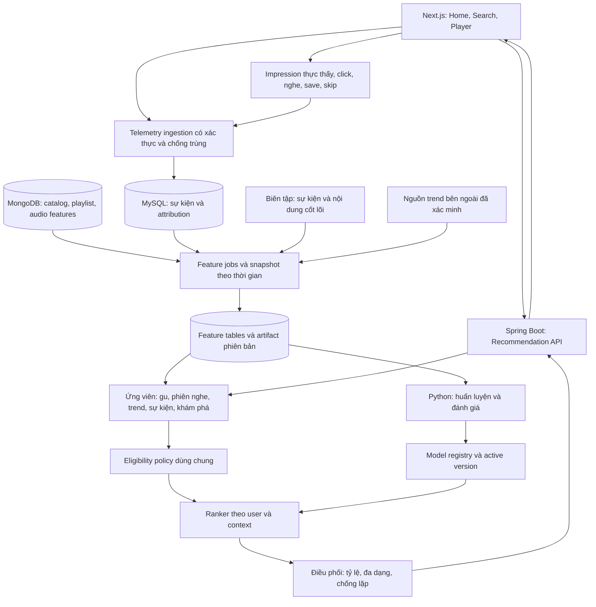

# Thiết kế kiến trúc đề xuất và cá nhân hóa cho Moodify

Ngày khảo sát: **26/10/2026**. Đây là tài liệu thiết kế và căn cứ khảo sát ban đầu.

Tài liệu hiện hành: [kiến trúc và cách hoạt động theo mã](RECOMMENDATION_SYSTEM_ARCHITECTURE.md), [đánh giá dữ liệu và chiến lược production](RECOMMENDATION_PRODUCTION_REVIEW.md). Nội dung bên dưới giữ lại để tham khảo lịch sử thiết kế.

**Cập nhật 27/10/2026 — phương án cũ đã được thay thế:** triển khai hiện hành không thêm bảng/cột MySQL và chỉ dùng 2 collection Mongo. Xem [persistence thu gọn và cách vận hành](RECOMMENDATION_IMPLEMENTATION.md). Các bảng/collection và đề xuất hạ tầng bên dưới là lịch sử thiết kế, không phải schema cần triển khai.

Phạm vi đã làm rõ theo xác nhận của chủ dự án: **model cảm xúc hiện có chỉ phục vụ phân tích yêu cầu để tìm kiếm bài hát phù hợp. Hệ đề xuất cá nhân hóa trong tài liệu này được thiết kế độc lập với model đó**, không dùng nhãn cảm xúc, confidence, strategy hoặc điểm khớp tìm kiếm làm đầu vào bắt buộc hay tín hiệu học sở thích.

Tài liệu kết hợp ba loại căn cứ: mã nguồn đang có trong workspace; dữ liệu snapshot trong repository; tài liệu công khai và nghiên cứu từ nguồn gốc. Các công thức, tỷ lệ phân bổ, lịch chạy và mục tiêu hiệu năng bên dưới là **giả thuyết thiết kế cho Moodify**, cần kiểm chứng bằng dữ liệu thực. Chúng không phải cấu hình nội bộ của Spotify.

Phương án schema 8 bảng MySQL + 4 collection Mongo trong [bản thiết kế playlist/database ban đầu](RECOMMENDATION_PLAYLIST_DATABASE_DESIGN.md) đã bị loại khỏi triển khai hiện hành theo yêu cầu chủ dự án.

## 1. Quyết định kiến trúc

Xây **hệ đề xuất lai, có nhận biết thời gian và ngữ cảnh**, theo luồng:

**Hành vi đáng tin cậy → đặc trưng người dùng/bài hát/xu hướng → nhiều nguồn ứng viên → xếp hạng cá nhân → điều phối danh sách → đo lường phản hồi.**

Giữ Spring Boot làm nơi điều phối API, xác thực, catalog và quyền phát. MySQL và MongoDB tiếp tục là nguồn dữ liệu chính. Bổ sung mô-đun tổng hợp dữ liệu và worker Python để huấn luyện khi dữ liệu đủ; Redis và dịch vụ suy luận riêng chỉ thêm khi có nhu cầu thực tế.

Hệ thống cần phục vụ đồng thời:

- Gu tương đối bền vững của từng người.
- Nhu cầu của phiên hiện tại: những bài vừa nghe, thao tác chọn/bỏ qua/lưu bài và lựa chọn nội dung chủ động; không suy ra qua model cảm xúc.
- Nội dung đang tăng trưởng trong cộng đồng, theo cửa sổ thời gian.
- Sự kiện, mùa, đợt phát hành, chương trình biên tập có thời hạn.
- Khám phá bài mới và nghệ sĩ ít được tiếp cận nhưng phù hợp.

“Khách quan” ở đây là dữ liệu có nguồn gốc, mục tiêu minh bạch, có đối chứng, có kiểm soát thiên lệch và khả năng giải thích. Không có thuật toán nào tự động biến hành vi quan sát thành sở thích hoàn toàn không thiên lệch.

## 2. Khảo sát những gì Moodify đã có

### 2.1. Nguồn dữ liệu và luồng xử lý

| Thành phần | Căn cứ trong mã | Có thể dùng cho đề xuất |
| --- | --- | --- |
| Catalog MongoDB | [Track.java](../src/main/java/com/laphuth/moodify/entities/Track.java) | Nghệ sĩ, album, genre, lời bài hát, thời lượng, ngày phát hành nếu có, popularity, mood tag, trạng thái hiển thị/kiểm duyệt |
| Đặc trưng âm thanh | `Track.AudioFeatures`: BPM, key signature, energy, danceability, valence, acousticness | Tương đồng nội dung, ngữ cảnh, cold start của bài mới |
| Dịch vụ phân tích audio | [AudioAnalysisService.java](../src/main/java/com/laphuth/moodify/services/AudioAnalysisService.java) gọi `/analyze` | Có đường tích hợp để bổ sung đặc trưng khi nhập bài; mã mô hình phân tích không nằm trong phần đã khảo sát |
| Lịch sử nghe | `listening_history` trong [schema tham khảo](../database/Moodify.annotated.schema.sql) | Người–bài, thời gian, thời lượng nghe, vị trí cuối, nguồn phát, thiết bị |
| Sự kiện playback | `playback_events` | PLAY, PAUSE, RESUME, SEEK, SKIP_NEXT, SKIP_PREVIOUS, COMPLETE và vị trí thao tác |
| Player phía web | [player-context.tsx](../../Moodify/components/dashboard/player-context.tsx) | Phiên phát UUID; heartbeat mỗi 5 giây khi đủ điều kiện; các thao tác playback |
| Theo dõi phiên và doanh thu | [RevenuePlaybackService.java](../src/main/java/com/laphuth/moodify/services/RevenuePlaybackService.java) | Kiểm tra tiến độ với thời gian server; qualified stream theo quy tắc 60 giây liên tục, kèm điều kiện nghiệp vụ khác |
| Lịch sử tìm kiếm | [SearchHistoryService.java](../src/main/java/com/laphuth/moodify/services/SearchHistoryService.java) | Kết quả người dùng chủ động chọn rồi nghe/lưu có thể trở thành hành vi thông thường. Nhãn cảm xúc và confidence do model tạo không được đưa vào hệ cá nhân hóa này |
| Thư viện cá nhân | [UserLibraryService.java](../src/main/java/com/laphuth/moodify/services/UserLibraryService.java) | Thêm bài là tín hiệu sở thích rõ hơn một lượt mở xem |
| Playlist | [Playlist.java](../src/main/java/com/laphuth/moodify/entities/Playlist.java), `PlaylistService` | Danh sách bài, thứ tự, công khai/riêng tư; có thể phát triển tín hiệu đồng xuất hiện |
| Các loại yêu thích | `favorite_songs`, `favorite_artists`, `favorite_albums` trong schema | Cần kiểm chứng đường ghi và ý nghĩa sản phẩm trước khi gom vào huấn luyện |
| Truy cập nội dung | `platform_traffic_events`, [PlatformTrafficService.java](../src/main/java/com/laphuth/moodify/services/PlatformTrafficService.java) | Lượt ghé thăm và kênh truy cập; không tương đương việc thẻ đề xuất được nhìn thấy |
| Quyền phát/kiểm duyệt | `song_licenses`, `TrackService`, `SongLicenseLifecycleScheduler` | Điều kiện bắt buộc trước khi trả đề xuất và khi bắt đầu phát |
| Tìm kiếm theo cảm xúc — ngoài phạm vi hệ đề xuất | [EmotionService.java](../src/main/java/com/laphuth/moodify/services/EmotionService.java), [MoodTrackScorer.java](../src/main/java/com/laphuth/moodify/services/MoodTrackScorer.java) | Phân tích yêu cầu và tìm bài phù hợp. Không dùng làm candidate provider, ranker hoặc nguồn hồ sơ người dùng cho hệ đề xuất cá nhân hóa |

Các bảng xuất hiện trong schema chưa chứng minh chúng có dữ liệu đủ hoặc mọi giao diện đang ghi đúng. Không truy cập database production, không đọc dữ liệu định danh cá nhân để lập tài liệu này.

### 2.2. Số liệu snapshot đã kiểm tra

File [scripts/data/tracks.json](../../scripts/data/tracks.json) được đọc và đếm trực tiếp ngày khảo sát:

| Chỉ tiêu trong file | Số lượng |
| --- | ---: |
| Bài hát | 147 |
| Có Spotify ID | 147 |
| Đủ BPM, key, energy, danceability, valence, acousticness | 105 |
| Thiếu ít nhất một trong sáu trường trên | 42 |
| Có genre | 147 |
| Có lời bài hát dạng plain | 68 |
| Có `release_date` không rỗng | 0 |
| Có `mood_tags` không rỗng | 0 |

Đây là **snapshot của file**, không phải số liệu hiện hành của MongoDB. [Audit ngày 16/10/2026](mood-tag-audit.md) ghi nhận một snapshot khác với 154 document. README và công cụ mood tag còn mô tả một lần apply sau đó; vì vậy không suy ra database hiện tại vẫn thiếu tag từ file xuất cũ.

Nếu catalog thực tế cùng bậc quy mô này, có thể chấm toàn bộ bài hợp lệ bằng ma trận trong RAM. ANN/vector database chưa đem lại lợi ích rõ ràng trước khi đo độ trễ và tăng trưởng catalog.

### 2.3. Những khoảng trống ảnh hưởng trực tiếp đến mô hình

1. **Hệ đề xuất học từ hành vi cần được thiết kế riêng.** `recommendTracksByMood(text, strategy, limit)` thuộc chức năng tìm kiếm theo cảm xúc, không phải hệ cá nhân hóa cần mở rộng. Việc hàm này không học lịch sử của user không phải thiếu sót trong phạm vi chức năng đó; kiến trúc mới không lấy nó làm nền xếp hạng.
2. **Tên khối giao diện chưa đồng nghĩa với thuật toán.** `lumen-hero.tsx` lấy nhạc theo genre và catalog; editor picks gọi catalog thường rồi lấy bốn phần tử. `TrackService.getTracks` mặc định sắp theo tên; luồng genre sắp theo popularity. Không có cửa sổ thời gian hay tốc độ tăng trưởng trong các đường này.
3. **Attribution nguồn phát bị mất.** Player có nhiều nơi truyền `source: HOME`; nhánh có `sessionKey` tại `TrafficAnalyticsApi` gọi revenue service mà không truyền source/sourceId/deviceType. Revenue service ghi cố định HOME/WEB. Không thể mặc định dữ liệu source cũ phản ánh hành trình thật.
4. **Chưa có impression của đề xuất trong schema đã khảo sát.** Cần biết bài nào đã được nhìn thấy, vị trí nào, thuộc request/model nào. Lượt ghé trang không trả lời được câu hỏi đó.
5. **Định danh bài đang có hai dạng.** Thư viện ưu tiên Spotify ID; revenue session chuẩn hóa về Mongo `_id`. Join thẳng hai nguồn theo chuỗi `track_id` có thể bỏ sót cùng một bài.
6. **Chưa có lịch sử xu hướng dạng snapshot và lịch chiến dịch chuyên biệt** trong schema đã khảo sát. Một giá trị popularity không có timestamp không đủ để đo tăng trưởng.
7. **Hệ đề xuất mới cần policy quyền phát rõ ràng.** Có thể tái sử dụng nghiệp vụ catalog/license của `TrackService`, đồng thời xác định điều kiện được phát theo thời gian và cách xử lý trạng thái thiếu. Đây là trách nhiệm của tầng nghiệp vụ nội dung, độc lập với model tìm kiếm cảm xúc.
8. **Dữ liệu lỗi/mất chưa có phép đo riêng.** Telemetry phía web bắt lỗi và trả null; không thể diễn giải mất mạng, tab đóng hay buffering thành “không thích”. Nhánh analytics cũ còn chuẩn hóa sự kiện không nhận diện thành COMPLETE.
9. **Chất lượng đặc trưng chưa được chứng minh bằng đánh giá độc lập.** BPM, energy, valence và các đặc trưng bài hát có thể hỗ trợ content-based recommendation, nhưng không tự cho biết người dùng thích bài nào. Cần provenance, kiểm tra chất lượng và đánh giá bằng hành vi thực. Các đặc trưng này thuộc dữ liệu bài hát, không phải đầu ra của model phân tích cảm xúc người dùng.

`seedTrafficData` hiện trả 0 và ghi log rằng seed đã tắt. Có hàm seed cũ mang tên `unused_seedTrafficData`, nhưng điều đó **không chứng minh đang phát sinh dữ liệu giả**. Dữ liệu lịch sử cần audit nguồn gốc; không tự đánh dấu là giả hoặc xóa dựa trên sự tồn tại của hàm.

## 3. Bài học từ tài liệu công khai

| Nguồn gốc | Điều nguồn công bố | Suy luận áp dụng cho Moodify |
| --- | --- | --- |
| [Google: YouTube Recommendations, 2016](https://research.google/pubs/deep-neural-networks-for-youtube-recommendations/) | Tách candidate generation và ranking | Giữ interface hai tầng ngay cả khi ban đầu chấm toàn catalog |
| [Spotify: Understanding recommendations, cập nhật 20/10/2026](https://www.spotify.com/ie/safetyandprivacy/understanding-recommendations) | Kết hợp biên tập, taste profile, hành vi, ngữ cảnh và trends | Dành vai trò riêng cho gu, biên tập và xu hướng; không dùng một nguồn làm toàn bộ hệ thống |
| [Spotify: Contextual and Sequential User Embeddings, 2021](https://research.atspotify.com/2021/04/contextual-and-sequential-user-embeddings-for-music-recommendation) | Lịch sử gần và ngữ cảnh phiên có ích cho dự đoán nhạc | Tách hồ sơ dài hạn và ý định hiện tại, tránh dùng một vector cố định cho mọi lúc |
| [Spotify: Calibrated Recommendations with Contextual Bandits, 2025](https://research.atspotify.com/2025/9/calibrated-recommendations-with-contextual-bandits-on-spotify-homepage) | Học cách phân phối loại nội dung theo ngữ cảnh bằng bandit | Có thể học tỷ lệ giữa các nguồn của Moodify sau khi có log exploration hợp lệ; đây là phép mở rộng do tài liệu này đề xuất |
| [YouTube: Trending Charts](https://support.google.com/youtube/answer/7239739?hl=en) | Trending xét tăng trưởng, nguồn truy cập, tuổi nội dung và nhiều tín hiệu | Phân biệt tổng phổ biến với đang tăng nhanh; giữ bảng xu hướng chung và gợi ý trend cá nhân thành hai sản phẩm |
| [Ji và cộng sự: data leakage](https://arxiv.org/abs/2010.11060) | Đánh giá có thể bị sai nếu không tuân thủ timeline toàn cục | Chia train/validation/test theo thời gian; feature cũng phải đúng thời điểm dự đoán |

Các công bố này mô tả những thành phần hoặc nghiên cứu cụ thể. Chúng không cho phép khẳng định biết toàn bộ kiến trúc hoặc thuật toán hiện tại của các nền tảng lớn.

## 4. Kiến trúc logic



Sơ đồ là phân chia trách nhiệm; không yêu cầu mỗi ô thành một microservice. Ban đầu có thể dùng vài service class trong Spring Boot và một worker Python chạy theo lịch.

### 4.1. Luồng phục vụ một request

1. Xác định user từ phiên xác thực; nhận surface, ngữ cảnh thời gian, intent, seed và session ID.
2. Đọc hồ sơ dài hạn, gần đây, phiên hiện tại và snapshot trend/event hợp lệ.
3. Lấy ứng viên từ nhiều nguồn; mỗi bài giữ tập nguồn gốc thay vì mất thông tin khi hợp nhất.
4. Chuẩn hóa ID, loại trùng, lọc điều kiện quyền phát/hiển thị và phản hồi chặn rõ ràng.
5. Xếp hạng; điều phối tỷ lệ nguồn, đa dạng và mệt mỏi do lặp.
6. Kiểm tra lại eligibility cuối cùng; bổ sung bài dự phòng hợp lệ nếu cần.
7. Lưu quyết định: request ID, model/policy/feature versions, ứng viên được phục vụ và điểm từng phần. Trả danh sách, lý do và thời hạn hiệu lực.
8. Client chỉ gửi impression khi nội dung thực sự hiển thị theo định nghĩa đã thống nhất. Play/save liên kết về đúng request/item đó.

Cache phải được gắn user, surface, context, policy/model và phiên bản quyền phát phù hợp. Cache hết hạn hoặc sự kiện kết thúc không được tiếp tục giữ boost cũ. Quyền phát vẫn được kiểm tra khi bắt đầu stream.

## 5. Nền dữ liệu cần hoàn thiện trước

### 5.1. Chuẩn hóa định danh và ngữ nghĩa

- Dùng Mongo `Track.id` hiện tại làm `canonical_track_id` nội bộ; Spotify ID là alias. Thêm bảng/collection ánh xạ có uniqueness, kiểm tra xung đột và orphan trước backfill. Không thay toàn bộ ID cũ trong một lần.
- Khi nhập lại dữ liệu, giữ định danh nội bộ ổn định; hỗ trợ track không có Spotify ID nếu đáp ứng các điều kiện sản phẩm.
- Tách `playback_session_id` cho một lần phát bài, `listening_session_id` cho phiên gồm nhiều bài, `request_id` cho một lượt đề xuất và `event_id` cho một sự kiện.
- Tách `origin_surface` (home/search/playlist...), `candidate_sources` (content/CF/trend...), `selection_mode` (chủ động/autoplay/repeat) và `acquisition_channel` (direct/social...). Chúng mô tả các khía cạnh khác nhau.
- Lưu UTC cho sự kiện mới; `timezone=Asia/Ho_Chi_Minh` dùng suy ra giờ/ngày tại địa phương và lịch chiến dịch. Dữ liệu DATETIME cũ phải được xác định quy ước trước khi chuyển đổi.

### 5.2. Hợp đồng sự kiện

Ví dụ cấu trúc logic, chưa phải endpoint đang triển khai:

```json
{
  "event_id": "evt-unique",
  "schema_version": 1,
  "event_type": "PLAY_START",
  "occurred_at": "2026-10-26T13:30:00Z",
  "canonical_track_id": "catalog-internal-id",
  "playback_session_id": "uuid-per-track-play",
  "listening_session_id": "uuid-for-listening-session",
  "request_id": "rec-request-id",
  "item_token": "server-issued-attribution-token",
  "origin_surface": "HOME",
  "section_id": "trending_for_you",
  "position": 3,
  "selection_mode": "USER_SELECTED",
  "device_type": "WEB",
  "timezone": "Asia/Ho_Chi_Minh"
}
```

`user_id`, `received_at`, model version và nguồn ứng viên do server xác định hoặc đối chiếu với decision log; không tin các giá trị có thể bị client tự đổi. Trạng thái playback vẫn cần kiểm tra tiến độ và phiên sở hữu đúng user.

Định nghĩa impression ban đầu có thể là thẻ hiển thị ít nhất 50% trong 1 giây. Đây là quy ước cần thử nghiệm cho UI hiện tại; queue autoplay phải có định nghĩa exposure và outcome riêng. API trả 20 bài không đồng nghĩa 20 impression.

Sự kiện cần có: `RECOMMENDATION_SERVED`, `ITEM_IMPRESSION`, `ITEM_CLICK`, `PLAY_START`, `PLAY_PROGRESS`, `PLAY_END`, `LIBRARY_ADD/REMOVE`, `PLAYLIST_ADD/REMOVE`, `SEARCH_RESULT_SELECT`, `NOT_INTERESTED`, `HIDE_ARTIST`. Trạng thái cuối phân biệt completed, skipped, track changed, stopped, error, timeout. Không ánh xạ mọi loại chưa biết thành COMPLETE.

Đảm bảo `UNIQUE(event_id)`, số thứ tự theo playback session, retry với ID giữ nguyên, xử lý out-of-order, giới hạn tốc độ và theo dõi mất log. Server ghi sự kiện cốt lõi sau khi giao dịch thư viện/playlist thành công; outbox cần dùng nếu giao dịch và phát sự kiện tách hệ thống. Đối soát hai đường telemetry để một lần nghe không bị đếm hai lần.

### 5.3. Biến hành vi thành tín hiệu

| Tín hiệu | Cách diễn giải đề xuất | Điểm cần giữ ngữ cảnh |
| --- | --- | --- |
| Thêm thư viện/playlist cá nhân | Positive mạnh | Tránh tính hai hành động tương đương thành hai lần xác nhận độc lập |
| Chủ động chọn và nghe đủ lâu | Positive tương đối mạnh | Phân biệt phát tự động và phát do người dùng chọn |
| Nghe phần lớn bài | Positive vừa | Tính từ thời gian nghe hợp lệ; không dùng vị trí sau tua làm lượng đã nghe |
| Nghe lại ở các ngày khác nhau | Positive dài hạn | Saturation theo ngày; vòng lặp một phiên có mức đóng góp giới hạn |
| Search có chọn kết quả rồi nghe | Tín hiệu ý định hiện tại mạnh | Keyword đơn lẻ chỉ là tín hiệu yếu |
| Bỏ qua rất sớm do chủ động | Negative mềm trong ngữ cảnh đó | Chỉ khi đã thực sự phát; loại buffering/error và thao tác thử mẫu |
| Tua/Previous | Tín hiệu phụ | Có thể tìm đoạn thích hoặc muốn nghe lại; không mặc định negative |
| Xóa khỏi thư viện | Giảm mức tin vào sở thích lâu dài | Không đồng nhất với “cấm đề xuất” |
| Không quan tâm/chặn nghệ sĩ | Phản hồi rõ ràng | Chặn hoặc giảm theo đúng phạm vi người dùng chọn |
| Pause/tab đóng/mất heartbeat | Outcome thiếu hoặc chưa biết | Không gắn nhãn ghét bài |
| Impression không click | Weak negative sau cửa sổ quan sát | Chỉ dùng cho đúng surface; không phải nhãn âm học |

Tạo `valid_listened_ms`, `completion_ratio`, `early_skip`, `replay_distinct_days`, `save_flag`, `intent_source`, `playback_quality_flag`. Cho phép playback speed khác 1x; tách thời gian thực và lượng audio đã nghe. Một lần COMPLETE chỉ có giá trị nếu phù hợp tiến độ quan sát.

Có thể thử định nghĩa “engaged play” là nghe hợp lệ ít nhất `min(30 giây, 50% thời lượng bài)`. Đây là **nhãn đánh giá đề xuất thử nghiệm**, không thay quy tắc doanh thu 60 giây liên tục. Lưu cả thành phần gốc để thay định nghĩa mà không mất dữ liệu.

Với CF, tổng hợp positive có saturation và time decay; explicit negative xử lý riêng. ALS coi các cặp chưa quan sát là prior confidence thấp theo mục tiêu implicit, không phải bằng chứng user đã thấy và ghét. Không đưa một tổng điểm có dấu tùy ý vào ALS/WARP mà chưa khớp ngữ nghĩa loss và API.

## 6. Hồ sơ người dùng và nội dung

### 6.1. Sở thích trên nhiều thang thời gian

Giữ ba bộ đặc trưng:

- **Dài hạn:** nghệ sĩ, genre, audio cluster và các chủ đề người dùng quay lại trong khoảng 60–180 ngày.
- **Gần đây:** thay đổi trong khoảng 7–14 ngày.
- **Phiên hiện tại:** một số bài vừa nghe, kết quả được chọn, thao tác bỏ qua/lưu và lựa chọn nội dung chủ động; cập nhật ngay khi nhận hành vi hợp lệ. Không dùng cảm xúc do model suy ra.

Các khoảng trên là giá trị bắt đầu cần chỉnh theo tần suất sử dụng. Dùng decay `2^(-age/half_life)` và độ tin cậy theo số ngày có hoạt động. Không dùng một buổi nghe liên tục để ghi đè gu dài hạn.

Baseline có thể thử `0.60 * long_term + 0.25 * recent + 0.15 * session`; khi có intent rõ như “tập trung”, tăng ảnh hưởng intent/phiên. Không xem tỷ lệ này là hằng số chuẩn. Với người mới, giảm thành phần thiếu dữ liệu và chuẩn hóa lại phần còn lại.

Không chỉ dùng một trung bình audio: người thích cả ballad và dance có trung bình không đại diện cho bên nào. Giữ phân bố genre/nghệ sĩ và vài centroid theo nhóm nội dung hoặc phiên. Key không được mã hóa như một số thứ tự tuyến tính; BPM cần chuẩn hóa thang đo và xử lý sự nhập nhằng half/double tempo.

### 6.2. Ranh giới với chức năng tìm kiếm theo cảm xúc

Theo xác nhận của chủ dự án, hai luồng có trách nhiệm riêng:

- **Tìm kiếm theo cảm xúc hiện có:** yêu cầu tìm kiếm → model phân tích → tìm bài phù hợp → trả kết quả tìm kiếm.
- **Hệ đề xuất cá nhân hóa mới:** hành vi nghe/chọn/lưu/bỏ qua → học sở thích và ngữ cảnh phiên → phối ứng viên với trend/sự kiện → xếp hạng nội dung.

Hệ đề xuất không gọi `EmotionService`/`MoodTrackScorer`, không lấy nhãn cảm xúc, confidence, strategy hoặc điểm khớp tìm kiếm để tạo hồ sơ sở thích, và không thay thứ tự kết quả của luồng tìm kiếm cảm xúc trong phạm vi thiết kế này. Model tìm kiếm lỗi hoặc không được sử dụng không làm gián đoạn hệ đề xuất.

Nếu người dùng tìm được một bài rồi chủ động nghe, lưu hoặc bỏ qua, các thao tác đó vẫn là hành vi người dùng thông thường như khi đến từ bất kỳ trang nào khác. Có thể lưu nguồn phát để attribution, nhưng không diễn giải nhãn cảm xúc của truy vấn thành thuộc tính hay sở thích của người đó.

Các chỉ số như energy, valence, danceability và BPM là đặc trưng của **bài hát**. Hệ content-based có thể sử dụng chúng trực tiếp từ catalog; điều này không tạo ra phụ thuộc vào model phân tích cảm xúc. `mood_tags` được ghi nhận trong phần kiểm kê snapshot, không phải điều kiện tiên quyết cho hệ đề xuất mới.

### 6.3. Chất lượng và mở rộng nội dung

Thêm `feature_source`, `extractor_version`, `extracted_at`, coverage và confidence nếu bộ trích xuất cung cấp. Giữ missing indicator; không thay giá trị thiếu bằng 0 vì 0 là một giá trị âm học có nghĩa. Ngày phát hành phải bổ sung từ metadata có nguồn; `created_at` chỉ cho biết lúc nhập catalog.

Sau baseline, thử audio embedding từ mô hình pretrained thay vì tự huấn luyện mô hình audio lớn. [Essentia](https://essentia.upf.edu/models.html) công bố các bộ trích xuất embedding; cần kiểm chứng tính phù hợp với nhạc Việt và điều kiện sử dụng của model được chọn. Có thể bổ sung text embedding của mô tả/lời bài hát, nhưng lời buồn không đồng nghĩa giai điệu buồn. Mỗi nhánh phải được đánh giá đóng góp độc lập.

## 7. Các thuật toán và điều kiện nâng cấp

| Tầng | Thuật toán đề xuất | Khi phù hợp | Điều kiện để dùng sâu hơn |
| --- | --- | --- | --- |
| Baseline | Popular theo thời gian, genre, audio nearest neighbors | Có thể triển khai ngay sau chuẩn hóa | So sánh được và giải thích được |
| Cá nhân hóa nội dung | User profile nhiều centroid + cosine/khoảng cách có trọng số | Ít người dùng hoặc bài mới | Feature coverage và taxonomy đủ tốt |
| Cộng đồng | Item–item co-listening có regularization | Có người nghe chồng lấn giữa các bài | Dùng distinct users/ngày, kiểm soát bias bài phổ biến |
| CF học máy đầu tiên | Implicit ALS | Có tương tác lặp và overlap thực giữa user–item | Thắng baseline qua các cửa sổ test, không chỉ trên user dày dữ liệu |
| Hybrid factorization | LightFM với metadata, so với ALS | Metadata hữu ích và cold start là vấn đề chính | Là ứng viên thay thế để benchmark, không buộc chạy cả hai trong production |
| Ranker học máy | Logistic baseline, rồi LightGBM/LambdaMART | Có impression và outcome được nối đúng | Đủ nhóm request có lựa chọn khác nhau, feature đúng thời điểm |
| Theo chuỗi | Session kNN/Markov baseline, rồi SASRec hoặc mô hình session/context | Có nhiều chuỗi thật, không chỉ vòng lặp | Thắng baseline đơn giản; báo cáo riêng cold/sparse users |
| Điều phối thích ứng | Contextual bandit trên vài chính sách phối nguồn | Có exploration log, propensity và sample đủ | Off-policy evaluation đáng tin và A/B có guardrails |
| Retrieval quy mô lớn | Two-tower + ANN | Catalog/traffic khiến retrieval hiện tại không đạt SLO | Đo bottleneck, bảo đảm recall sau ANN |

Tài liệu thư viện gốc: [implicit ALS](https://benfred.github.io/implicit/api/models/cpu/als.html), [LightFM](https://making.lyst.com/lightfm/docs/home.html), [LightGBM objectives](https://lightgbm.readthedocs.io/en/stable/Parameters.html). Nghiên cứu chuỗi: [SASRec](https://arxiv.org/abs/1808.09781).

Không có ngưỡng “N user là đủ cho deep learning” áp dụng chung. Cần đo số người nghe thực, số ngày hoạt động, tương tác/người, tỷ lệ overlap, độ dài chuỗi, sparsity và learning curve. Lặp bài một triệu lần bởi vài tài khoản không tạo ra một triệu quan sát độc lập hữu ích.

## 8. Sinh ứng viên và xếp hạng

### 8.1. Các nguồn ứng viên

1. **Core/taste:** bài gắn với sở thích bền vững, bài lưu và nội dung tương tự.
2. **Collaborative:** bài những người có mẫu nghe tương tự quan tâm; ALS hoặc item–item.
3. **Session/context:** khớp các bài vừa nghe và lựa chọn nội dung chủ động trong phiên; không dùng model cảm xúc.
4. **Trend:** tăng trưởng đáng tin trong cộng đồng phù hợp.
5. **Event/editorial:** chiến dịch đang hiệu lực, tuyển chọn theo tiêu chí và nhóm người nghe.
6. **Discovery/new-to-user:** bài mới với user, nghệ sĩ khác, hoặc bài mới nhập đủ dữ liệu nội dung.

Một bài có thể đến từ nhiều nguồn; giữ tất cả provenance nhưng chỉ xuất hiện một lần. Catalog nhỏ có thể trả mọi bài hợp lệ vào ranking, vẫn giữ các điểm thành phần này. Catalog lớn mới cấp ngân sách ứng viên cho từng nguồn và đo candidate recall.

### 8.2. Eligibility là điều kiện cứng

Tạo `TrackEligibilityService` dùng chung cho catalog, đề xuất và playback: quyền hiển thị, trạng thái xuất bản/kiểm duyệt theo policy đã xác định, license/hợp đồng đúng thời điểm, khả năng phát audio, giới hạn người dùng và phản hồi chặn. Policy phải chỉ rõ trường hợp thiếu license/trạng thái; không tự suy ra hợp lệ chỉ vì không nằm trong danh sách bị chặn. Tầng này không phụ thuộc model cảm xúc.

Áp dụng trước ranking, trước trả response và lúc bắt đầu stream. Có invalidation khi catalog/license thay đổi và chiến lược xử lý khi không đọc được nguồn quyền phát. Danh sách thiếu bài được bù từ fallback đã kiểm tra; không nới điều kiện cứng để lấp đầy quota.

### 8.3. Score ban đầu và ranker học từ dữ liệu

Một baseline minh bạch:

```text
base_score(u,i,c,t) =
    a * content_affinity
  + b * collaborative_affinity
  + c1 * session_intent_fit
  + d * trend_fit
  + e * event_fit
  + f * novelty_quality
  - g * repetition_fatigue
```

Các điểm phải được chuẩn hóa bằng dữ liệu train/reference tương ứng; không cộng trực tiếp cosine, số lượt nghe và khoảng cách audio khác thang đo. Khi nguồn thiếu, ghi missing flag và có fallback rõ ràng. Score này không phải xác suất.

Với ranker học máy, đầu vào gồm affinity, audio match/coverage, artist/genre match, recency, valid play/skip/save rate có smoothing, organic trend, event fit, device/time context và lần tiếp xúc gần nhất. Nhãn có thể là mức độ liên quan 0–3 từ outcome hợp lệ; group theo request với item đã có exposure thích hợp. Nhãn chưa đủ thời gian quan sát được censor hoặc chờ chín, không gán ngay 0.

Một hướng đa mục tiêu tiếp theo là dự đoán riêng engaged play, save và early skip, rồi chọn utility có ràng buộc. Không dùng doanh thu một lượt nghe hoặc thời lượng vô hạn làm mục tiêu duy nhất. Ranker phải được đánh giá sau bước điều phối cuối, vì re-ranking có thể thay đổi kết quả đáng kể.

## 9. Xu hướng theo thời gian và bắt trend

### 9.1. Phân biệt các khái niệm

- **Popular:** có lượng quan tâm đáng kể trong một cửa sổ.
- **Trending:** mức quan tâm đang tăng so với nền phù hợp.
- **New release:** mới phát hành theo release date đã xác thực.
- **New to catalog:** mới nhập hệ thống; có thể là bài cũ.
- **Seasonal/event:** phù hợp với một thời điểm văn hóa hoặc chương trình cụ thể.

Một bài cũ tăng mạnh sau một buổi diễn có thể trending. Một bài mới phát hành không tự động trending.

### 9.2. Trend nội bộ

Tổng hợp các cửa sổ thử nghiệm 1h, 6h, 24h, 7d; so sánh các cửa sổ có độ dài bằng nhau. Đo distinct listeners thực, engaged plays, save và early skip đã qua kiểm tra, tách theo organic/recommendation/campaign khi attribution đủ.

Với nhóm người nghe `g` và cửa sổ `w`:

```text
U(i,g,w) = số người nghe bài i có engaged play hợp lệ
A(g,w)   = số người nghe hoạt động của nhóm trong cùng cửa sổ
p(i,g,w) = (U(i,g,w) + k * prior_rate) / (A(g,w) + k)
growth   = log((p_recent + epsilon) / (p_baseline + epsilon))
```

`k` là sức mạnh prior; estimate từ dữ liệu train hoặc cấu hình thử nghiệm. `p_baseline` có thể từ các khung giờ/ngày trong tuần tương ứng trước đó, chỉ khi có đủ lịch sử. Kết hợp growth đã chặn biên với quy mô listener, quality đã smoothing và độ tin cậy dữ liệu. Bảo đảm các feature dùng thông tin có sẵn tại thời điểm tính.

Quy tắc chống nhiễu:

- Distinct user trong cửa sổ phải tính đúng; không cộng số distinct từng giờ để suy ra distinct 24h.
- Có ngưỡng hỗ trợ và confidence; tăng từ 1 lên 3 listener không đương nhiên đứng trên bài có hàng trăm người nghe.
- Giới hạn đóng góp lặp của một user–track/ngày; loại tài khoản test/bot đã được xác minh và lượt bất thường theo policy.
- Nếu chưa đủ dữ liệu theo genre/vùng, backoff về nhóm rộng hơn và hiển thị độ tin cậy phù hợp.
- Khi có đủ attribution, giữ organic trend riêng để giảm vòng lặp “được đề xuất nhiều nên nghe nhiều rồi lại được coi là trend”. Đây vẫn là biện pháp giảm bias, không chứng minh quan hệ nhân quả.
- Dữ liệu cũ không có impression/source đáng tin không thể được sửa thành propensity hoặc organic exposure chính xác bằng suy đoán.

`trend_fit = trend_strength * affinity_to_user_context` chỉ dùng cho khối “xu hướng hợp gu”. Bảng “đang thịnh hành trên Moodify” giữ thứ hạng chung của cộng đồng đủ dữ liệu; không âm thầm đổi tên bảng cá nhân thành bảng chung.

### 9.3. Trend bên ngoài

Tạo `ExternalTrendAdapter` độc lập. Ban đầu cho phép nhập danh sách đã xác minh hoặc nguồn chính thức có quyền truy cập; tự động hóa sau khi kiểm tra phương thức cung cấp dữ liệu thực tế. Không mặc định Spotify, TikTok hoặc YouTube có API chart công khai đáp ứng đủ nhu cầu.

Mỗi snapshot lưu nguồn/URL, chart type, quốc gia/ngôn ngữ nếu có, chart period, published/observed/fetched timestamps, thứ hạng, confidence ánh xạ và thời hạn hiệu lực. Dùng ISRC/ID chính xác nếu có; title–artist fuzzy match cần kiểm tra version live/remix/cover. Chỉ nội dung đã có và đủ điều kiện trong catalog mới trở thành ứng viên phát.

Không cộng thẳng lượt xem YouTube với lượt nghe Moodify. Chuẩn hóa từng nguồn thành rank/percentile/độ tăng riêng rồi phối với trọng số có phiên bản. Dữ liệu quá hạn tự giảm ảnh hưởng hoặc ngừng dùng. `referrer_type=TIKTOK` là nhãn kênh truy cập, không tự chứng minh bài đang viral trên TikTok.

## 10. Sự kiện, mùa và các đợt nội dung

Tạo lịch chiến dịch có dữ liệu cấu hình; không nhúng quy tắc kiểu “tháng 12 tăng mọi bài Giáng sinh” vào model.

Mỗi campaign gồm `id`, tên/chủ đề, timezone, start/end, ramp-up/cool-down, audience/intent, danh sách track/playlist hoặc tiêu chí chọn, priority, exposure cap, người duyệt và revision. Điều kiện audience chỉ dùng dữ liệu thực có và được phép sử dụng.

Ví dụ: Tết, mùa thi, lễ Giáng sinh, concert của nghệ sĩ, đợt phát hành album, một trào lưu ngắn. Lịch âm như Tết cần nhập ngày từng năm hoặc bộ chuyển lịch đã kiểm chứng; không cộng cố định 365 ngày. Nếu chỉ có vài tuần/tháng dữ liệu, chưa thể học đáng tin tính mùa vụ hằng năm; dùng lịch biên tập trước.

```text
event_fit = active_window_weight
          * content_event_relevance
          * user_context_affinity
```

Ngoài khung thời gian thì `active_window_weight = 0`; invalidation/cache expiry phải bảo đảm điều đó. Trong chiến dịch có thể tăng dần trước sự kiện và giảm dần sau đó theo cấu hình.

Trong hệ đề xuất, nội dung cốt lõi gồm kho **evergreen/tuyển chọn** và nhóm nội dung người dùng thực sự gắn bó qua hành vi nghe/lưu. Có thể bảo vệ khả năng tiếp cận các khối này trên Home và cấp candidate budget cho chúng, đồng thời cá nhân hóa bài bên trong. Biên tập không đồng nghĩa ép mọi user nghe cùng một danh sách. Chức năng tìm kiếm theo cảm xúc hiện có giữ vai trò riêng; không dùng chức năng đó để định nghĩa nguồn core của hệ đề xuất.

## 11. Điều phối danh sách và kiểm soát thiên lệch

Sau xếp hạng, tối ưu chất lượng của cả danh sách: giới hạn trùng track/recording, giới hạn nghệ sĩ lặp, cân bằng thể loại, giảm bài vừa bỏ qua, độ mới với user, mức bám intent, và tỷ lệ nguồn. Bắt đầu bằng greedy re-ranking với penalty tương đồng; chỉ nới các ràng buộc mềm nếu catalog thiếu ứng viên và phải ghi log việc nới.

Ví dụ cấu hình thử nghiệm cho **20 vị trí trên Home gộp theo các khối**, không áp nguyên xi vào playlist người dùng tự chọn:

| Nguồn chính để tính ngân sách | Vị trí | Vai trò |
| --- | ---: | --- |
| Gu và nội dung cốt lõi phù hợp | 10 | Giữ tính quen thuộc và bản sắc |
| Xu hướng hợp gu | 4 | Cập nhật điều đang diễn ra |
| Sự kiện/biên tập | 2 | Hòa vào thời điểm và đợt nội dung |
| Khám phá | 4 | Học thêm sở thích, tạo cơ hội cho nội dung khác |

Một track có nhiều nguồn chỉ tính vào một quota chính do allocator chọn, đồng thời giữ đầy đủ provenance. Không có sự kiện phù hợp thì chuyển ngân sách sang core/discovery theo policy. Với playlist do user chọn, giữ thứ tự của user trừ khi họ bật chế độ khác. Một bài không phù hợp với ngữ cảnh phiên không được vào chỉ vì còn quota trend. Các quota này không áp vào kết quả tìm kiếm theo cảm xúc.

Các tỷ lệ 50/20/10/20 chỉ là điểm khởi đầu để test. Theo dõi hiệu quả riêng từng khối và toàn trang, tránh để việc chuyển vị trí hiển thị làm sai kết luận thuật toán nào tốt hơn.

Contextual bandit về sau nên chọn giữa một số **chính sách phối nguồn đã được giới hạn**, thay vì tự do thử mọi bài trên mọi người. Ghi chính xác xác suất chọn action và tập action có thể chọn. Với epsilon-greedy, xác suất phải gồm cả nhánh exploit và explore khi cùng chọn một action. Xác suất chọn policy không phải xác suất hiển thị từng bài sau mọi ràng buộc; đánh giá off-policy phải đúng cấp action.

Chỉ áp dụng IPS/SNIPS/doubly robust khi có support/overlap, propensity đáng tin, sample hữu hiệu và kiểm soát variance. Không gán propensity giả cho log deterministic cũ. Xem [nghiên cứu gốc về doubly robust](https://arxiv.org/abs/1103.4601). Bandit tối ưu reward được định nghĩa, không tự bảo đảm công bằng hay hài lòng dài hạn.

Cho người dùng các điều khiển “không quan tâm”, chặn nghệ sĩ, ưu tiên quen thuộc/khám phá và loại phiên khỏi hồ sơ gu. Lý do đề xuất phải dựa trên provenance thật: “tương tự bài bạn lưu”, “đang tăng lượt nghe trong tuần”, “thuộc tuyển chọn mùa thi”. Có thể nêu nhiều lý do; không biến một heuristic thành khẳng định tâm lý.

## 12. Thiết kế lưu trữ và API đề xuất

Mục này mô tả các cấu trúc logic. Tên vật lý, trường, khóa/index, ánh xạ giữa track/playlist và luồng version/queue được chốt ở [thiết kế playlist và database](RECOMMENDATION_PLAYLIST_DATABASE_DESIGN.md); không tạo riêng mọi tên logic thành một bảng.

### 12.1. Các cấu trúc bổ sung

| Cấu trúc logic | Nơi phù hợp ban đầu | Trường/chức năng chính |
| --- | --- | --- |
| `track_id_aliases` | MySQL hoặc Mongo, chọn một nguồn chuẩn | external type/id → canonical ID; kiểm tra uniqueness |
| `behavior_events` | MySQL append-only theo retention | event ID, user/session, type, timestamp, schema version, payload hợp lệ, provenance |
| `recommendation_requests/items` | MySQL | context, model/policy, ứng viên trả về, rank, score components, token attribution |
| `recommendation_impressions` | MySQL | liên kết request/item, vị trí, thời điểm thực thấy, exposure mode |
| `user_track_daily` | MySQL aggregate | các tín hiệu đã khử trùng theo ngày; không dùng làm sổ doanh thu |
| `track_metrics_windowed` | MySQL aggregate/snapshot | window, group, unique listeners, valid outcomes, trend components, as-of time |
| `user_profiles` | Mongo hoặc bảng feature | long/recent/session features, count/confidence, updated/as-of/version |
| `editorial_campaigns/items` | MySQL | khung hiệu lực, audience, content, cap, revision, người duyệt |
| `external_trend_snapshots` | Mongo hoặc MySQL | nguồn, kỳ chart, thứ hạng, thời gian, mapping confidence |
| `model_versions` | metadata MySQL + file artifact | training cutoff, feature schema, ID mapping, metrics, checksum, status |
| `feedback_preferences` | MySQL | hide/not interested/exclusions và phạm vi |

Đây là mô hình logic, không yêu cầu tạo 11 bảng ngay. MVP có thể ghép một số cấu trúc hoặc dùng JSON có schema version. Cần index theo user/time, track/time, request/item và khóa chống trùng; không nhân bản mọi heartbeat vô thời hạn.

Lưu dữ liệu training dạng Parquet snapshot có manifest trong volume/object storage khi cần tái lập. Giữ retention, tombstone/xóa và cập nhật feature khi user chọn xóa lịch sử hoặc loại khỏi hồ sơ. `playback_events` hiện phụ thuộc lịch sử nghe; pipeline mới phải có chính sách xóa nhất quán để dữ liệu đã bị user xóa không quay lại qua một bản sao training.

### 12.2. API dự kiến

- `GET /api/recommendations/home`: các section và item có attribution token.
- `GET /api/recommendations/next?seedTrackId=...`: ứng viên phát tiếp với intent của phiên.
- Luồng tìm kiếm theo cảm xúc giữ API và xử lý riêng hiện có; không bổ sung endpoint tích hợp model cảm xúc vào recommendation trong phạm vi này.
- `POST /api/recommendations/impressions`: batch sự kiện thực thấy, chống trùng.
- `POST /api/recommendations/feedback`: phản hồi rõ ràng.
- API quản trị campaign: tạo, duyệt, đặt lịch, kết thúc, xem exposure theo revision.

Response nên có `requestId`, `generatedAt`, `expiresAt`, `modelVersion`, `policyVersion`, `sections[].items[]`, canonical ID, item token, reason code. Score nội bộ chi tiết phục vụ debug có kiểm soát; không cần đưa mọi feature người dùng vào response công khai. Principal phải do server xác thực, không lấy user ID tùy ý từ query.

### 12.3. Nơi tích hợp vào mã đang có

- `player-context.tsx`: giữ attribution từ thao tác chọn bài đến queue; phân biệt đổi bài do user/autoplay; truyền source/sourceId/session chính xác.
- `auth-client.ts`: event contract có version, retry/dedupe và quan sát thất bại telemetry.
- `TrafficAnalyticsApi`/`RevenuePlaybackService`: tiếp nhận attribution hợp lệ trên nhánh session key; giữ độc lập quy tắc doanh thu và nhãn recommendation.
- `UserLibraryService`/`PlaylistService`/`SearchHistoryService`: phát sự kiện sau mutation thành công; chuẩn hóa track ID.
- `EmotionService`/`MoodTrackScorer`: giữ ngoài pipeline cá nhân hóa, không sửa để tích hợp vào recommendation trong phạm vi này.
- `lumen-hero.tsx`: thay dữ liệu nguồn các khối bằng recommendation response và ghi impression đúng vị trí.
- Backend bổ sung các class trách nhiệm: `RecommendationService`, `CandidateProvider`, `FeatureReader`, `RankingService`, `SlatePolicy`, `TrendAggregationJob`, `CampaignService`, `TrackEligibilityService`.

## 13. Vận hành, huấn luyện và fallback

Lịch thử nghiệm: session feature cập nhật theo event; trend aggregate mỗi 5–15 phút tùy traffic; hồ sơ gần đây cập nhật mỗi giờ; hồ sơ dài hạn/CF theo ngày khi có thay đổi đủ lớn. Catalog/audio features cập nhật khi ingest hoặc extractor đổi phiên bản. Các mốc này là đề xuất, cần benchmark với hạ tầng thật.

Mỗi model phải đi kèm ID mapping, feature transform/schema, training cutoff, seed/config và artifact checksum. Không cập nhật riêng model mà bỏ quên mapping. Xuất artifact atomically, kiểm tra rồi chuyển active pointer; giữ bản trước để rollback. Python worker huấn luyện không nằm trong request path của người dùng.

Với catalog nhỏ: Spring đọc feature/artifact đã tính sẵn và rank trực tiếp, hoặc worker xuất top candidates/điểm cho Spring. Chỉ thêm Python serving API khi cần score động khó đóng gói hoặc có nhiều consumer. Có timeout/circuit breaker và fallback theo thứ tự: model đang hoạt động → hybrid baseline → tuyển chọn/genre/popular hợp lệ.

Fallback vẫn phải tuân thủ quyền phát, chặn của user và thời hạn campaign. Hệ đề xuất và fallback của nó không gọi model tìm kiếm cảm xúc. Nếu không còn bài hợp lệ, trả trạng thái thiếu nội dung đúng sự thật.

Mục tiêu ban đầu để đo có thể là p95 Recommendation API dưới 300 ms sau warm-up, kèm thời gian database/hydration; đây chưa phải kết quả đạt được. Chỉ bổ sung Redis khi truy vấn/cost đo được cần cache. Kafka/Flink/feature store chuyên dụng chỉ cân nhắc khi event throughput, nhiều consumer hoặc yêu cầu độ trễ không còn phù hợp với job/database hiện tại.

## 14. Đánh giá tính hiệu quả và khách quan

### 14.1. Audit dữ liệu trước thí nghiệm

Đếm user thật hoạt động theo ngày/tuần; phân bố tương tác/người; số ngày lịch sử; session lengths; ID join coverage; missing audio/release date; tỷ lệ source=HOME; duplicate/out-of-order/missing end; outcome do lỗi playback; staff/test/seed provenance nếu xác minh được. Kiểm tra khả năng đối soát served → impression → click → play → save.

Không thể kết luận đủ dữ liệu để train, hoặc đủ traffic cho A/B, chỉ từ snapshot catalog. Cần bản audit đọc database hiện hành ở môi trường được xác định.

### 14.2. Offline

Chia timeline toàn cục: train trước T1, validation T1–T2, test sau T2. Dùng rolling backtest và chờ đủ outcome window. Scaler, trend, CF factors, metadata mới xuất hiện và campaign snapshots đều phải đúng as-of; không dùng ngày phát hành hoặc thống kê tương lai.

Baseline đối chứng: catalog/genre hiện tại, time-popular, content-only, CF-only và hybrid. Làm ablation bỏ trend, bỏ session, bỏ event để biết thành phần nào thực sự có ích. Với catalog nhỏ, đánh giá trên toàn bộ bài đủ điều kiện; nếu sampled negatives ở quy mô lớn, báo rõ phương pháp và giới hạn so sánh.

| Nhóm | Chỉ số |
| --- | --- |
| Retrieval/ranking | Candidate Recall@K, Recall@10/20, NDCG@10/20 |
| Khớp trải nghiệm | Engaged-play rate, save rate, early-skip rate theo ngữ cảnh |
| Khám phá | Catalog/artist coverage, new-to-user discovery, distinct artists được nghe lại |
| Cân bằng | Mức tập trung exposure theo nghệ sĩ/popularity decile, phân phối genre/nguồn |
| Ngữ cảnh | Độ phù hợp với phiên nghe và lựa chọn chủ động, khác biệt theo giờ/thiết bị nếu đủ mẫu; không đánh giá model tìm kiếm cảm xúc trong thí nghiệm recommendation |
| Dữ liệu | Missing/duplicate rate, attribution join rate, feature freshness |
| Hệ thống | p50/p95 latency, timeout/fallback/error rate |

Nhạc có hành vi nghe lại: không loại mọi bài đã nghe khỏi candidate set một cách máy móc. Tách đánh giá phát lại yêu thích và khám phá bài chưa nghe. Báo cáo riêng user mới, user ít lịch sử và user dày dữ liệu; thêm bootstrap/confidence interval theo user thay vì coi từng heartbeat là mẫu độc lập.

### 14.3. Online

Chia A/B theo user với bucket ổn định, tính sample/power từ baseline và mức thay đổi tối thiểu có ý nghĩa. Chạy qua các ngày trong tuần và event quan trọng theo kế hoạch; không ấn định “hai tuần là đủ” khi chưa biết traffic.

Mục tiêu chính nên gắn với sự hài lòng: engaged listening và save/revisit, có đo quay lại nghe nghệ sĩ/bài mới sau 7 ngày khi đủ thời gian. Guardrails gồm early skip, explicit negative, error/buffering, độ tập trung nghệ sĩ, intent violations và latency. Theo dõi CTR nhưng không tối ưu chỉ số này một mình.

Exploration được giới hạn trong các ứng viên hợp lệ và phù hợp tối thiểu; tần suất/scope có policy. Giữ nguyên hoặc ghi rõ thay đổi vị trí UI giữa hai nhóm. Log deterministic cũ chỉ hỗ trợ đánh giá mô tả, không cho phép tuyên bố chắc chắn tác động nhân quả của mô hình mới.

## 15. Lộ trình triển khai theo đầu ra kiểm chứng

| Giai đoạn | Đầu ra | Điều kiện đi tiếp |
| --- | --- | --- |
| 0. Audit hiện trạng | Báo cáo dữ liệu live ở môi trường xác định; policy ID/time/source/eligibility | Biết rõ provenance, quy mô và điểm thiếu; thống nhất nghĩa của các hành vi |
| 1. Telemetry chuẩn | Attribution xuyên suốt, impression thực thấy, dedupe, quality metrics, feedback rõ ràng | Truy vết được một đề xuất đến outcome; không đếm trùng; lỗi playback không thành negative |
| 2. Hybrid có thể giải thích | User profile, content candidate, trend nội bộ, campaign có hạn, slate policy | Có baseline và lý do thật; sự kiện hết hạn đúng; quyền phát dùng chung |
| 3. ML đầu tiên | ALS/item–item hoặc LightFM được benchmark; ranker khi có exposure labels | Hybrid thắng các baseline với độ bất định chấp nhận được, không hỏng cohort nhỏ |
| 4. Thích ứng | Session model/bandit trong phạm vi kiểm soát | Có chuỗi hoặc exploration data đủ, propensity đúng, A/B và rollback |
| 5. Mở rộng | ANN/two-tower, streaming/caching theo bottleneck | Benchmark chứng minh cần và đo được lợi ích |

Phạm vi hợp lý cho một phiên bản đồ án có chiều sâu: **telemetry chuẩn + content/CF hybrid + trend theo cửa sổ + campaign theo lịch + re-ranking + đánh giá theo thời gian**. Độ thuyết phục đến từ thí nghiệm và tính tái lập; không phụ thuộc việc phải dùng Transformer hoặc LLM.

LLM có thể hỗ trợ gợi ý tag/chủ đề cho người biên tập duyệt, hoặc diễn đạt lý do từ fact đã có. Không nên là bộ xếp hạng chính gọi lại cho mỗi bài mỗi request khi chưa có lý do đo lường được. Catalog và feedback thật vẫn quyết định bài được phát.

## 16. Ví dụ hành trình

Một người thường nghe ballad Việt vào tối muộn. Trong phiên mới, họ chủ động nghe liên tiếp ba bài acoustic ít năng lượng và lưu một bài. Một bài dance đang tăng nhanh ngoài cộng đồng; một bài acoustic khác thuộc tuyển chọn mùa thi. Không cần gọi model cảm xúc để quan sát các hành vi này.

Hệ thống giữ gu dài hạn nhưng tăng mức phù hợp với nhóm acoustic người dùng đang chọn trong phiên này, không tự kết luận họ đang có cảm xúc nào. Bài dance không giành vị trí chỉ nhờ trend. Nếu có phiên bản acoustic đúng catalog và phù hợp, đó có thể là ứng viên trend hợp gu. Tuyển chọn mùa thi được xét khi chiến dịch còn hiệu lực; một số vị trí khám phá đưa nghệ sĩ acoustic khác vào, kèm kiểm soát lặp.

Khi người dùng chuyển sang nghe một nhóm bài khác, đặc trưng phiên cập nhật từ hành vi mới; hồ sơ dài hạn không bị xóa. Khi chiến dịch mùa thi kết thúc, boost chiến dịch về 0, còn bài đã được user yêu thích vẫn có thể xuất hiện qua nguồn core/taste. Đây là cách giữ nội dung bền vững mà vẫn thích ứng với từng giai đoạn.

## 17. Những gì còn phải xác minh trước khi hiện thực hóa

- Database hiện tại có bao nhiêu bài/người nghe thật, bao nhiêu ngày dữ liệu và tỷ lệ cập nhật feature?
- Những bảng yêu thích nào được sản phẩm ghi thực tế; “thích” và “thêm thư viện” có phải cùng một thao tác?
- Dịch vụ phân tích audio đang chạy phiên bản nào; feature source và chất lượng đặc trưng bài hát trên nhạc Việt ra sao? Model tìm kiếm cảm xúc nằm ngoài phạm vi xác minh này.
- Quy ước timezone của lịch sử cũ và tác động khi người dùng xóa lịch sử?
- Nguồn chart bên ngoài nào có quyền truy cập ổn định; độ chính xác khi ánh xạ về catalog?
- Hạn mức CPU/RAM, traffic và p95 hiện tại của hạ tầng triển khai?

Các câu hỏi này không ngăn việc xây khung kiến trúc, nhưng quyết định model và hạ tầng nào thực sự đáng triển khai. Tài liệu này không xác nhận kết quả benchmark, A/B hoặc chất lượng mô hình khi những phép đo đó chưa được thực hiện.
