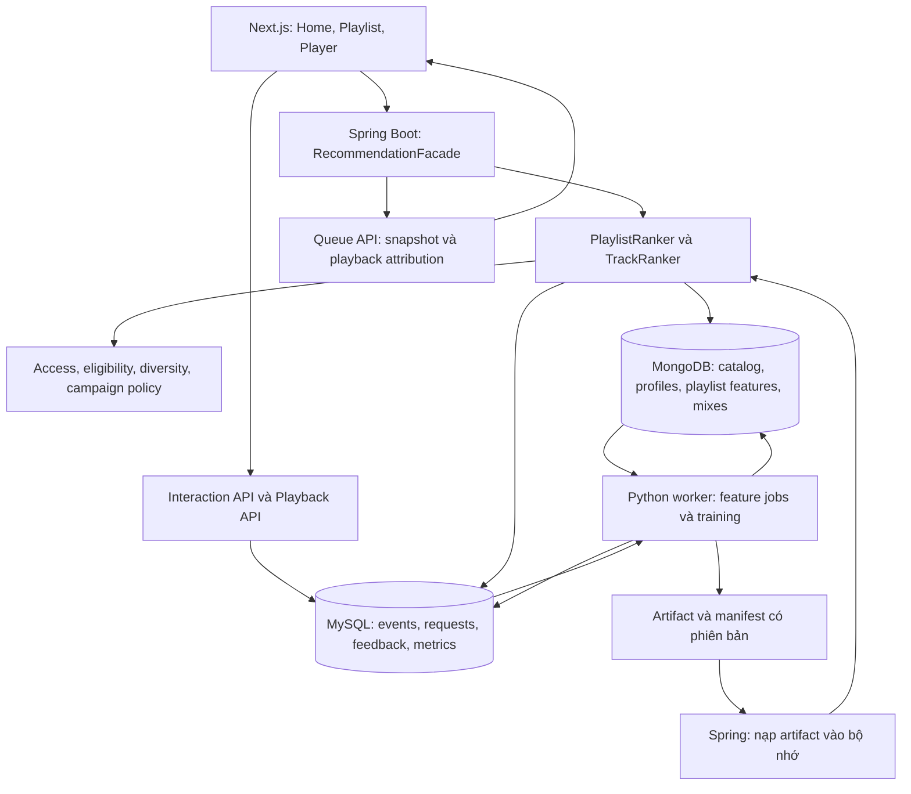

# Thiết kế chi tiết: đề xuất playlist, dữ liệu và các thành phần triển khai

Ngày thiết kế: **26/10/2026**. Đây là tài liệu thiết kế schema và luồng xử lý ban đầu.

Tài liệu hiện hành: [kiến trúc và cách hoạt động theo mã](RECOMMENDATION_SYSTEM_ARCHITECTURE.md), [đánh giá dữ liệu và chiến lược production](RECOMMENDATION_PRODUCTION_REVIEW.md). Không dùng schema lịch sử bên dưới làm kế hoạch migration mới.

**Cập nhật 27/10/2026 — phương án cũ đã được thay thế:** triển khai hiện hành không thêm bảng/cột MySQL và chỉ dùng 2 collection Mongo. Xem [persistence thu gọn và cách vận hành](RECOMMENDATION_IMPLEMENTATION.md). Các bảng/collection và đề xuất hạ tầng bên dưới là lịch sử thiết kế, không phải schema cần triển khai.

Tài liệu này cụ thể hóa [kiến trúc tổng thể](PERSONALIZED_RECOMMENDATION_ARCHITECTURE.md). Mọi thông số số lượng bài, lịch chạy, tỷ lệ phối và độ trễ là cấu hình khởi đầu cần đo, không phải kết quả đã kiểm chứng.

**Ranh giới đã thống nhất:** model cảm xúc hiện có phục vụ tìm kiếm bài hát phù hợp và nằm ngoài hệ đề xuất này. Không dùng nhãn cảm xúc, confidence, strategy hoặc `MoodTrackScorer` để cá nhân hóa.

## 1. Phạm vi đầu ra: bài hát và playlist đều là đối tượng đề xuất

| Sản phẩm | Đầu ra cho người nghe | Cách hình thành |
| --- | --- | --- |
| Đề xuất bài hát | Các bài trên Home, khám phá, phát tiếp | Rank các track đủ điều kiện theo user và phiên |
| Đề xuất playlist đã có | Playlist công khai/tuyển chọn/sự kiện phù hợp | Rank các playlist dưới dạng đối tượng riêng; giữ nội dung và thứ tự do chủ playlist đặt |
| Playlist cá nhân do hệ thống tạo | Bản phối hằng ngày, khám phá tuần, xu hướng hợp gu | Chọn nhiều track, kiểm soát đa dạng, sắp thứ tự rồi lưu thành phiên bản riêng tư của user |
| Tiếp nối playlist | Một nhóm bài gợi ý ở cuối trang playlist hoặc queue autoplay | Dùng các bài trong playlist và ngữ cảnh nghe làm seed; chỉ ghi vào playlist khi user chủ động thêm |

Ví dụ tên sản phẩm trong tài liệu là phương án thiết kế, không phải các tính năng đã có. Chưa cần tạo tất cả loại playlist ngay; v1 có thể bắt đầu với một bản phối cá nhân và một hàng playlist có sẵn.

### 1.1. Playlist hiện tại trong mã

[Playlist.java](../src/main/java/com/laphuth/moodify/entities/Playlist.java) đang lưu ở collection `playlists`: `_id`, tên, mô tả, ảnh, `username`, `is_public`, `track_spotify_ids`, thời gian tạo/sửa. [PlaylistService](../src/main/java/com/laphuth/moodify/services/PlaylistService.java) đã có tạo, đọc, thêm/xóa bài và đổi quyền hiển thị.

`searchPublicPlaylists` hiện tìm theo tên nếu có query và sắp theo thời điểm tạo. Luồng này chưa học gu người nghe. Playlist đang tham chiếu bài bằng Spotify ID, trong khi playback có đường dùng Mongo track ID; cần resolver ID dùng chung trước khi tính đặc trưng playlist.

`getPlaylist(id)` trong service hiện đọc theo ID mà không nhận principal để kiểm tra quyền sở hữu. Khi hiện thực hóa thiết kế này cần bổ sung kiểm tra đọc private playlist tại tầng service và kiểm thử quyền truy cập; không coi `is_public` là điều kiện chỉ cần kiểm tra lúc lập danh sách gợi ý.

## 2. Quyết định về database và tiến trình

**V1 tiếp tục dùng MySQL và MongoDB đang có.** Không cần thêm loại database hoặc database server. Bổ sung schema bên trong database ứng dụng hiện tại; tên database cụ thể lấy theo cấu hình môi trường khi triển khai.

| Thành phần | Vai trò | Thay đổi dự kiến |
| --- | --- | --- |
| Next.js hiện tại | Hiển thị hàng bài/playlist, player, ghi exposure và tương tác | Thêm API client, attribution và UI cho playlist cá nhân |
| Spring Boot hiện tại | API, xác thực, quyền truy cập, đọc catalog, ranking và phục vụ queue | Thêm package `recommendation`, dùng chung catalog/playback nghiệp vụ |
| MySQL hiện tại | Event, decision log, aggregate, feedback, campaign, model metadata | Thêm **8 bảng** cho phạm vi v1 đầy đủ bên dưới |
| MongoDB hiện tại | Catalog, playlist người dùng và read model phục vụ recommendation | Giữ collection cũ; thêm **4 collection** |
| Python worker mới | Feature jobs, benchmark/huấn luyện, sinh playlist theo lịch | Một tiến trình chạy job theo lịch, không nằm trong request path |
| Volume hoặc object storage | Model artifact, mapping và snapshot training | Bắt đầu bằng volume bền vững, có manifest và phiên bản |
| Redis | Cache và trạng thái ngắn hạn nếu thực sự cần | Chưa bắt buộc ở v1; quyết định sau benchmark |

Đây là mục tiêu schema cụ thể của v1 đầy đủ, có thể triển khai qua nhiều migration. Bản chỉ xếp hạng playlist có sẵn sẽ chưa cần hai collection playlist cá nhân. Chưa thêm Kafka, vector database hoặc cụm feature store.

## 3. Kiến trúc triển khai



Spring và Python là hai tiến trình có thể triển khai độc lập. Không chuyển từng request Home sang Python để huấn luyện hoặc dựng playlist lại từ đầu. Với catalog nhỏ, Python xuất vector/item similarity và candidate đã tính; Spring nạp đúng phiên bản, tính điểm nhẹ và lọc theo trạng thái hiện hành.

### 3.1. Các mô-đun bên trong Spring Boot

| Mô-đun đề xuất | Trách nhiệm |
| --- | --- |
| `RecommendationFacade` | Điều phối Home, playlist suggestions, track suggestions; gắn request/model/policy |
| `CandidateProvider` | Interface cho content, collaborative, session, trend, campaign và curated fallback |
| `PlaylistFeatureReader` / `UserProfileReader` | Đọc read model có `as_of`, schema/version, kiểm tra độ cũ |
| `PlaylistRanker` | Xếp hạng playlist phù hợp user; không thay nội dung của playlist |
| `TrackRanker` | Xếp hạng bài để khám phá, phát tiếp hoặc tạo mix |
| `SlatePolicy` | Bố trí các khối trên Home; chống playlist quá giống nhau; giới hạn lặp nguồn/nghệ sĩ |
| `PlaylistAccessPolicy` | Chỉ public playlist hoặc tài nguyên đúng chủ sở hữu mới được đọc theo phạm vi API |
| `TrackEligibilityService` | Kiểm tra trạng thái nội dung, quyền phát và availability hiện hành |
| `PersonalizedPlaylistService` | Đọc stable mix và active version; yêu cầu refresh/copy có xác thực |
| `QueueService` | Tạo queue theo đúng version, lưu quan hệ nguồn cho từng track |
| `RecommendationEventService` | Xác minh token, chống trùng, liên kết impression/click/play/save |
| `CampaignService` | Khung thời gian, audience, quota và revision của chiến dịch |
| `ModelArtifactLoader` | Nạp manifest + feature schema + ID mapping atomically; giữ bản cũ để rollback |

Các mô-đun là class/package trong backend hiện tại, chưa cần tách thành từng microservice.

## 4. Tám bảng MySQL bổ sung

Tất cả thời gian mới dùng UTC `DATETIME(3)`; user lấy từ authentication. ID bài/playlist ở Mongo là tham chiếu logic, không khai báo foreign key MySQL sang Mongo. Các trường thường xuyên lọc cần cột và index rõ ràng; JSON chỉ chứa context/chi tiết ít truy vấn, có schema version.

### 4.1. `recommendation_requests`

- `request_id CHAR(36) PRIMARY KEY`, `user_id BIGINT`, `listening_session_id CHAR(36) NULL`.
- `surface VARCHAR(40)`, `model_version VARCHAR(80)`, `policy_version VARCHAR(80)`, `feature_snapshot_id VARCHAR(100)`.
- `context_json JSON`, `created_at DATETIME(3)`, `expires_at DATETIME(3)`.
- Index `(user_id, created_at)`; liên kết `users.id` theo chính sách xóa dữ liệu đã thống nhất.
- Một hàng cho một response đề xuất. V1 chỉ phục vụ cá nhân hóa user đăng nhập; anonymous về curated/public fallback, chưa nối định danh chéo thiết bị.

### 4.2. `recommendation_items`

- `id BIGINT PRIMARY KEY`, `request_id CHAR(36)` FK đến request.
- `section_id VARCHAR(60)`, `position INT`, `entity_type VARCHAR(30)`, `entity_id VARCHAR(100)`.
- `entity_version VARCHAR(100) NULL`, `score DOUBLE NULL`, `sources_json JSON`, `reason_code VARCHAR(60)`, `attribution_token_hash VARCHAR(128)`.
- Unique `(request_id, section_id, position)`; index `(entity_type, entity_id)`.
- `entity_type`: `TRACK`, `PLAYLIST`, `PERSONALIZED_PLAYLIST`. ID của ba loại có namespace riêng, không đoán loại bằng chuỗi ID.
- Với playlist cá nhân, `entity_version` giữ version đã được giới thiệu. Playlist công khai được giới thiệu cũng giữ revision hiện có để đối soát thay đổi.

### 4.3. `recommendation_events`

- `event_id CHAR(36) PRIMARY KEY`, `user_id BIGINT`, `event_type VARCHAR(40)`, `schema_version INT`.
- `recommendation_item_id BIGINT NULL`, `request_id CHAR(36) NULL`, `entity_type`, `entity_id`, `entity_version NULL`.
- `playback_session_id CHAR(36) NULL`, `listening_history_id BIGINT NULL`, `parent_playlist_type NULL`, `parent_playlist_id NULL`, `parent_playlist_version NULL`, `queue_position INT NULL`.
- `occurred_at`, `received_at`, `payload_json JSON`, `provenance VARCHAR(30)`.
- Index `(user_id, occurred_at)`, `(entity_type, entity_id, occurred_at)`, `(request_id, event_type)` và `(playback_session_id)`.
- Event gồm impression, click/open, playlist start/follow/save, thêm bài, hide và liên kết playback. `event_id` chống trùng retry; event vẫn có thể có `request_id=NULL` khi thao tác trực tiếp trong thư viện.
- Không sao chép mọi heartbeat sang bảng này. Thời lượng nghe và diễn biến phát tiếp tục dùng `listening_history`, `playback_events` và session hiện có; event mới bổ sung attribution và tương tác chưa có.

### 4.4. `recommendation_feedback`

- `user_id`, `entity_type`, `entity_id`, `feedback_type`, `created_at`, `updated_at`, `expires_at NULL`.
- Unique `(user_id, entity_type, entity_id, feedback_type)`.
- Lưu trạng thái hiện hành: hide playlist, not interested track, hide artist, theo dõi playlist nếu v1 có nút follow. Audit hành động nằm trong events.
- Hide playlist không đồng nghĩa ghét mọi bài trong playlist. Follow cũng không tự ghi tất cả bài vào thư viện.

### 4.5. `user_track_daily`

- Khóa `(user_id, canonical_track_id, activity_date_utc)`.
- `valid_listened_ms BIGINT`, `engaged_plays INT`, `early_skips INT`, `save_count INT`, `replay_count_capped INT`, `last_interaction_at`, `computed_at`, `feature_version`.
- Index `(user_id, activity_date_utc)` và `(canonical_track_id, activity_date_utc)`.
- Aggregate có thể tính lại idempotent từ nguồn chuẩn; dữ liệu đến muộn/xóa lịch sử được xử lý qua cửa sổ tính lại và tác vụ xóa. Không dùng làm sổ doanh thu.

### 4.6. `content_metrics_windows`

- Khóa `(entity_type, entity_id, audience_key, window_start_utc, window_seconds, metric_version)`.
- `unique_listeners`, `engaged_plays`, `visible_impressions`, `opens`, `saves`, `early_skips`, `growth_score`, `confidence`, `as_of`, `updated_at`.
- Index `(entity_type, audience_key, window_seconds, as_of)` và `(entity_type, entity_id, as_of)`.
- Dùng cho track và playlist công khai/biên tập. Playlist riêng của từng user không trở thành hàng trăm bản sao để bơm trend chung. Trend của template hoặc campaign phải gộp theo nguồn chung với khử trùng user.
- Đếm distinct trên đúng toàn cửa sổ; không cộng các số distinct theo giờ để giả lập 24h.

### 4.7. `editorial_campaigns`

- `campaign_id`, `name`, `status`, `revision`, `timezone`, `starts_at_utc`, `ends_at_utc`, `priority`.
- `audience_json`, `content_targets_json`, `mixing_policy_json`, `created_by`, `approved_by NULL`, `updated_at`.
- Index `(status, starts_at_utc, ends_at_utc)`.
- `content_targets_json` là danh sách có giới hạn của `{entity_type, entity_id}` hoặc template rule. Với quy mô hiện tại có thể lưu trong một bảng; nếu danh sách/nhu cầu truy vấn tăng mới tách bảng campaign items.

### 4.8. `recommendation_model_versions`

- `version_id`, `model_name`, `status`, `train_cutoff_utc`, `feature_schema_version`, `artifact_uri`, `artifact_checksum`, `id_mapping_checksum`, `metrics_json`, `created_at`, `activated_at NULL`.
- Unique `(model_name, version_id)`; index `(model_name, status)`.
- Manifest lưu cùng artifact: model, transforms, mapping, training config, seed, cutoff và evaluation. Quy trình activation bảo đảm chỉ một active version cho mỗi model name; không chỉ dựa vào index status thông thường.

Tên logic trong tài liệu tổng thể được ánh xạ như sau: `behavior_events` và `recommendation_impressions` gộp vào `recommendation_events`; `track_metrics_windowed` mở rộng thành `content_metrics_windows`; `editorial_campaigns/items` dùng một bảng với target JSON trong v1. Alias ID đọc từ catalog và resolver hiện có, chưa cần thêm bảng alias riêng. Nguồn trend bên ngoài là giai đoạn bổ sung, có thể cần collection snapshot riêng khi kết nối thực tế.

## 5. Bốn collection MongoDB bổ sung

### 5.1. `user_recommendation_profiles`

- Unique `user_id`; các trường `long_term`, `recent`, `preferred_artists`, `genre_distribution`, `audio_clusters`, `collaborative_vector`, `candidate_track_ids`, `candidate_playlist_ids`.
- `as_of`, `feature_schema_version`, `model_version`, `interaction_count`, `active_days`, `source_watermark`, `updated_at`.
- Danh sách candidate có giới hạn; không nhúng toàn bộ lịch sử user vào một document.
- Ngữ cảnh phiên được dựng từ các hành vi gần đây hoặc cache Spring có TTL; không đặt TTL lên toàn hồ sơ dài hạn.

### 5.2. `playlist_features`

- Unique `(playlist_id, source_revision, feature_schema_version)`.
- `owner_user_id` nếu đã resolve được, `visibility_snapshot`, `content_fingerprint`, `track_ids_canonical` có giới hạn cho playlist trong v1, `available_track_count`.
- `genre_distribution`, `artist_distribution`, `audio_centroids`, `audio_spread`, `duration_stats`, `top_track_quality`, `as_of`.
- Index `(playlist_id, source_revision)`; quyền public/private vẫn được đọc lại từ playlist nguồn, không tin visibility snapshot khi phục vụ.
- Worker chỉ sinh candidate cộng đồng từ playlist công khai và phù hợp tiêu chí nội dung. Playlist riêng không đưa vào phân phối cho người khác.

### 5.3. `personalized_playlists`

- `_id` là stable mix ID; `user_id`, `mix_type`, `name`, `description`, `cover_url`.
- `active_version_id`, `previous_version_id NULL`, `refresh_due_at`, `created_at`, `updated_at`.
- Unique `(user_id, mix_type)` cho loại mix có một bản đang hoạt động/người. Không dùng uniqueness này cho trường hợp một user được tạo nhiều mix cùng loại trong tương lai.
- Đây là tài nguyên riêng tư; không thêm cờ public để chia sẻ ngầm. Nếu user muốn chia sẻ, tạo bản sao sang `playlists` thuộc quyền user.

### 5.4. `personalized_playlist_versions`

- `_id` là version ID; `playlist_id`, `user_id`, `generation_key`, `status`, `model_version`, `policy_version`, `feature_snapshot_id`, `campaign_revisions`.
- `tracks`: mảng có thứ tự của `{canonical_track_id, primary_source, reason_code, rank_score}`.
- `generated_at`, `recommendation_valid_until`, `target_track_count`, `actual_track_count`, `generation_diagnostics`, `content_checksum`.
- Unique `(playlist_id, generation_key)` chống job chạy lại tạo bản trùng; index `(playlist_id, generated_at)` và `(user_id, generated_at)`.
- Track list của một version đã publish không đổi. `recommendation_valid_until` giới hạn dùng bản đó cho đề xuất mới, không phải quyền phát của từng bài và không tự xóa playlist đang nghe.
- Giữ version cũ đủ lâu cho queue, attribution và audit theo retention đã định; khi xóa phải xử lý tham chiếu và quyền xóa dữ liệu của user. Không dùng TTL xóa ngay khi refresh.

### 5.5. Bổ sung trường cho `playlists` hiện có

Thêm dần `owner_user_id`, `revision`, `source_kind=USER|EDITORIAL`, `canonical_track_ids` cùng trường tham chiếu bản sinh nếu có: `generated_source_id`, `generated_source_version`, `copy_request_id`.

Backfill `owner_user_id` từ `username` có đối chiếu, không đoán khi không tìm thấy user. Dual-read Spotify ID/Mongo ID trong giai đoạn chuyển; chỉ đổi sang canonical read sau audit. Mọi sửa bài/thứ tự/visibility phải tăng revision; API sửa dùng optimistic concurrency để tránh ghi đè thay đổi của user.

Index đề xuất: `(is_public, updated_at)`, `(owner_user_id, created_at)` và unique partial index cho `copy_request_id` khi trường tồn tại. Endpoint copy phải kiểm tra owner/request, không để một request ID của người khác trả về playlist riêng.

## 6. Thuật toán đề xuất playlist có sẵn

### 6.1. Biểu diễn playlist

Playlist được mô tả từ các track hợp lệ: phân bố genre/nghệ sĩ, một số centroid âm thanh, độ phân tán energy/BPM, tỷ lệ bài đã biết với user, chất lượng bài ở đầu danh sách và tỷ lệ bài còn phát được.

Không chỉ lấy trung bình tất cả bài. Một playlist pha dance và acoustic cần giữ nhiều nhóm, nếu không trung bình có thể không giống trải nghiệm thực. Trường mô tả/tên playlist có thể hỗ trợ chủ đề khi được kiểm chứng, nhưng không dùng model cảm xúc để phân tích.

### 6.2. Sinh và xếp hạng ứng viên

Nguồn ứng viên: playlist có nội dung gần gu, playlist người có mẫu nghe tương tự thường bắt đầu và nghe tiếp, tuyển chọn biên tập, playlist trend và campaign đang hiệu lực. V1 dữ liệu playlist ít có thể chấm tất cả playlist công khai hợp lệ bằng content affinity.

```text
playlist_score = a * user_playlist_content_fit
               + b * observed_playlist_affinity
               + c * credible_trend
               + d * active_campaign_fit
               + e * new_to_user_value
               - f * recently_seen_fatigue
               - g * unavailable_content_penalty
```

Mọi thành phần được chuẩn hóa theo reference train; các hệ số cần đánh giá. Với user–playlist interactions ít, dùng content và priors; không dựng thêm một deep model chỉ vì entity là playlist.

Sau ranking, re-rank các card để tránh ba playlist đầu có phần lớn cùng một tập bài. Có thể đo overlap bằng Jaccard trên track IDs và gần nhau của đặc trưng; bảo vệ sự đa dạng nhưng vẫn tôn trọng relevance.

### 6.3. Tín hiệu đánh giá riêng của playlist

Theo dõi card impression → mở → chủ động bắt đầu nghe → số track/lượng nghe hợp lệ → follow/save → quay lại. Mở trang chưa chứng minh thích playlist; bỏ qua một bài không đủ để gắn nhãn ghét cả playlist. Clamp/cân bằng tín hiệu theo user và độ dài để playlist 200 bài không có lợi thế chỉ vì dài.

Giữ hai cấp phản hồi: `user→playlist` và `user→track`. Một lượt play trong playlist có thể đóng góp cho hai bài toán với ngữ nghĩa riêng, nhưng tổng thời lượng/trend track không được đếm hai lần.

## 7. Tạo playlist cá nhân từ bài hát

`PersonalizedPlaylistGenerator` chạy theo lịch hoặc yêu cầu refresh có giới hạn, qua các bước:

1. Chọn template `DAILY_MIX`, `WEEKLY_DISCOVERY` hoặc `TREND_FOR_YOU`; đọc user profile đúng phiên bản.
2. Lấy candidate từ content/CF, sở thích bền vững, trend và campaign hợp lệ. Catalog nhỏ chấm toàn bộ track.
3. Lọc quyền phát, khả năng hiển thị, explicit preferences và nội dung user đã chặn.
4. Chọn track theo ngân sách nguồn; một ví dụ là 30 bài với 15 theo gu, 6 trend hợp gu, 3 campaign và 6 khám phá. Chuyển phần campaign sang nguồn phù hợp nếu không có sự kiện.
5. Giới hạn trùng track/recording và sự tập trung nghệ sĩ; kiểm soát overlap với mix trước, đồng thời giữ lại bài quen thuộc ở mức phù hợp template.
6. Sắp thứ tự bằng utility và penalty chuyển tiếp: tránh dồn nghệ sĩ, biến đổi energy/BPM quá đột ngột khi template cần liền mạch. BPM/key là ưu tiên mềm, không phải yêu cầu bắt buộc cho mọi playlist.
7. Kiểm tra toàn danh sách: availability, số lượng thực, mức đa dạng, quota đã nới; ghi diagnostics.
8. Ghi version mới hoàn chỉnh rồi publish active pointer; retry theo generation key phải idempotent.

Nếu chỉ có 18 bài phù hợp, trả playlist 18 bài và số lượng thật. Không lặp bài hoặc bỏ điều kiện quyền phát để đạt 30. Các tỷ lệ và giới hạn trên phải được điều chỉnh theo quy mô catalog thực tế.

Lịch minh họa: daily mix refresh mỗi ngày theo múi giờ user; discovery theo tuần; trend mix có thể refresh thường hơn khi có dữ liệu mới đủ tin cậy. Không refresh lại chỉ vì một lần GET hoặc F5. User đang nghe tiếp tục dùng version đã nhận; nội dung không còn quyền phát bị bỏ qua theo eligibility hiện hành.

Với ít dữ liệu, sử dụng onboarding lựa chọn nghệ sĩ/genre nếu có, nội dung công khai/biên tập và một số candidate đa dạng. Không tạo cảm giác hiểu chính xác sở thích khi hồ sơ chưa có căn cứ.

## 8. Các luồng request cụ thể

### 8.1. Home đề xuất playlist

1. `GET /api/recommendations/home`: Spring resolve principal, profile và model đang active.
2. Đọc public playlist candidates và stable mix riêng của user; batch hydrate metadata để tránh mỗi card gọi một query.
3. Kiểm tra visibility/owner, campaign window, số bài phát được; rank riêng playlist và track.
4. `SlatePolicy` bố trí các hàng như “Bản phối của bạn”, “Playlist hợp gu”, “Xu hướng”, “Tuyển chọn theo đợt”; không trộn trực tiếp raw score track với raw score playlist.
5. Ghi request/items; response trả card metadata, entity type/ID/version, reason, token. Không trả toàn bộ bài của mọi playlist trên Home.
6. Client gửi impression thực thấy, click/open có token; khi user chọn nghe, truyền token và nguồn đến queue.

### 8.2. Nghe playlist

1. `POST /api/playback/queues`: body nhận entity reference/version và attribution token; user được resolve trên server.
2. Nếu là playlist cá nhân: kiểm tra user sở hữu cả stable ID và version; version phải thuộc đúng playlist. Nếu là playlist có sẵn: kiểm tra public hoặc owner.
3. Lấy track list theo version/revision và thứ tự; loại track không đủ điều kiện hiện hành. Playlist có sẵn giữ thứ tự tác giả, không cá nhân hóa lại tự động.
4. Trả `queue_id`, `parent_playlist_type/id/version`, các track IDs và token theo track. Queue snapshot không bị cập nhật khi active mix đổi.
5. Player dùng `playback_session_id` cho từng lần phát, giữ parent và recommendation item cho toàn hành trình; backend xác minh thay vì tin client tự khai.
6. Playback vẫn ghi một lịch sử nghe duy nhất. Revenue rules giữ nguyên; recommendation attribution không thay đổi điều kiện doanh thu.

V1 có thể dùng queue payload có chữ ký và hạn sử dụng để tránh thêm bảng queue: client giữ snapshot, server xác minh context và quyền tại playback. Nếu danh sách quá lớn hoặc cần khôi phục queue qua thiết bị, chuyển queue state sang persistence riêng ở giai đoạn sau. Token còn hiệu lực không thay thế việc kiểm tra owner/visibility hiện hành.

Nếu một public playlist đổi revision giữa lúc card hiển thị và lúc bấm Play, server trả revision/queue thực dùng và lưu revision lúc được giới thiệu để đối soát. Với generated mix đã bị supersede và hết hạn recommendation, yêu cầu mới resolve về active version; queue đã bắt đầu có thể tiếp tục version cũ trong retention, vẫn kiểm tra quyền phát.

### 8.3. Lưu playlist cá nhân vào thư viện

V1 chọn thao tác **“Lưu bản sao”**: copy track list của một version sang `playlists` của user, kèm lineage và `copy_request_id` chống trùng. Bản sao do user chỉnh được và giữ độc lập khi mix hệ thống refresh. Loại quyền hiển thị theo lựa chọn sản phẩm rõ ràng, mặc định private.

Nếu sau này thêm **“Theo dõi bản phối”**, đó là thao tác giữ stable mix ID để theo dõi version mới. Không gộp hai ý nghĩa dưới một nút mà không giải thích hành vi cập nhật.

### 8.4. Gợi ý thêm bài vào playlist

`GET /api/recommendations/playlist-continuation?playlistId=...` kiểm tra quyền đọc, lấy vài nhóm bài làm seed, loại bài đã trong playlist và rank theo playlist fit + user context. Chỉ `POST /api/playlists/{id}/tracks` có xác thực chủ sở hữu mới sửa playlist. Autoplay queue không tự thêm bài vào danh sách lưu.

## 9. API v1 dự kiến

| API mới | Kết quả |
| --- | --- |
| `GET /api/recommendations/home` | Sections có card track/playlist/personalized playlist |
| `GET /api/recommendations/playlists` | Playlist có sẵn được rank cho user, phân trang bằng cursor ổn định |
| `GET /api/me/personalized-playlists` | Các stable mix của user |
| `GET /api/me/personalized-playlists/{id}` | Metadata và active version user có quyền đọc |
| `GET /api/me/personalized-playlists/{id}/versions/{versionId}` | Nội dung một version còn được giữ; kiểm tra ownership |
| `POST /api/me/personalized-playlists/{id}/refresh` | Job refresh có dedupe/rate limit, trả trạng thái queued; không hứa có model mới ngay |
| `POST /api/me/personalized-playlists/{id}/copies` | Lưu bản sao của version được chọn vào playlist người dùng |
| `POST /api/playback/queues` | Queue snapshot có attribution và danh sách bài đủ điều kiện |
| `GET /api/recommendations/playlist-continuation` | Đề xuất bài để thêm/phát tiếp |
| `POST /api/recommendations/events` | Batch event impression/open/feedback có schema và dedupe |
| `PUT /api/recommendations/feedback` | Upsert trạng thái not interested/hide/follow; event audit phát sinh trên server |

API CRUD playlist hiện có tiếp tục dùng cho playlist của user. Có thể điều chỉnh route cho nhất quán khi hiện thực hóa; đây là hợp đồng thiết kế. Không đưa model cảm xúc vào bất kỳ route mới nào.

## 10. Worker, tính nhất quán và refresh

### 10.1. Các job

| Job | Đọc | Ghi | Lịch khởi đầu để thử |
| --- | --- | --- | --- |
| Daily behavior aggregation | History, playback, interaction events | `user_track_daily` | Theo giờ, tính lại cửa sổ có dữ liệu đến muộn |
| Trend aggregation | Events/history đã lọc | `content_metrics_windows` | 5–15 phút khi traffic đủ |
| Playlist feature build | `playlists` theo revision và tracks | `playlist_features` | Khi revision đổi + đối soát định kỳ |
| User profile build | Daily aggregates, library, feedback | `user_recommendation_profiles` | Theo giờ/ngày; session update xử lý nhẹ trên request |
| Training/evaluation | Snapshot đúng cutoff | Artifact + `recommendation_model_versions` | Theo ngày khi có thay đổi đủ dữ liệu |
| Personalized mix generation | Profiles, catalog, metrics, campaign | Hai collection personalized playlist | Theo lịch từng template và refresh được chấp nhận |

Ban đầu dùng một worker có khóa chống chạy job trùng; chưa cần cụm scheduler. Chỉ cấp worker quyền đọc/ghi đúng nguồn cần thiết. Không để worker sửa doanh thu hoặc ghi lại lịch sử playback.

### 10.2. Publish playlist không đổi dở dang

Ghi một version hoàn chỉnh có checksum trước, rồi cập nhật active pointer của stable playlist bằng compare-and-set theo pointer cũ. Nếu insert thành công mà pointer update thất bại, version đó chưa được phục vụ như active; retry idempotent hoặc dọn orphan sau đối soát. Không publish trước rồi mới ghi thêm từng track.

MongoDB bảo đảm atomic cho một thao tác trên một document; giao dịch nhiều document có yêu cầu triển khai riêng. Phương án version trước/pointer sau giúp không cần mặc định đã có transaction phân tán giữa MySQL và MongoDB. [Tài liệu MongoDB về transactions](https://www.mongodb.com/docs/manual/core/transactions/)

Mutation playlist trong Mongo và event trong MySQL là hai lần ghi khác hệ thống. Để không mất event, dùng pending event có ID ổn định nhúng vào cùng document mutation và tác vụ chuyển/ack có giới hạn, hoặc cơ chế outbox tương đương nếu môi trường hỗ trợ; MySQL tiếp nhận idempotent. Có job reconciliation theo revision/watermark. Không giả định `@Transactional` của Spring tự bảo đảm atomic cả hai database.

### 10.3. Fallback và tính hiện hành

- Profile/model thiếu: content-based và tuyển chọn hợp lệ.
- Mix chưa sinh xong: dùng version trước còn hợp lệ cho đề xuất hoặc trả pending và gợi ý playlist công khai; không chờ training trong GET.
- Campaign hết hạn: loại khỏi đề xuất mới dù model chưa train lại.
- Playlist chuyển private/bị xóa: loại ngay khỏi gợi ý cho người khác và kiểm tra lại khi mở/play.
- Track hết quyền phát: loại khỏi queue/current playback theo policy, dù có trong version cũ.
- Metrics cũ: giảm/bỏ trend boost, không gắn nhãn đang thịnh hành dựa trên dữ liệu quá hạn.

## 11. Thí nghiệm và điều kiện nghiệm thu

Đề xuất playlist có sẵn cần đo visible impression → open → engaged playlist start, save/follow và revisit; generated mix cần đo valid listening, early skip, discovery được nghe lại và tỷ lệ đổi nội dung giữa các version. Continuation cần đo tỷ lệ chấp nhận thêm bài và chất lượng nghe tiếp.

Không dùng một chỉ số click chung để so mọi loại nội dung; vị trí card, tên/ảnh và số bài khác nhau có thể ảnh hưởng kết quả. So với baseline playlist mới tạo hiện tại, time-popular playlist và content-only. Chia theo thời gian, báo cáo riêng user mới/ít lịch sử và giữ quyền truy cập trong bộ candidate đánh giá.

Các kiểm chứng bắt buộc khi triển khai:

- User A không đọc version riêng của B kể cả khi biết ID hoặc có token cũ.
- Public playlist chuyển private không tiếp tục lọt qua cache/candidate cũ.
- Hai job generation chạy lại không tạo hai active version bất định.
- Refresh không thay đổi thứ tự playlist user tự tạo hoặc queue đã bắt đầu.
- Retry event/copy không tạo lượt tương tác hoặc bản sao trùng.
- Hide playlist không tự chặn mọi track bên trong.
- Xóa lịch sử/tài khoản được áp dụng tới profile, training snapshot và version cá nhân theo chính sách lưu trữ.
- Campaign hết hạn và license thay đổi có hiệu lực không cần đợi model train lại.
- Mỗi lượt nghe trong playlist chỉ có một nguồn duration chuẩn; doanh thu và tín hiệu sở thích đối soát được.

## 12. Thứ tự triển khai để kiểm soát phạm vi

1. **Chuẩn hóa nền:** ID resolver, source/parent playlist attribution, ACL playlist, revision và event contract.
2. **Đề xuất playlist có sẵn:** request/items/events, playlist features, content ranking, impression UI; chưa cần generated mix.
3. **Playlist cá nhân:** user profiles, hai collection versioned mix, generator baseline, queue snapshot và lưu bản sao.
4. **Trend/campaign và ML:** aggregates, campaign policy, ALS/item–item benchmark, model registry; đo đóng góp từng phần.
5. **Tối ưu theo bằng chứng:** học playlist affinity/ranker khi đủ data, cache khi cần và session/bandit khi log đủ điều kiện.

Hướng nghiên cứu liên quan nhưng khác nhau: [A Scalable Framework for Automatic Playlist Continuation, SIGIR 2023](https://arxiv.org/abs/2304.09061), [automatic playlist sequencing and transitions](https://research.atspotify.com/publications/automatic-playlist-sequencing-and-transitions/). Việc chọn playlist, chọn tập bài và sắp thứ tự là ba bài toán cần đánh giá riêng; một model không mặc nhiên giải quyết tốt cả ba.
