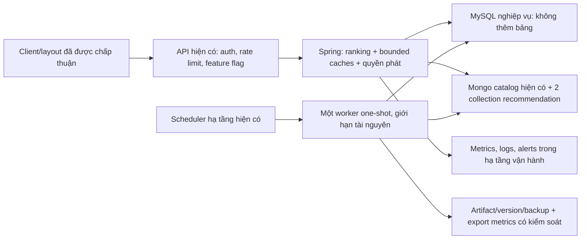

# Đánh giá dữ liệu và chiến lược production cho hệ đề xuất Moodify

**Ngày đánh giá:** 27/10/2026.  
**Căn cứ:** mã nguồn hiện hành, audit read-only database local và tài liệu nghiên cứu/nhà cung cấp chính thức.  
**Kết luận:** **chưa nên mở production rộng hoặc quảng bá là hệ ML đã được kiểm chứng.** Phù hợp làm nền cho pilot thuật toán dựa trên nội dung sau khi giải quyết dữ liệu và các mục P0 dưới đây.

Đọc cùng [kiến trúc và cách hoạt động](RECOMMENDATION_SYSTEM_ARCHITECTURE.md). Tài liệu này đánh giá độ sẵn sàng, không sửa thuật toán, UI, schema, giấy phép hoặc dữ liệu ứng dụng.

**Trạng thái mới ngày 29/10/2026:** [v1.2 đã bổ sung nền vận hành](RECOMMENDATION_V1_2_OPERATIONS.md): outcome async có queue/deadline/circuit, targeted heartbeat, controls generation/CF/campaign và metrics/preview ADMIN theo process. [Audit mới](recommendation-data-audit-v1.2-20261029.json) vẫn có 0/153 bài đủ policy. Điều khiển này chưa thay thế rollout toàn cụm, benchmark lỗi read path, experiment bucket hoặc đánh giá chất lượng. Các số liệu audit 27/10 bên dưới vẫn được giữ làm snapshot lịch sử.

**Cập nhật sau cải thiện v1.1:** [biên bản triển khai hiện hành](RECOMMENDATION_V1_1_IMPLEMENTATION.md), [audit chỉ đọc mới](recommendation-data-audit-v1.1-20261027.json). Follow/album/selected result đã tham gia ranking; không sinh label ALS giả. Worker snapshot đã sửa và kiểm thử; owner ID có hiệu lực cho playlist có ID/mới; trend canonical distinct và lọc USER ACTIVE đã sửa. Các mục P0 bên dưới ghi rõ phần đã xử lý, phần còn mở. Kết luận chưa đủ production rộng vẫn giữ vì catalog 0 bài hợp lệ, thiếu fault isolation/rollout/đánh giá chất lượng. [Inventory trước cải thiện](RECOMMENDATION_SIGNAL_REASSESSMENT.md) vẫn giữ để truy nguyên quyết định nguồn.

## 1. Phạm vi và độ chắc chắn của đánh giá

### 1.1. Đã thực hiện

- Audit database local được cấu hình trong backend, không truy cập Oracle/production.
- Chạy SQL trong transaction READ ONLY; Mongo chỉ find/count/aggregate metadata. Không gọi hàm tạo index, publish model hoặc worker run trong lượt audit.
- Xuất [JSON tổng hợp](recommendation-data-audit-20261027.json); không xuất user ID, email, tên người dùng, token hoặc danh sách bài nghe theo cá nhân.
- Đọc code canonical ID, eligibility, ranking, mix, queue, telemetry, training, publish, scheduler và retention.
- Đối chiếu nghiên cứu implicit feedback, time-aware evaluation, vận hành ML và tài liệu MySQL/MongoDB.

### 1.2. Chưa thực hiện

Chưa đo database production, traffic/RPS, CPU/RAM, p95/p99 trên hạ tầng triển khai, độ trễ CDN hoặc chất lượng phát audio thật. Chưa có human evaluation, A/B hoặc chứng minh dữ liệu hiện tại là người nghe production tự nhiên. Vì vậy mọi mốc tải, chi phí lưu trữ và gate đề xuất là giả thuyết vận hành cần đo, không phải kết quả đạt được.

Snapshot local không được thay thế cho audit production. Khi chuẩn bị deploy, phải chạy bản audit được cấp quyền đọc trên đúng nguồn production/replica; script audit local hiện cố ý từ chối host ngoài loopback.

SQL audit có snapshot đọc trong một transaction; các truy vấn Mongo được thực hiện tuần tự và không tạo một snapshot phân tán nguyên tử giữa hai hệ. Với môi trường đang có traffic, cần ghi cutoff/version và chấp nhận/đo độ lệch đó, hoặc dùng extract bất biến để đánh giá theo thời gian.

## 2. Bảng quyết định triển khai

| Hạng mục | Đánh giá hiện tại | Quyết định |
| --- | --- | --- |
| Kiến trúc gọn 0 bảng MySQL mới, 2 collection Mongo | Phù hợp quy mô khởi đầu và yêu cầu chủ dự án | Giữ |
| Catalog có thể đề xuất | 0/153 bài đủ policy | Chặn mở tính năng ra người dùng thật |
| Playlist có sẵn | 25 document legacy không khớp schema reader | Cần adapter/migration được duyệt |
| Content-based | Đã có mã; 105/153 bài có đủ 5 feature hợp lệ miền số | Pilot sau kiểm chứng feature/candidate |
| Xu hướng | 0 USER hoạt động trong 48 giờ gần nhất | Không có cơ sở hiển thị trend từ dữ liệu hiện tại |
| Collaborative ALS | 2 user, 3 bài, 3 cặp; không có bài chung giữa user | Giữ tắt; không dùng model để tạo cảm giác hệ đã học cộng đồng |
| Telemetry recommendation | Chưa có log impression/open/play recommendation trên dataset local | Chưa đo được funnel hoặc hiệu quả |
| `watch` worker | v1.1 đã kết thúc snapshot mỗi batch, test freshness đạt | Vẫn cần đo vận hành; one-shot đơn giản cho pilot |
| Fault isolation và rollback | Có bảo vệ SQL khi Mongo outcome write lỗi; chưa bảo vệ mọi đường gọi | Bổ sung trước production |
| Kiểm thử | Đã có kiểm thử chức năng; chưa có tải/chaos/A-B | Chưa đủ bằng chứng sẵn sàng production |

Quan điểm kỹ thuật: tăng model complexity lúc này không giải quyết được việc thiếu catalog hợp lệ và thiếu người nghe độc lập. Ưu tiên pipeline, mục tiêu đo lường và baseline đơn giản phù hợp với hướng dẫn [Rules of ML của Google](https://developers.google.com/machine-learning/guides/rules-of-ml).

## 3. Kết quả audit dữ liệu hiện tại

Thời điểm chính xác và mọi số đếm máy đọc được nằm trong JSON audit; các phần trăm dưới đây được tính từ snapshot đó. Chúng là mô tả dữ liệu local, không phải thống kê đại diện thị trường.

### 3.1. Catalog và quyền phát

| Chỉ số | Giá trị | Ý nghĩa |
| --- | ---: | --- |
| Tổng track | 153 | Không đồng nghĩa 153 candidate hợp lệ |
| Thiếu `status`/`visibility` | 147 | Khoảng 96,1% catalog dùng metadata legacy |
| Published + public + approved | 2 | Hai bài đi qua các bước đầu của eligibility |
| Có metadata đường dẫn audio | 153 | Chưa kiểm tra file/HTTP/audio thật |
| Bài có license hiệu lực nối được về catalog | 2 | Không trùng hai bài published/public/approved |
| Đủ toàn bộ eligibility | **0** | Serving phải trả rỗng ở dữ liệu này |
| License rows tổng | 6 | ACTIVE 3, EXPIRED 1, REVOKED 1, PENDING 1 |
| License rows không nối được catalog | 4 | Cần phân biệt orphan, bài đã xóa, fixture hoặc mapping sai |

Waterfall thực tế: **153 → published 2 → public 2 → approved 2 → có audio path 2 → license hiệu lực 0**.

Hai bài có license hiệu lực gồm một draft/public/pending và một bài legacy approved nhưng thiếu status/visibility. Vì vậy chỉ thêm license hoặc chỉ đổi trạng thái một cách hàng loạt đều không phải kế hoạch dữ liệu đúng. Cần xác minh từng nội dung thực và nguồn quyền phát.

**Chiến lược dữ liệu:** lập danh sách đối soát nội dung trong công cụ quản trị hiện có; canonicalize ID, xác minh quyền, duyệt nội dung, kiểm tra audio rồi mới xuất bản. Không tự đặt 147 bài thành published/public; không tắt policy license để đạt mục tiêu số lượng. Công việc này thay đổi dữ liệu nên cần đợt thực hiện riêng được chủ dự án đồng ý.

### 3.2. Metadata và audio features

| Chỉ số | Giá trị |
| --- | ---: |
| Có genre | 153/153 |
| Có artist ID | 151/153 |
| Đủ energy, valence, danceability, acousticness, BPM trong miền số | 105/153 = 68,6% |
| Thiếu bộ feature đầy đủ | 48/153 = 31,4% |
| Vector audio đầy đủ khác nhau | 73 trên 105 bài |
| Nhóm vector giống hệt lớn nhất | 5 bài |
| `energy = 1.0` | 67/105 = 63,8% số bài có feature |
| `acousticness = 0.1` | 67/105 |
| Valence 0.5 hoặc 0.75 | 69/105 |
| Có giá trị release date sử dụng được theo kiểm tra hiện tại | 0/153; 147 document có field nhưng rỗng/null |

Đây là dấu hiệu cần kiểm chứng calibration/provenance, **không đủ chứng minh feature giả hoặc extractor sai**. Nhạc có thể có phân bố lệch thật, nhưng saturation và nhiều giá trị giống nhau có thể làm similarity kém phân biệt. Điểm “đủ feature” chỉ kiểm tra hình thức và miền số, không phải độ đúng âm nhạc.

Các nhãn genre đồng thời có dạng slug và hiển thị: `rap`, `Rap / Hip-Hop`, `v-pop`, `V-Pop`, `EDM / Remix`... Java mới gộp một số biến thể và gộp V-Pop thành pop, chưa có taxonomy đầy đủ. Điều này làm Jaccard và chiến dịch theo genre thiếu nhất quán.

**Đề xuất trước pilot:**

1. Lưu version extractor và quy tắc chuẩn hóa trong metadata track hiện có khi có kế hoạch ingest được duyệt; không thêm collection.
2. Kiểm thử mẫu khoảng 20–30 bài phân tầng theo genre, mức energy và nguồn ingest; so với audio thật và extractor đáng tin cậy. Đây là mẫu kiểm tra kỹ thuật ban đầu, không khẳng định đánh giá khoa học đủ lực thống kê.
3. Tách “missing” khỏi “giá trị mặc định”; không điền hàng loạt 0.5 hoặc 1.0 để tăng coverage.
4. Chọn một taxonomy genre ổn định; giữ nhãn raw để đối soát. Không đánh mất ngôn ngữ/V-Pop chỉ vì gộp tên.
5. Không xây khối “mới phát hành” dựa trên metadata ngày phát hành hiện tại.

### 3.3. Playlist: có dữ liệu nhưng reader chưa đọc đúng

Có **25 playlist**, tất cả dùng bộ trường legacy: `tracks`, `created_by`, `total_tracks`, `source_spotify_id`, không có `is_public`, `username`, `track_spotify_ids`. Reader hiện hành không có cơ sở chọn chúng làm playlist công khai hoặc nhận diện chủ sở hữu.

Mảng legacy có tổng **990 mục**, không phải 990 bài khác nhau. Phép đối chiếu trực tiếp qua các key ID thông dụng nối được **15 mục (khoảng 1,5%)** với catalog local. Đây chỉ là kết quả resolver kiểm tra; các mục còn lại có thể là bài ngoài catalog hoặc cấu trúc ID khác, chưa được kết luận đã mất dữ liệu.

Kế hoạch chuyển đổi phải giữ nguyên document gốc và ID playlist; xác định chủ sở hữu, nguồn Spotify/editorial và quyền công khai; đối soát track reference; chạy preview trước mutation. Không tự tạo artist/track giả để đủ playlist. Tất cả có thể xử lý trong collection `playlists` hiện có. Chưa thực hiện migration này.

### 3.4. Người dùng và hành vi

| Chỉ số | Giá trị | Cách đọc đúng |
| --- | ---: | --- |
| Tài khoản role USER | 3 | 2 ACTIVE, 1 BANNED; không tự coi là 3 người production thật |
| Tổng lịch sử | 124 | 73 hàng thuộc CONTENT_LEAD/MODERATOR/ADMIN |
| Lịch sử role USER | 51 = 41,1% tổng | Tập quan sát có thể dùng sau chuẩn hóa |
| Người USER có lịch sử | **1** | Replay nhiều không tạo thêm mẫu độc lập giữa người dùng |
| USER history nối được track | 43/51 = 84,3% | 8 hàng chưa nối được |
| USER history nối được track đủ serving policy | 0/51 | Lịch sử chưa tạo seed dương khả dụng hiện tại |
| Hàng USER duration >=30 giây | 45/51 | Không phải engaged-play rate của recommender mới |
| USER history có revenue session hiện hành | 0/51 | Chưa xác nhận bằng pipeline mới trên dataset thật |
| Ngày hoạt động USER khác nhau | 26 | Trải dài dữ liệu cũ; không đồng nghĩa 26 ngày gần đây |
| Lượt USER gần nhất sau chuẩn hóa | 07/10/2026 | Khoảng 20 ngày trước audit |
| USER hoạt động 1/2/7 ngày gần nhất | 0/0/0 | Không có tín hiệu phiên/trend gần đây |
| USER hoạt động 30 ngày gần nhất | 1 | Không đủ A/B hoặc suy luận cộng đồng |
| USER library rows | 4 | Chỉ 2 rows nối được catalog |

Nguồn USER history gồm HOME 27, SEARCH 13, EMOTION 7 và một số nguồn khác; không nên mô tả toàn bộ history đều bị hard-code HOME. Tuy vậy nguồn cũ chưa có decision/impression link, nên không thể suy luận hiệu quả recommendation từ nhóm HOME. `EMOTION` chỉ nói người dùng nghe từ một luồng tìm kiếm; nhãn dự đoán cảm xúc không vào thuật toán.

### 3.5. Dữ liệu ML và trend

Worker tạo 36 bucket user–track–ngày trong RAM. Ma trận hiện tại:

```text
2 người dùng × 3 bài = 6 ô
3 cặp user–track dương
0 bài được quan tâm bởi nhiều hơn một người trong ma trận
coverage item so với catalog: 3/153 ≈ 1,96%
```

Density 50% nhìn cao nhưng chỉ là ma trận cực nhỏ và rời rạc. Không có nền tảng để học sự tương đồng cộng đồng đáng tin. Người thứ hai trong ma trận có thể được đưa vào qua library; không mâu thuẫn với việc chỉ một USER có listening history.

Cutoff đánh giá hiện tại là 20/10/2026 00:00 UTC; train trước cutoff vẫn chỉ có 2 user, 3 bài, 3 cặp. Sanity gate 5/5/30 không đạt. Không được nhân bản rows, sinh nghe giả hoặc dùng hành vi nhân viên để đạt gate.

Trend có 0 người hoạt động trong cả hai cửa sổ 24 giờ. Không thể suy ra trend hiện tại; không nên thay bằng popularity tĩnh rồi giữ nhãn “đang thịnh hành”.

### 3.6. Telemetry và trạng thái sau cleanup

Hai PROFILE hiện mang model `content-session-v1`. Chưa có decision/impression/open/outcome recommendation để đo funnel trên database local. Không có legacy SQL table hoặc legacy Mongo collection còn lại.

Kết luận dữ liệu: ưu tiên **catalog hợp lệ → nối ID/schema → chất lượng feature → thu hành vi người dùng thật**, rồi mới tăng ML. Không có lý do thêm database mới để giải quyết các thiếu hụt này.

## 4. Các phát hiện kỹ thuật cần xử lý trước production

P0 trong tài liệu nghĩa là phải giải quyết trước phạm vi phát hành liên quan. Không phải tất cả mục đều gây lỗi trên snapshot nhỏ hiện tại; có mục là lỗ hổng hành vi chưa được test hoặc rủi ro khi scale. Bằng chứng ban đầu là snapshot trước v1.1; trạng thái xử lý được ghi riêng bên dưới và trong tài liệu v1.1.

### P0-1. Snapshot worker có thể cũ xuyên nhiều vòng `watch`

**Trạng thái v1.1: đã sửa và kiểm thử fixture.** `load_sources` dùng transaction READ ONLY riêng mỗi batch và rollback trong finally. Smoke xác nhận commit thêm/xóa từ connection khác qua ba batch. Những mô tả rủi ro sau đây là bằng chứng của bản trước sửa, không phải hành vi worker hiện hành. Chưa chứng nhận benchmark/daemon production.

**Bằng chứng:** audit đo `autocommit=0`, isolation REPEATABLE-READ. `worker.connections` không bật autocommit; vòng `main` giữ connection, dùng ping rồi extract mà không commit/rollback sau batch. Theo [MySQL consistent reads](https://dev.mysql.com/doc/refman/8.4/en/innodb-consistent-read.html), những SELECT trong cùng transaction có thể dùng cùng snapshot. [PyMySQL](https://pymysql.readthedocs.io/en/latest/modules/connections.html) cũng mô tả autocommit mặc định false.

**Tác động:** train lặp có thể không thấy lịch sử mới/xóa mới, đồng thời giữ read view lâu. Thành công của one-shot và HTTP smoke không kiểm tra tình huống này.

**Cách xử lý:** transaction đọc có giới hạn cho mỗi extract, kết thúc sau batch hoặc dùng connection mới; giữ advisory lock ở cấp session theo thiết kế được kiểm chứng. Tạm thời dùng job one-shot có process mới theo lịch hạ tầng hiện có. Không dùng locking read để “sửa” vì sẽ tăng tác động vào nghiệp vụ.

**Test chấp nhận:** batch 1 đọc fixture; connection khác commit thêm/xóa history; batch 2 phải phản ánh thay đổi và không giữ read transaction qua thời gian sleep. Thực hiện test trên fixture, không ghi thêm lịch sử giả vào database ứng dụng.

### P0-2. Catalog rỗng và schema playlist lệch

**Bằng chứng:** các mục 3.1 và 3.3. Resolver/eligibility đúng kiểu fail-closed dẫn tới rỗng là hành vi an toàn, nhưng không tạo ra sản phẩm đề xuất hữu ích.

**Cách xử lý:** có bộ nội dung pilot được xác minh và adapter/migration preview cho playlist legacy. Không tự public hóa dữ liệu thiếu trạng thái. Endpoint readiness cần được đưa vào gate release, không chỉ kiểm tra health HTTP.

### P0-3. Quyền sở hữu playlist cần ID bất biến

**Trạng thái v1.1: đã sửa cho playlist có owner ID và dữ liệu mới; legacy còn cần đối soát.** Tạo/copy ghi `owner_user_id`, đọc/list/mutation ưu tiên ID; test đổi username và tài khoản khác nhận tên cũ đạt. Missing visibility mặc định private. Không bulk gán owner cho 25 playlist legacy; fallback tên trên dữ liệu chưa có ID chưa giải quyết hoàn toàn identity legacy.

**Bằng chứng:** `RecommendationCatalog.owns` hiện so username/email; `owner_user_id` đã có trong entity nhưng chưa được dùng để quyết định ở hàm này. Playlist legacy cũng thiếu owner canonical.

**Tác động:** đổi username/email có thể làm mất liên kết quyền; việc tái sử dụng tên cần được xét để tránh nhận nhầm quyền. Không khẳng định đã khai thác được trên hệ hiện tại, nhưng không nên đưa luồng private ra production khi ownership chưa rõ.

**Cách xử lý:** dùng owner ID bất biến cho dữ liệu mới; fallback legacy chỉ sau đối soát; thiếu owner/visibility phải fail-closed. Test đổi tên, tài khoản khác nhận tên cũ, copy private và read/version/queue chéo user. Không yêu cầu bảng SQL mới.

### P0-4. Tách lỗi recommendation khỏi đường phát nhạc

**Trạng thái v1.2: đã tách ghi outcome và bỏ full-catalog scan khi xác minh heartbeat.** Callback sau commit chỉ enqueue, executor hữu hạn dùng deadline insert EVENT và circuit/drop counters. Unit kiểm tra chậm/đầy/rollback/cooldown/driver không phản hồi; HTTP fixture ép validator từ chối outcome vẫn giữ SQL session. Catalog/license/owner/block read vẫn là dependency bắt buộc; chưa có benchmark mất Mongo toàn cụm, SQL timeout hoặc deadline read path đầy đủ. Phần bằng chứng sau mô tả bản trước sửa.

**Bằng chứng:** `recordRecommendationAfterCommit` nuốt lỗi write nhưng callback vẫn đồng bộ; `playbackContext` đọc catalog/license/ownership trước khi ghi session, kể cả request heartbeat có queue token.

**Tác động:** Mongo chậm/mất kết nối có thể làm chậm hoặc lỗi request xác minh queue; toàn catalog bị hydrate lặp khi heartbeat có thể tải mạnh hơn chính API Home. Test Mongo từ chối outcome không đại diện cho cả server Mongo ngừng hoạt động.

**Cách xử lý:** tách xác minh session/track tối thiểu khỏi ranking toàn catalog; timeout rõ; đường ghi log có giới hạn, có số đếm drop và đối soát từ history hiện có. Nếu dùng async queue trong bộ nhớ phải công khai khả năng mất log khi crash. Không thêm SQL outbox hoặc hạ tầng message broker chỉ để giữ thống kê ở giai đoạn pilot. Không fail-open ownership/quyền phát khi thiếu dữ liệu.

**Test:** ngắt Mongo thật trên fixture, trì hoãn callback, SQL timeout, queue token hết hạn, permission thay đổi; kiểm tra audio/session nghiệp vụ và pool JDBC. Đo cả latency khi dependency lỗi.

### P0-5. Canonical ID và population train/serve chưa đồng nhất

**Trạng thái v1.1: đã sửa canonical distinct trend và USER ACTIVE cho worker/trend.** Banned không làm tăng ngưỡng trend trong fixture. Population provenance người thật/test, eligibility as-of, license/payment lookup parity và train/serve feature parity vẫn cần làm; không coi toàn bộ mục này đã đóng.

**Bằng chứng:** trend GROUP BY raw IDs; worker canonicalizes. Worker dùng USER role nhưng chưa lọc ACTIVE hoặc test provenance. Train lấy mọi track nối được trong catalog, còn online profile chỉ giữ bài đang đủ eligibility.

**Tác động:** chia nhỏ trend, train/serve skew, học dữ liệu không đại diện, hoặc đánh giá bài không thuộc tập thực sự có thể phục vụ. Dữ liệu tài khoản BANNED/test phải có policy rõ, không đơn thuần gom mọi role USER.

**Cách xử lý:** một hợp đồng canonical ID/version; distinct count sau hợp nhất đúng user; quy định population, opt-out/deletion và tập available as-of. License resolver của serving và nhánh qualified stream cũng cần đối soát vì nhánh doanh thu hiện lookup canonical khác khả năng alias của recommender; không tự đổi công thức thanh toán.

### P0-6. Có đường tắt an toàn và quan sát được khi rollout

V1.2 đã có startup flags và controls ADMIN theo revision cho generation/CF/campaign trên từng process; tắt generation vẫn đọc/play được mix có sẵn sau kiểm tra quyền. Có fixed-cardinality request/error/latency/empty/outcome counters. Còn thiếu stable experiment bucket, scrape/alert triển khai và đồng bộ điều khiển nhiều instance. Restart trở về biến môi trường; thao tác qua load balancer một lần không tắt cả cụm. Không thay layout hoặc luồng UI.

Các counters v1.2 phân biệt response rỗng thành công với lỗi ghi decision và unavailable do tắt generation. Trước pilot phải nối thu thập/alert, đo tải và lỗi read path; không hạ policy license khi fallback.

### P0-7 cho ML. Đánh giá, publish và khả năng khôi phục

Gate NDCG hơn popularity 0,005 với 5 user không chứng minh hiệu quả. Chưa có CI, rolling windows, thử user/item lạnh, eligibility as-of, champion model hoặc publish toàn bộ cohort nguyên tử. `feature_snapshot_id` không phải feature snapshot thật.

Cần manifest extract/catalog/ID mapping có version, dữ liệu đánh giá bất biến ở artifact storage, model assignment có rollback và publication hoàn chỉnh trước khi chuyển cohort. Có thể giữ manifest/active pointer trong file atomic hoặc metadata của hai collection, không thêm registry SQL. Điều này có thể làm sau pilot content-based nhưng trước khi quảng bá/rollout ALS.

### P1. Các việc tiếp theo

| Vấn đề | Hướng xử lý không thêm bảng/collection |
| --- | --- |
| Decision TTL 7 ngày, event TTL 30 ngày | Căn chỉnh retention cho experiment/outcome hoặc xuất facts định kỳ trước khi decision mất; không suy diễn D7 join đầy đủ hiện tại |
| Version orphan/race TTL | Reconciler trên `recommendation_state`; TTL cho orphan sau grace; không xóa version active hoặc token còn hiệu lực |
| Scheduler nhiều instance, mỗi lượt tối đa 100 | Một leader hoặc lease/CAS ngay trên state; sort/batch/backoff, theo dõi oldest due và generation lag |
| Trần campaign/core chưa cứng | Policy nguồn và exposure cap thực sự; nhãn từng nguồn không đủ chứng minh quota |
| Online/library/playlist weights khác worker | Định nghĩa feature contract chung; test parity và recency; không âm thầm coi những công thức khác nhau là một |
| Skip do lỗi playback | Tách lỗi audio/network khỏi ý định; skip hiện chỉ giảm điểm bài, chưa khái quát thành ghét genre |
| FOLLOW trước đây chỉ lưu | v1.1 đã nối SQL authority + prior, unfollow trung tính, HIDE thắng; còn cần ablation/A/B |
| Nguyên nhân recommendation chỉ có một nhãn | Ghi component scores và nguồn đóng góp trên decision hiện có |
| Copy đã lưu nhưng log lỗi trả lỗi; version hết TTL | Tách outcome phụ khỏi thành công copy, kiểm tra bản sao idempotent trước khi đòi snapshot còn hạn |
| HMAC fallback cùng JWT key, chưa key rotation | Tách secret, quản lý key ID/grace phù hợp token 12 giờ; không ghi secret trong log/source |
| Mọi request có thể tạo log; thiếu rate limits | Giới hạn user/device/batch/card, sampling decision có policy; không nhân impression từ heartbeat |
| Runtime tạo index bằng `ensureIndex` | Provision index ở bước deploy được cấp quyền; runtime kiểm tra readiness với quyền tối thiểu |
| Đọc full catalog và playlist trên mỗi request | Đo profiler trước; cache trong process, invalidation/version, query bounded; không bắt đầu bằng vector DB |
| Xóa lịch sử chưa full unlearning | Policy cho projection, log, artifact, cutoff reset và việc worker không học lại dữ liệu đã xóa; library là ý định riêng |

## 5. Kiến trúc production đề xuất, giữ nguyên ràng buộc dữ liệu

Đây là **kiến trúc mục tiêu tối thiểu**, chưa triển khai trong lượt này.



### 5.1. Triển khai ban đầu

- Một backend application theo hạ tầng hiện có; worker là process riêng, không chạy fit trong HTTP/JVM.
- Ưu tiên batch one-shot mỗi lần train có connection mới để đơn giản vận hành. v1.1 đã sửa watcher và có test freshness; vẫn cần benchmark, giám sát và giới hạn tài nguyên trước daemon production.
- Dùng database hiện có; không thêm Redis/Kafka/vector DB/feature-store service ở giai đoạn này.
- Cache catalog/features/trend trong bộ nhớ ứng dụng theo version/TTL ngắn sau benchmark; kiểm tra quyền phát và quyền riêng tư có chiến lược invalidation riêng, không phục vụ cache cũ tùy ý.
- Hạn CPU/RAM worker để train không giành tài nguyên nghe nhạc; có runtime/memory timeout và cảnh báo khi job vượt hạn.
- SQL worker có quyền SELECT trên bảng cần thiết; không có DROP/DDL. Mongo worker chỉ cần đọc catalog và ghi PROFILE trong phạm vi được cho phép; index provisioning tách vai trò.
- Artifact/manifest/backup phải tồn tại qua restart/deploy; chỉ giữ last-good model sau khi kiểm chứng restore, không chỉ “file được ghi thành công”.

Không bắt buộc một dịch vụ cloud hay loại máy cụ thể khi chưa đo tài nguyên/traffic. Tách host, read replica hoặc cache ngoài là quyết định sau benchmark, không phải điều kiện để recommender có chất lượng.

### 5.2. Chiến lược fallback

Thứ tự mục tiêu: CF hợp lệ + content → content/session → tuyển chọn/popularity **đủ điều kiện** → rỗng có lý do khi không còn nội dung. CF stale chỉ bỏ thành phần CF. Mongo feedback/owner không đọc được cần policy fail-closed cho nội dung có rủi ro quyền; không giả vờ tất cả nội dung đều an toàn.

Campaign hết hạn không được tái xuất chỉ vì cache/pointer cũ. Pipeline tìm kiếm cảm xúc vẫn tách biệt; không gọi model đó làm fallback cho recommender.

## 6. Lộ trình phát hành theo điều kiện, không theo lời hứa thời gian

### Giai đoạn 0 — sửa dữ liệu và P0

**Đầu ra:** catalog pilot hợp lệ, playlist có schema/quyền rõ, phiên bản feature kiểm chứng, worker snapshot đúng, ownership bất biến, fault isolation, kill switch và metrics.

**Gate sản phẩm gợi ý cho pilot, không phải định luật ML:** khoảng 60 bài hợp lệ trở lên, ít nhất 15 nghệ sĩ và có nhiều nhóm nội dung phù hợp người tham gia. Muốn mix 30 bài với cap 3/nghệ sĩ thì điều kiện cần là `Σ_artist min(track_count_artist,3) >=30`; còn phải xét block và gu từng người. Nếu không đủ thì công khai phục vụ mix ngắn, không phát lại cùng bài cho đủ.

Mục tiêu join tham chiếu candidate phục vụ là 100%; lịch sử unresolved phải được phân loại và giảm về mức có thể giải thích, không ép mọi ID cũ khớp một bài tùy ý. Mốc kiểm tra thực tế có thể dùng join >=99% cho tương tác mới và 0 nội dung sai quyền, nhưng cần ghi rõ mẫu số và nguyên nhân loại.

**Trạng thái:** chưa đạt; hiện 0 bài hợp lệ.

### Giai đoạn 1 — shadow và pilot content-based

Chạy thuật toán với traffic được cấp phép, ghi kết quả mà chưa thay trải nghiệm đại trà. Sau kiểm tra, mở cho nhóm nhỏ tự nguyện/nội bộ có provenance; không đưa hành vi test vào train production. Giữ UI đã được chấp thuận để tránh thay đổi vị trí gây nhiễu kết quả.

Đo empty rate, quyền phát, diversity, save/engaged/skip, latency và phản hồi định tính. Không gán nhãn “ALS đang học” khi serving là baseline.

**Gate:** dữ liệu mới join được, không vi phạm quyền, fallback chạy, audio thực phát được, job/backup/restore thành công, latency đạt mục tiêu trên tải đại diện. Pilot nhỏ dùng để xác nhận hành vi và vận hành, chưa tuyên bố uplift thống kê.

### Giai đoạn 2 — collaborative offline

Thu đủ người dùng độc lập, nhiều bài có người nghe chung và nhiều chu kỳ thời gian. Dùng mức khoảng 100 user có holdout làm mốc khảo sát ban đầu nếu phù hợp, nhưng không dùng nó làm chứng nhận đủ lực thống kê. Quyết định dựa coverage, cấu trúc overlap và khoảng tin cậy chứ không chỉ tổng số hàng.

So content-only, recent-popular, item–item đơn giản và ALS/hybrid. Chạy ít nhất vài cutoff/rolling windows để phát hiện kết quả lệ thuộc một tuần hoặc campaign. Đánh giá trên candidate thực sự đủ quyền tại thời điểm đó; tách người mới, người ít lịch sử, người dày lịch sử, bài mới và nghệ sĩ ít phổ biến.

**Gate:** có cải thiện với CI đủ rõ theo user, không giảm cohort quan trọng; train/serve parity; model mapping đúng; publish/rollback có kiểm thử. Nếu không thắng thì tiếp tục baseline.

### Giai đoạn 3 — canary rồi thử nghiệm chất lượng

Canary vận hành có thể đi từ nhóm cho phép → khoảng 1% → 5% → 25% → rộng hơn, nhưng đây là tỷ lệ kế hoạch cần feature flag/bucket, không phải config đã có. Mỗi bước chỉ tăng sau health gate; không tăng tự động theo thời gian khi thiếu request.

Canary kiểm tra ổn định; A/B chất lượng cần thiết kế riêng, phân nhóm ổn định theo user, cùng UI, cùng eligibility và cùng thời hạn đo. Theo [Google SRE về canary](https://sre.google/workbook/canarying-releases/), phát hành một phần có thời hạn giúp đánh giá trước khi mở rộng; tỷ lệ cụ thể ở đây là đề xuất cho Moodify.

**Trạng thái sau v1.2:** có kill switch theo process nhưng chưa có assignment/rollout theo phần trăm hoặc điều khiển phân tán; chưa thể thực hiện lộ trình canary toàn cụm chỉ bằng một PUT hiện hữu.

### Giai đoạn 4 — mở rộng khi có bottleneck đo được

Tối ưu SQL/query, cache và sparse matrix trước. Chỉ cân nhắc ANN/two-tower khi catalog/ranking budget thực sự không đáp ứng; session model cần chuỗi có chất lượng; contextual bandit cần exploration và propensity được ghi đúng. Không đặt những thành phần này vào đường găng phát hành ban đầu.

## 7. Đo hiệu quả và mức “khách quan”

### 7.1. Không có điểm số khách quan tuyệt đối

Hệ hiện tại có hệ số do người thiết kế chọn, metadata có sai số, telemetry có thiên lệch exposure và campaign do con người biên tập. Vì vậy “khách quan” nên được chuyển thành yêu cầu kiểm chứng: tiêu chí công khai, lý do có căn cứ, đo thiên lệch, người dùng điều khiển phản hồi và kết quả thí nghiệm tái lập được.

Không dùng CTR đơn độc hoặc tổng phút nghe để khẳng định hài lòng. Nội dung gây click, replay do lỗi và ưu tiên chiến dịch có thể làm chỉ số tăng mà trải nghiệm giảm. Vòng lặp dữ liệu/policy là rủi ro cấp hệ thống, được phân tích trong [Hidden Technical Debt in ML Systems](https://papers.neurips.cc/paper/5656-hidden-technical-debt-in-machine-learning-systems.pdf).

### 7.2. Metric contract

| Nhóm | Đề xuất định nghĩa |
| --- | --- |
| Engaged play | Một session recommendation có thời lượng hợp lệ >=30 giây, dedupe theo session; bài ngắn có định nghĩa riêng được chốt trước |
| Engaged-play rate | Số item impression dẫn tới ít nhất một engaged session trong cửa sổ attribution / số item impression hợp lệ; không chia session cho request |
| Save rate | Impression có save bài hoặc copy playlist hợp lệ / impression tương ứng; phân biệt save track và save playlist |
| Early-skip rate | Session người dùng chủ động next trước 15 giây / session đủ điều kiện quan sát; tách lỗi phát |
| Khám phá | Tỷ lệ bài/nghệ sĩ mới với user; nghe lại nội dung mới sau 7 ngày |
| Diversity/coverage | Nghệ sĩ khác nhau, catalog coverage, phân bố exposure theo popularity/genre; đo theo cohort |
| Trust | Hide/not interested, sai ownership/quyền phát; âm thanh không phát được |
| Operational | p50/p95/p99, error, timeout, fallback, stale feature/model, generation lag |

Đây là định nghĩa mục tiêu. Mã hiện ghi impression/open/play start/save copy nhưng chưa có đầy đủ join/attribution windows/metrics jobs để tính hết. Decision giữ 7 ngày nên phải export facts hoặc điều chỉnh retention của chính collection trước khi đo D7 đủ outcome window. Dữ liệu source HOME cũ không được dùng làm nhóm đối chứng giả.

### 7.3. Offline không rò rỉ thời gian

Train trước T1, validation T1–T2, final test sau T2; release/metadata/license/campaign features phải đúng as-of. Không random split heartbeat và không dùng metadata tương lai để đánh giá quyết định quá khứ. Nghiên cứu [Ji và cộng sự về data leakage](https://arxiv.org/abs/2010.11060) cho thấy việc bỏ qua timeline toàn cục có thể làm sai đánh giá recommender.

Chấp nhận repeat listening nhưng báo riêng “phát lại bài quen” và “khám phá bài mới”. Báo NDCG@10, Recall@K, item/user coverage và độ bất định bootstrap theo user; sampled negatives phải được mô tả nếu không đánh giá toàn candidate set.

Ablation cần bỏ từng nguồn content/session/trend/campaign/CF trong cùng dữ liệu đánh giá. Counterfactual/causal uplift không thể suy chắc từ log deterministic không có propensity; chưa được mô tả như đã có ở v1.

### 7.4. A/B và cỡ mẫu

Không chốt “chạy hai tuần là đủ”. Phải biết baseline, mức thay đổi tối thiểu có ý nghĩa, đơn vị ngẫu nhiên và tương quan các lần nghe của cùng người.

Ví dụ minh họa, không phải số Moodify đo được: baseline 20%, muốn phát hiện tăng tuyệt đối 2 điểm phần trăm, alpha 5%, power 80%, giả định mẫu Bernoulli độc lập:

```text
n mỗi nhóm ≈ 2 × 0,2 × 0,8 × (1,96 + 0,84)^2 / 0,02^2
           ≈ 6.272 đơn vị độc lập mỗi nhóm
```

Nếu dùng nhiều lượt nghe của cùng user phải xét clustering/design effect hoặc phân tích user-level; không coi 6.272 heartbeat là đủ. Dataset hiện có một người nghe không hỗ trợ thử nghiệm như vậy. Cần kế hoạch thực nghiệm phù hợp traffic thực, hoặc giới hạn kết luận ở pilot định tính.

## 8. Tải hệ thống và ngân sách lưu trữ

### 8.1. Request path

Home hiện đọc full catalog/license, history user, library, playlist, feedback/profile/campaign và hai query trend, rồi tạo/đọc mix và ghi decision. Ranking có phần khoảng `N × seed_count` với tối đa 30 seed; playlist hydration theo số playlist/track reference; sequencing mix khoảng bình phương 30, thường không phải bottleneck lớn nhất.

Đặc biệt kiểm tra heartbeat: đường xác minh queue hiện có thể gọi lại catalog snapshot. 100 người nghe với heartbeat 5 giây đã tạo khoảng 20 request/giây cho đường này, chưa tính Home. Đây chỉ là phép tính lưu lượng giả định; chưa có benchmark chứng minh backend chịu được mức đó.

Đã có index `(user_id,started_at)`, `(track_id,started_at)` và index playback/session phù hợp một phần. Query trend có chuẩn hóa thời gian trong derived table và filter phía ngoài; không mặc định cho rằng index đã đủ hoặc cần thêm index. Đầu tiên dùng EXPLAIN/rows examined với dữ liệu đại diện và giới hạn read window. Ràng buộc hiện tại không cho tự thêm index/cột/bảng MySQL.

### 8.2. Dense ALS

Mã chặn `U×I > 2.000.000` trước allocation, nhưng còn confidence, preference, scores, factors và dictionary history trong RAM. Một triệu hàng dictionary có thể tốn RAM lớn hơn ma trận; chưa có memory cap cho toàn extract.

| Số item có tương tác | U tối đa theo riêng hàng rào 2 triệu ô |
| ---: | ---: |
| 153 | 13.071 |
| 1.000 | 2.000 |
| 10.000 | 200 |

Đây là phép chia số ô, **không phải công suất người dùng cam kết**. Dense solve và 12 vòng vẫn có thể chậm trước khi chạm guard. Khi tăng quy mô, chuyển sparse/incremental extract và benchmark trước, không tăng giới hạn bằng tay để “chạy được”.

### 8.3. Hai collection vẫn cần quản lý dung lượng

Không nhiều collection không có nghĩa dữ liệu nhỏ. Dung lượng log phụ thuộc số request, item và event:

```text
raw_log_bytes ≈ decisions_per_day × average_decision_bytes × decision_retention_days
              + events_per_day × average_event_bytes × event_retention_days
```

Ví dụ lập kế hoạch, không phải traffic thật: 1.000 DAU × 10 decision/ngày =10.000 decision; giả định 8 KB/decision và 6 event/decision ×1 KB/event, với TTL 7/30 ngày, raw payload khoảng 0,56 GB +1,8 GB =2,36 GB theo đơn vị thập phân. Chưa gồm index, replication, journal, backup và overhead; kích thước thực phải đo BSON.

PROFILE top 500 giới hạn một phần dung lượng theo user. MIX_VERSION vẫn tăng theo số user, loại mix và số lần refresh; giới hạn refresh 5 phút không thay cho budget storage. Cần TTL/orphan cleanup và alert theo document count/bytes.

TTL là tác vụ nền, không bảo đảm xóa đúng giây hết hạn; retention logic phải kiểm tra timestamp và monitor lag, theo [MongoDB TTL](https://www.mongodb.com/docs/manual/core/index-ttl/).

## 9. Mục tiêu vận hành và rollback

Các mốc sau là mục tiêu khởi đầu cần duyệt và đo trên staging đủ candidate, không phải SLA đã đạt:

| Mục tiêu | Đề xuất ban đầu |
| --- | --- |
| Recommendation API warm p95 | <=300 ms |
| p99 | <=1 giây trong tải thiết kế |
| 5xx/timeout | <1% và không làm giảm health luồng nghe |
| Nội dung sai quyền/private sai owner | 0 trường hợp chấp nhận |
| Bản ghi tương tác mới nối được ID | >=99%, có lý do rõ cho phần còn lại |
| CF projection freshness | Cảnh báo trước 72 giờ; stale tự bỏ CF |
| Daily/weekly mix lag | Theo lịch + ngân sách scheduler đã đo; theo dõi oldest due |
| Outcome write loss | Có counter và đối soát; không hứa exactly-once cross-DB |

Empty-candidate rate phải đo tách cohort và lý do. Với dataset hiện tại 0 eligible, latency thấp của response rỗng không chứng minh target p95 cho production.

### 9.1. Tín hiệu phải theo dõi

Theo endpoint/cohort/model: request latency, candidate count, empty reason, dependency time, Mongo outcome drops, decision→impression→play join rate, stale profile, expiry queue token, campaign activation/expiry lag, refresh conflict/orphan và worker extract/train/runtime/RSS.

Không log secret hoặc nguyên queue token. User ID là định danh giả danh, không tự trở thành dữ liệu ẩn danh. Export metrics/artifact có chính sách truy cập, retention và xóa; tránh mang raw text tìm kiếm cảm xúc vào ML dataset.

### 9.2. Kế hoạch rollback

1. Sai ownership/quyền phát: dừng nguồn/tính năng liên quan ngay; giữ trải nghiệm nghe cũ có policy đúng.
2. Lỗi vận hành tăng: tắt CF hoặc campaign qua cơ chế đã triển khai; nếu không đủ thì rollback bản ứng dụng đã biết tốt.
3. Model lỗi: chuyển last-good manifest/projection theo quy trình; không sửa mapping thủ công hoặc lấy score model A gắn nhãn B.
4. Job lỗi/stale: ngừng publish candidate model, giữ baseline; kiểm tra freshness/snapshot trước retry.
5. Không phục hồi bằng cách chạy migration SQL obsolete hoặc tạo lại các bảng đã dọn.

Các bước này đòi hỏi feature flags/rollback tooling chưa đủ trong mã hiện tại. Phải diễn tập trên staging, không chỉ ghi trong runbook.

## 10. Bộ kiểm thử cần bổ sung

| Tình huống | Điều cần chứng minh |
| --- | --- |
| Hai batch worker và commit từ connection khác | Batch sau thấy tương tác/xóa mới |
| Mongo down/chậm toàn phần | Phân biệt lỗi log và lỗi xác minh; không rollback SQL đã commit; không cạn pool |
| Nhiều instance, refresh + feedback + campaign cùng lúc | Pointer/nonce đúng, không mất invalidation, active version không bị TTL xóa |
| Crash giữa insert version và publish | Orphan có thể dọn, active version có thể đọc |
| Thu hồi license/đổi visibility khi có cache và queue cũ | Quyền hiện hành được giữ đúng theo policy |
| Đổi username/email/tái dùng tên | Private playlist không mất/chuyển owner sai |
| Track cùng bài qua hai dạng ID | Unique listeners không bị chia/đếm trùng |
| Playlist legacy và reference ngoài catalog | Preview chính xác, không tự public hóa hoặc tạo track giả |
| Audio thật + seek/pause/heartbeat | Không biến buffering/lỗi audio thành negative hoặc engaged giả |
| Worker bị kill khi publish một phần | Last-good/cohort assignment có thể rollback |
| Day boundary UTC/VN, thứ Hai, campaign end | Không lệch lịch, không giữ campaign quá hạn |
| Xóa lịch sử khi job đang train | Không publish lại hồ sơ dựa snapshot đã mất hiệu lực |
| Tải đại diện catalog hợp lệ | Đạt mục tiêu với candidate thực, không chỉ response rỗng |

Không cần viết test cho mọi câu trong tài liệu; ưu tiên test hành vi có thể gây lỗi hoặc thay đổi sản phẩm. Test hiện có vẫn hữu ích nhưng chưa bao phủ các mục trên đầy đủ.

## 11. Quyết định đề xuất cho Moodify

1. **Giữ kiến trúc gọn hiện có:** không mở lại 8 bảng SQL, không thêm collection thứ ba trong phạm vi hiện tại.
2. **Chưa phát hành rộng:** giải quyết 0 eligible tracks, playlist legacy, ID join và P0 trước.
3. **Mở pilot bằng content/session baseline:** minh bạch thuật toán đang phục vụ; giữ quyền phát và phản hồi làm điều kiện bắt buộc.
4. **Thu dữ liệu người nghe thật và đo đúng:** không bù thiếu dữ liệu bằng seed, staff hoặc replay lặp.
5. **ALS chỉ được nâng cấp khi có bằng chứng:** offline nhiều cutoff, coverage/CI hợp lý, rồi A/B có lực thống kê.
6. **Giữ nội dung cốt lõi bằng policy rõ:** có exposure cap/campaign budget và đo diversity; các tỷ lệ chọn mềm hiện tại chưa đủ để cam kết cân bằng khách quan.

## 12. Nguồn tham khảo chính

Ngày truy cập: 27/10/2026. Những kết luận riêng về Moodify xuất phát từ audit và mã, không được gán cho các nền tảng lớn.

- [Hu, Koren, Volinsky — Collaborative Filtering for Implicit Feedback Datasets](https://yifanhu.net/PUB/cf.pdf): cơ sở implicit confidence/preference; bản triển khai dense của Moodify có giới hạn riêng.
- [Ji và cộng sự — A Critical Study on Data Leakage in Recommender System Offline Evaluation](https://arxiv.org/abs/2010.11060): timeline và leakage khi đánh giá.
- [Spotify Research — Socially-Motivated Music Recommendation](https://www.research.atspotify.com/publications/socially-motivated-music-recommendation): trade-off phù hợp/tính kịp thời; không dùng để suy diễn công thức nội bộ Spotify.
- [Google — Rules of Machine Learning](https://developers.google.com/machine-learning/guides/rules-of-ml): ưu tiên pipeline và mục tiêu đo được.
- [Sculley và cộng sự — Hidden Technical Debt in Machine Learning Systems](https://papers.neurips.cc/paper/5656-hidden-technical-debt-in-machine-learning-systems.pdf): phụ thuộc dữ liệu và vòng phản hồi.
- [MySQL — Consistent Nonlocking Reads](https://dev.mysql.com/doc/refman/8.4/en/innodb-consistent-read.html), [PyMySQL connections](https://pymysql.readthedocs.io/en/latest/modules/connections.html): căn cứ đánh giá transaction freshness.
- [MongoDB — Atomicity and Transactions](https://www.mongodb.com/docs/manual/core/write-operations-atomicity/), [TTL indexes](https://www.mongodb.com/docs/manual/core/index-ttl/): giới hạn atomicity/retention.
- [Google SRE — Canarying Releases](https://sre.google/workbook/canarying-releases/): phát hành một phần và điều kiện mở rộng.
