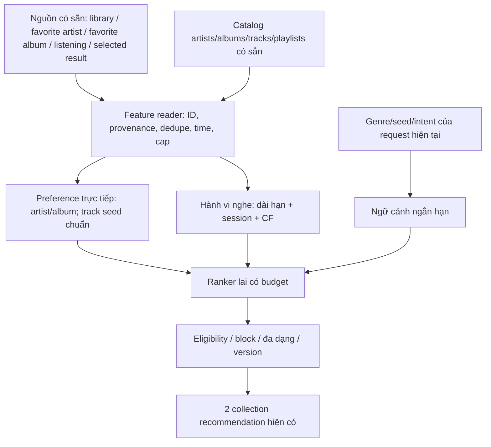

# Khảo sát lại tín hiệu hiện có và quyết định đưa vào hệ đề xuất

**Ngày:** 27/10/2026.  
**Phạm vi:** frontend hiện hành, Spring API/service/entity, metadata 27 bảng MySQL và 19 collection Mongo local; đọc dữ liệu tổng hợp ở các nguồn có liên quan.  
**Kết quả khảo sát ban đầu:** cần mở rộng thiết kế tín hiệu, nhưng phải sửa liên kết ID và phân biệt dữ liệu có producer thật với dữ liệu legacy. Đây là biên bản trước cải thiện; các mô tả "hiện tại/chưa triển khai" trong thân tài liệu nói về phiên bản tại thời điểm khảo sát.

**Kết quả thực hiện sau khảo sát:** [v1.1 đã triển khai](RECOMMENDATION_V1_1_IMPLEMENTATION.md) follow artist, favorite album, selected result ngắn hạn, dedupe library, namespace/owner validation, fingerprint refresh mix, worker freshness và canonical trend USER ACTIVE. Không đổi UI/schema và không sửa bulk dữ liệu legacy. `favorite_songs` vẫn là legacy chưa import; queue/repeat/download/client vibe chưa thành telemetry mới; genre chỉ được hỗ trợ qua API tùy chọn. Các trọng số, API, 66 backend tests + 15 Python tests + 31 tình huống tích hợp và giới hạn production được ghi trong tài liệu v1.1. Nhận định FOLLOW chưa ảnh hưởng điểm bên dưới chỉ còn ý nghĩa lịch sử.

## 1. Điều chỉnh nhận định của lần khảo sát trước

Lần khảo sát trước tập trung vào listening history, thư viện, playlist, audio features và pipeline recommendation mới. Phạm vi đó bỏ sót việc đối soát đầy đủ `favorite_songs`, `favorite_artists`, `favorite_albums`, search-result selection và một số thao tác client. Đó là thiếu sót trong khảo sát, không phải lý do để coi những nguồn này không có giá trị.

Nhận định “FOLLOW hiện chưa ảnh hưởng score” vẫn đúng theo mã hiện hành. Tuy nhiên cần bổ sung: **database đã có `favorite_artists` riêng**, và đó là nguồn quan hệ người dùng–nghệ sĩ cần đánh giá trước khi đưa ra thiết kế hoàn chỉnh. `artists.followers` là thuộc tính tổng của nghệ sĩ; `favorite_artists` là quan hệ từng user; feedback `FOLLOW` mới trong Mongo lại là nguồn thứ ba. Ba thứ này không đồng nghĩa và không tự đồng bộ.

Tài liệu này thay thế phần nhận định rằng tập tín hiệu đã được khảo sát đầy đủ trong các tài liệu trước. [Kiến trúc hiện hành](RECOMMENDATION_SYSTEM_ARCHITECTURE.md) vẫn mô tả mã đang chạy; mọi mở rộng dưới đây là **đề xuất sau khảo sát**, chưa có trong score hiện tại.

## 2. Cách khảo sát và giới hạn

Theo từng tín hiệu, lần lượt kiểm tra:

1. Có thao tác người dùng cụ thể nào trên client?
2. Thao tác gọi API/hàm nào?
3. API ghi vào bảng, collection hoặc chỉ state client nào?
4. Có dữ liệu thực sự trong local không? Tài khoản nào hợp lệ, có nối được ID không?
5. Recommender/worker hiện có đọc dữ liệu đó không?
6. Tín hiệu thể hiện sở thích, ý định tức thời, điều kiện quyền hay chỉ thống kê vận hành?

SQL dùng transaction READ ONLY; không xuất search keyword, nhãn cảm xúc, confidence, user ID hoặc target ID thô. Metadata các collection hạ tầng như cookie/proxy/fingerprint chỉ được nhận diện tên, không đọc giá trị để phân tích gu nghe. Mongo `users` chỉ kiểm tra field presence, không đọc password/email values.

Nguồn số liệu: [JSON inventory](recommendation-signal-inventory-20261027.json). Công cụ chạy lại: [audit_signals.py](../recommendation-worker/audit_signals.py). Audit là snapshot local, không xác nhận dữ liệu production hoặc chứng minh các rows legacy do người thật tạo. Việc không tìm thấy writer trong repo không loại trừ một client/hệ cũ bên ngoài repo; nó có nghĩa chưa đủ bằng chứng về producer hiện hành.

## 3. Những dữ liệu bị bỏ sót: số liệu kiểm chứng

| Nguồn | Tổng rows | Rows USER ACTIVE | Rows USER ACTIVE nối được đích | Reader recommendation hiện tại |
| --- | ---: | ---: | ---: | --- |
| `favorite_songs` | 5 | 2 | 1 | Chưa đọc |
| `favorite_artists` | 5 | 2 | 0 | Chưa đọc |
| `favorite_albums` | 5 | 2 | 0 | Chưa đọc |
| `user_library_tracks` | 6 | 3 | 2 | Có đọc; hiện chưa lọc ACTIVE riêng trong worker |

Cả ba bảng favorite đều có 3 rows USER và 2 rows CONTENT_LEAD; trong 3 rows USER có một row thuộc tài khoản không ACTIVE. Không được dùng tổng 5 như năm tín hiệu người nghe production hợp lệ.

Một cặp user–track nối được của `favorite_songs` **đã nằm trong** hai cặp nối được của `user_library_tracks`. Do đó union hai nguồn hiện không bổ sung cặp thích bài mới có thể dùng; cộng trọng số hai lần sẽ khuếch đại cùng một ý định.

Các đích `favorite_artists` không khớp `_id`/`spotify_id` trong 183 artist documents, cũng không khớp artist ID trên tracks. Các đích `favorite_albums` không khớp 128 Mongo albums hoặc MySQL albums. MySQL `albums` và `album_tracks` đang rỗng. Không được fuzzy-match theo tên hoặc tự nhận một ID cũ là một nghệ sĩ/album mới để tăng coverage.

Các nguồn bổ sung khác:

- `search_history`: 13 rows, trong đó 6 có selected target, 4 selection thuộc USER ACTIVE; chỉ một selection thuộc USER ACTIVE nối được catalog. Tách theo loại: ARTIST 0/2, TRACK 1/2, ALBUM 0/1, PLAYLIST 0/1 nối được.
- `platform_traffic_events`: 134 rows, tất cả target TRACK; 56 rows thuộc USER, không có row anonymous trong snapshot. Có 29 nhãn TIKTOK, nhưng chưa có chứng cứ đây là số liệu chart/trend TikTok.
- `offline_downloads`: 6 rows, mỗi trạng thái QUEUED/DOWNLOADING/DOWNLOADED/FAILED/EXPIRED/REMOVED có một row. Không có row DOWNLOADED thuộc USER ACTIVE trong snapshot.
- Mongo `artists`: 183; `albums`: 128; `genres`: 12; Mongo `users`: 1, khác namespace tài khoản SQL. Không có cầu nối ID tài khoản đủ rõ để ghép preference từ Mongo `users` vào principal SQL.

## 4. Ma trận nguồn → đường ghi → ý nghĩa → quyết định

| Tín hiệu | Producer/nơi lưu đã xác minh | Đã vào rank? | Đề xuất |
| --- | --- | --- | --- |
| Nghe có thời lượng | Player → analytics/session → `listening_history` | Có | Giữ, chuẩn hóa provenance/thời lượng |
| Tim bài hát trên player/menu/search | `addToLibrary` → UserLibraryApi → `user_library_tracks` | Có | Nguồn chuẩn cho thao tác tim hiện hành |
| `favorite_songs` | Admin đọc/xóa; có trong SQL dump, chưa thấy self-service writer hiện hành | Không | Đối soát/import hợp lệ một lần; không cộng song song mù quáng |
| Follow/yêu thích nghệ sĩ | Có `favorite_artists`; admin đọc/xóa; chưa tìm thấy UI/API self-service ghi bảng này | Không | Nên thành feature trực tiếp sau khi xác nhận semantics, ID và writer |
| `FOLLOW` feedback mới | Recommendation feedback API → Mongo FEEDBACK | Chỉ lưu | Chọn một nguồn chuẩn với artist relation; không duy trì hai bản sự thật |
| Yêu thích album | AlbumCard/AlbumDetail/Search/Library → AlbumApi → `favorite_albums` | Không | Nên đưa vào, nhưng resolver album đang là điểm chặn |
| Tự thêm bài vào playlist | PlaylistApi/PlaylistService → Mongo `playlists` | Có, schema canonical | Giữ, giảm đếm trùng và nhận diện copy hệ thống |
| Tạo album/đăng bài của CONTENT_LEAD | Album/content-management API | Không phải gu USER | Không dùng làm sở thích người nghe hoặc popularity |
| Chọn kết quả tìm kiếm | Search page → select-result API → `search_history.selected_target_*` | Không | Ngữ cảnh yếu, ngắn hạn, sau validate ID |
| Keyword tìm kiếm thô | Search history API | Không | Chưa đưa trực tiếp vào model gu; tránh tự diễn giải câu cảm xúc |
| Chọn V-POP/INDIE/EDM trên Home | URL `vibe`, state, event client, fetch genre catalog | Không truyền vào recommendation context hiện tại | Nên dùng làm ý định request/session, không mặc định sở thích lâu dài |
| COMPLETE/replay qua nhiều ngày | Player/session/events + listening history | Chỉ dùng thời lượng/tần suất một phần | Bổ sung completion/replay có giới hạn, phân biệt loop và lỗi |
| Next sớm | Player → SKIP_NEXT | Có tín hiệu giảm bài | Giữ, kiểm tra buffering, giới hạn skip theo gói và source |
| Pause/seek/previous | Player → playback events | Chưa suy thành preference riêng | Không gán negative/positive mặc định |
| Thêm hàng đợi | `addToQueue` cập nhật state/persist player ở client | Chưa có event server chuyên biệt | Chưa dùng như feature backend cho đến khi có telemetry đúng |
| Repeat/shuffle | State và playback persistence ở client | Không | Không coi bật repeat là thích tất cả bài; chỉ dùng lượt nghe quan sát được |
| Tải file | Download API kiểm tra gói rồi redirect audio | Không | Không đồng nhất redirect với download thành công; chưa dùng rows offline làm gu thật |
| Visit/referrer | Player → recordPlatformVisit → traffic table | Không | Đo funnel/nguồn; tránh đếm lại cùng PLAY |
| Artist followers/track popularity | Mongo metadata catalog | Không dùng trực tiếp làm gu | Chỉ cân nhắc prior/tie-break cold start có freshness, không thay quan hệ follow của user |
| Hour/device/source | Session metadata | Dùng source cho attribution, chưa học context đầy đủ | Phân tích cohort và lỗi trước; không áp stereotype genre theo thiết bị/giờ |
| Subscription/payment/revenue | SQL nghiệp vụ | Không dùng làm gu | Quyền/quota/đối soát; không ưu tiên nghệ sĩ trả nhiều tiền hoặc user mua gói cao hơn |
| Hide/not interested | Mongo FEEDBACK | Có | Điều kiện ưu tiên cao hơn mọi boost follow/album/campaign |
| License/moderation/visibility | Catalog/SQL license | Có | Hard filter; không biến thành bonus tính điểm |

## 5. Các đường ghi cụ thể và vấn đề phải giải quyết

### 5.1. Tim bài hát không ghi vào `favorite_songs`

`global-player.tsx`, `track-action-menu.tsx`, search và listening history gọi `addToLibrary`/`removeFromLibrary` từ frontend API client. Backend `UserLibraryService` ghi `user_library_tracks`, kiểm tra track tồn tại và idempotency cơ bản. Admin lại dùng `favorite_songs` cho nhiều thống kê yêu thích.

Hệ quả: “số yêu thích trên admin” và “bài người nghe đã tim” có thể dùng hai nguồn khác nhau. Thiết kế feature không được tự xem cả hai đều là hai lần bày tỏ sở thích.

**Quyết định đề xuất:** giữ `user_library_tracks` là nguồn chuẩn của nút tim hiện hành. `favorite_songs` là nguồn legacy cần xác minh và dedupe; preview import từng cặp canonical, không runtime union để một row cũ làm bài đã bỏ tim sống lại. Không thêm bảng/cột để giải quyết việc này.

### 5.2. Nghệ sĩ: ba khái niệm phải tách

1. `artists.followers`: con số tổng của metadata nghệ sĩ, không chỉ ra user hiện tại có theo dõi hay không.
2. `favorite_artists(user_id,artist_id)`: quan hệ cá nhân đã có trong database, nhưng hiện không nối được đích và chưa tìm thấy writer self-service trong repo.
3. Mongo FEEDBACK có `feedback_type=FOLLOW`: phản hồi mới đã lưu được, chưa được ranker/worker đọc và không invalidation mix ở nhánh hiện tại.

**Có nên đưa follow vào tính toán? Có.** Đây là lựa chọn trực tiếp của user và hữu ích khi thiếu history. Nhưng phải có nguồn đúng, không lấy con số tổng followers để thay cho follow cá nhân. Spotify cũng công khai việc “who you follow” có thể cung cấp tín hiệu về nội dung người dùng muốn theo dõi; điều đó hỗ trợ nguyên tắc chọn feature, không cung cấp trọng số cho Moodify. [Spotify recommendations](https://www.spotify.com/uk/safetyandprivacy/understanding-recommendations).

**Quyết định nguồn đề xuất:** ưu tiên tận dụng `favorite_artists` hiện có làm nguồn chuẩn nếu sản phẩm thống nhất favorite artist chính là follow. Mongo FOLLOW có thể là transport/cache/legacy chuyển tiếp, không trở thành một quan hệ cạnh tranh. Nếu hai thao tác “follow” và “yêu thích nghệ sĩ” có nghĩa khác nhau thì phải định nghĩa riêng trước, không tự đổi nghĩa dữ liệu.

Chưa có sự cho phép thêm/sửa giao diện nên không tự tạo nút follow. Tích hợp backend cần kiểm tra canonical artist ID, idempotency, đọc trạng thái hiện tại và remove khi unfollow; sau commit đánh dấu mix cần xem xét lại. Thay đổi mix vẫn giữ version để không đảo hàng đợi đang nghe.

### 5.3. Yêu thích album có writer, nhưng reader/resolver lệch

Frontend gọi `toggleFavoriteAlbum`; AlbumApi nhận album ID dạng string; AlbumService ghi `favorite_albums`. Tuy nhiên service đang ưu tiên namespace SQL, `getUserFavoriteAlbums` parse ID sang Long và đọc MySQL albums, trong khi catalog album thật hiện ở Mongo (128 album) và SQL albums rỗng. Thao tác toggle chưa xác nhận chắc album string thực sự tồn tại trước khi lưu.

Đây là điểm phải giải quyết trước khi dùng feature: xác định ID namespace SQL/Mongo/Spotify, kiểm tra album tồn tại và mapping track. Không thể chỉ SELECT bảng favorite rồi coi mọi track trong album là bài user đã thích.

### 5.4. Search selection có giá trị hơn việc chỉ đọc keyword

Search page ghi selected TRACK khi người dùng bấm phát, selected ARTIST khi bấm mở artist. API hỗ trợ thêm ALBUM/PLAYLIST, nhưng chưa thấy cùng đường gọi cho mọi loại ở frontend đã kiểm tra. Mỗi history row chỉ giữ target được chọn gần nhất; không phải chuỗi click đầy đủ, và không có timestamp selection riêng.

Với TRACK selection đã dẫn tới PLAY, hai bản ghi cùng ý định không nên được cộng như hai bằng chứng độc lập. Với ARTIST selection chỉ mở trang, nên tăng ưu tiên ứng viên ngắn hạn nhẹ hơn follow hoặc lượt nghe thực tế.

Không đọc `detected_emotion`, `emotion_confidence`, kết quả classifier hoặc raw câu tìm kiếm cảm xúc để suy gu. Một track được chọn rồi thực sự nghe từ luồng đó vẫn là listening signal bình thường.

### 5.5. Genre đang chọn trên Home là ý định chưa được nối

Home đã có `activeVibe`, URL `?vibe=...` và map VIBE_TO_GENRES để fetch catalog theo genre. RecommendationSections hiện không nhận context đó và Home recommendation API chưa có hợp đồng filter tương ứng.

Nên cho recommender biết **request hiện tại đang chọn genre gì**, ưu tiên/giới hạn theo intent của màn hình nếu sản phẩm muốn đồng nhất. Không ghi một lần chọn EDM thành sở thích vĩnh viễn; không coi chữ “vibe” trong UI là dữ liệu model cảm xúc. Việc truyền context không yêu cầu đổi bố cục, nhưng vẫn là thay đổi chức năng cần triển khai riêng.

### 5.6. Các thao tác có trên client chưa chắc là feature server

`addToQueue`, repeat, shuffle và playback state có trên client; hiện không có event server phân biệt “thêm chờ thủ công” với queue do hệ tạo. Biết có một bài trong queue không chứng minh user chủ động thích nó. Có thể dùng hành vi nghe sau đó; chưa thể cộng điểm chỉ vì client đã chứa bài.

Tương tự, download API trả redirect sau kiểm tra gói, không ghi trạng thái hoàn tất vào `offline_downloads`. Sáu rows offline không chứng minh producer hiện tại đang ghi download thật. Cần xác minh/sửa telemetry trước khi dùng; DOWNLOAD_FAILED không phải negative với bài hát.

### 5.7. Traffic/referrer không phải chart ngoài

Player hiện gọi recordPlatformVisit ở bước PLAY với target TRACK, referrer DIRECT và không truyền session ID ở call site đó. Đây không phải một phép đo độc lập người dùng ghé trang nghệ sĩ. Snapshot cũng không có traffic target ARTIST.

29 rows nhãn TIKTOK không đủ để kết luận bài đang trend TikTok. Nguồn có thể là dữ liệu legacy; referrer là nguồn truy cập được ghi, không phải tốc độ tăng quan tâm trên nền tảng ngoài. Không gắn nhãn “bắt trend” dựa trên một enum.

### 5.8. Không lấy mọi con số dashboard làm dữ liệu học

`ContentLeadAnalyticsService` có nhánh đọc traffic thật và nhánh fallback `generateConsistentAudienceResponse` tính một số giá trị từ hằng số theo period/số track. Vì vậy chỉ đọc bảng fact có provenance, không lấy mọi metric trả về từ màn dashboard làm nhãn người nghe thật.

Hàm seedTrafficData hiện được tắt, nhưng có dữ liệu trong SQL dump không đủ chứng minh dữ liệu local hiện tại hoàn toàn tự nhiên. Cần ghi provenance trước khi dùng thống kê legacy cho đánh giá chất lượng.

## 6. Nên đưa gì vào bộ tính toán

### 6.1. Nhóm nên ưu tiên

**A. Sở thích trực tiếp, lâu dài**

- Track đang nằm trong thư viện chuẩn: giữ.
- Artist follow/favorite đã xác minh: thêm feature cá nhân trực tiếp.
- Album favorite đã xác minh: thêm feature theo album, giới hạn ảnh hưởng.
- Playlist user tự biên soạn: giữ, phân biệt bản copy và nội dung do hệ tự tạo.

Các trạng thái explicit còn tồn tại có thể được giữ như preference ổn định; không cần giả sử mỗi ngày user phải follow lại. Unfollow/bỏ thích xóa bonus tương ứng; **không biến thành dislike**. Hide artist/track luôn thắng boost explicit.

**B. Hành vi nghe đã quan sát**

Giữ thời lượng hợp lệ, thêm tỷ lệ hoàn thành và replay qua ngày/session khi có provenance; chặn spam/loop. Cùng một phiên chỉ là một đơn vị hành vi, không cộng heartbeat như lượt nghe mới. COMPLETE event cần đối chiếu thời lượng/audio; pause/seek/previous không có dấu dương/âm cố định.

**C. Ý định ngắn hạn**

Genre đang chọn, một bài seed, playlist đang nghe và selected result mới có thể điều chỉnh request/session. Tác động ngắn hơn follow/save, không tự nhập vào gu dài hạn. Nếu thiếu selection timestamp thì phải hạ độ tin cậy hoặc dựa lượt PLAY có thời gian rõ.

### 6.2. Chỉ nên dùng làm điều kiện hoặc đo lường

License, moderation, visibility, ownership, trạng thái tài khoản và block là điều kiện. Impression/open/visit giúp đo exposure và funnel, không tự thành thích. Device/referrer giúp phân tích chất lượng/phân phối, không là chỉ dẫn “Android thích thể loại X”. Gói thuê bao giải thích hạn mức skip/offline và entitlement; không dùng tiền trả hoặc doanh thu nghệ sĩ làm gu nhạc.

Dữ liệu implicit có thiên lệch vị trí/exposure; không được cộng mọi click như cùng một mức sở thích. [Google Research về propensity và implicit-feedback bias](https://research.google/pubs/attribute-based-propensity-for-unbiased-learning-in-recommender-systems-algorithm-and-case-studies/).

### 6.3. Chưa nên dùng lúc này

Raw nội dung tìm kiếm cảm xúc, nhãn/confidence model cảm xúc; download chưa xác minh; thao tác queue/repeat chỉ ở client; account fingerprint/cookie/proxy; thống kê fallback dashboard; followers/popularity ngoài không có freshness; giới tính/tuổi/vị trí không có nguồn preference được xác minh. Không thu thêm PII chỉ để làm mô hình có nhiều feature hơn.

## 7. Cách ghép tín hiệu: không biến thành một phép cộng tùy ý

### 7.1. Chuẩn hóa một quan sát logic

Feature reader nên trả về đối tượng logic, không tạo bảng mới:

```text
actor: canonical user ID đã xác thực
target: canonical entity type + ID + namespace
signal: SAVED_TRACK / FOLLOWED_ARTIST / FAVORITE_ALBUM / LISTEN / SELECTED_RESULT ...
source: bảng/API và provenance
time: event time hoặc trạng thái hiện tại; không tự tạo timestamp selection bị thiếu
strength/confidence: phân biệt độ mạnh ý định và độ tin cậy dữ liệu
logical_key: phục vụ dedupe cùng hành vi qua nhiều nguồn
```

Một bài tim qua UI và có row favorite legacy tương ứng là một saved-track fact. Một lần bấm play trong search có selection, visit và session là một hành vi với nhiều dấu vết, không ba lượt thích. Ràng buộc contribution cap theo ngày/session/source cần thống nhất online và worker.

### 7.2. Theo dõi nghệ sĩ ảnh hưởng thế nào

Giữ follow là feature `is_following_artist(user,artist)`, không sinh hàng “user đã nghe/thích mọi bài của artist” cho ALS. Một track của artist được theo dõi có thể nhận prior trực tiếp sau eligibility; track mới có thể vào candidate pool dù chưa có history.

Không cho một nghệ sĩ có 200 bài chiếm 200 lần sức mạnh của một artist có 5 bài; cap số candidate/nghệ sĩ và budget exposure. Không chuyển tất cả genre của artist thành sở thích chắc chắn của user. Artist HIDE thì loại toàn bộ bài ngay cả khi follow còn tồn tại do nguồn chưa đồng bộ.

### 7.3. Yêu thích album ảnh hưởng thế nào

Giữ feature membership của track trong album được yêu thích hoặc mở nguồn candidate album có giới hạn. Tổng ảnh hưởng của một album có budget, không cộng một save weight đầy đủ cho từng track để album dài thắng tự động. Điều này cũng tránh tạo nhiều label dương không có quan sát thật khi train ALS.

### 7.4. Phân biệt seed, prior và context

```text
candidate_pool = nội dung đủ quyền từ:
  gu qua listening/saved tracks
  nghệ sĩ đang follow
  album đang favorite
  intent của request/session
  trend/biên tập có hiệu lực

score_mục_tiêu = combine(
  content affinity + consumption-based CF,
  explicit artist/album prior,
  current request/session intent,
  trend/campaign trong budget
)

slate = loại block/không đủ quyền + đa dạng + chống lặp + trần nghệ sĩ/nguồn
```

Đây là thiết kế mục tiêu, không phải công thức đang phục vụ. Chưa có bằng chứng để chốt follow bằng 10% hay album bằng 5%. Cần ablation chỉ thêm artist, chỉ thêm album, thêm selection rồi đo theo user/cohort. Track save đã ảnh hưởng seed hiện tại; không lặp lại cùng hành động ở một bonus mới mà không chủ động kiểm soát tương quan.

Người mới follow vài artist có thể có prior cá nhân ngay mà không cần bịa history để vượt gate ALS. Người có dữ liệu dày vẫn giữ lịch sử như nền; follow không vượt filter và không xóa quyền khám phá nội dung khác.

## 8. Kiến trúc mở rộng không thêm bảng/cột MySQL hoặc collection



Các nguồn SQL đã có được đọc; không mở lại bảng aggregate đã dọn. Hồ sơ/cache bổ sung nếu cần vẫn nằm trong `recommendation_state`; trace/mục thử nghiệm trong `recommendation_events`. Không dùng hai collection đó để sao chép lại toàn bộ raw history.

Follow/unfollow/favorite đổi trạng thái phải có đường invalidation sau mutation thành công. Home có thể tính lại theo request mới; mix tạo version mới ở thời điểm thích hợp; queue đang nghe không bị đảo thứ tự. Worker dùng cùng canonical mapping và biết reset/deletion để tránh học lại một trạng thái đã bỏ.

## 9. Thứ tự thực hiện được đề xuất

| Thứ tự | Việc cần làm | Vì sao |
| --- | --- | --- |
| 1 | Đối soát ID/provenance favorite, nguồn chuẩn của tim, namespace album/artist | Thêm source rỗng mapping không tạo được tín hiệu đúng |
| 2 | Sửa bộ lọc account, worker freshness và các P0 production đã nêu | Tránh học staff/banned/snapshot cũ |
| 3 | Nối artist follow và album favorite có chuẩn đọc/ghi, dedupe, invalidation | Bổ sung explicit intent quan trọng bị bỏ sót |
| 4 | Truyền request genre/seed và search selection có thời gian hợp lệ | Tôn trọng thao tác chủ động hiện tại |
| 5 | Completion/replay/negative có chất lượng, chống duplicate/loop | Tăng độ tin cậy hơn là chỉ tăng số event |
| 6 | Instrument queue/download nếu sản phẩm cần | Hiện chưa có event đủ rõ; chưa dùng như đã quan sát |
| 7 | Ablation/offline theo thời gian, pilot và A/B khi đủ người | Xác minh ích lợi thật trước khi chốt trọng số |

Mọi thay đổi UI hoặc dữ liệu legacy là công việc riêng cần chủ dự án chấp thuận; tài liệu này không tự cấp quyền public hóa playlist, đổi ID hoặc tạo nút follow.

## 10. Các test có ý nghĩa cho đợt tích hợp sau

- Follow một artist làm thay đổi thứ hạng trong những candidate đủ quyền; unfollow bỏ prior, không tự block; HIDE thắng follow.
- Cùng một saved track có ở library/favorite legacy chỉ tạo một fact; bỏ tim không bị dữ liệu legacy làm sống lại.
- Album 100 bài không nhận 100 lần budget của album nhỏ; không sinh fake played/save labels cho ALS.
- ID artist/album không nối được phải được bỏ qua có metric; không tự fuzzy-match.
- Selected track đã phát không được tính như hai lượt dương; selection chỉ mở artist có TTL ngữ cảnh ngắn.
- Genre đang chọn có hiệu lực đúng request; không ghi thành gu lâu dài sau một click.
- Download redirect/lỗi tải, bật repeat, pause/seek không tự trở thành save/dislike.
- Row staff/BANNED, data seed chưa xác minh và metric fallback không vào tập đánh giá người nghe thật.
- Dữ liệu mới được cả online reader và worker đọc nhất quán; follow/favorite mutation làm mới projection/mix mà không xáo queue hiện hành.

## 11. Bằng chứng mã nguồn

- Backend: [UserLibraryService](../src/main/java/com/laphuth/moodify/services/UserLibraryService.java), [AlbumService](../src/main/java/com/laphuth/moodify/services/AlbumService.java), [SearchHistoryService](../src/main/java/com/laphuth/moodify/services/SearchHistoryService.java), [AdminService](../src/main/java/com/laphuth/moodify/services/AdminService.java), [PlatformTrafficService](../src/main/java/com/laphuth/moodify/services/PlatformTrafficService.java), [SubscriptionApi](../src/main/java/com/laphuth/moodify/api/SubscriptionApi.java), [ContentLeadAnalyticsService](../src/main/java/com/laphuth/moodify/services/ContentLeadAnalyticsService.java).
- Frontend: [API client](../../Moodify/lib/api-client.ts), [global player](../../Moodify/components/dashboard/global-player.tsx), [track action menu](../../Moodify/components/dashboard/track-action-menu.tsx), [search page](../../Moodify/app/dashboard/search/page.tsx), [album detail](../../Moodify/components/dashboard/album-detail-modal.tsx), [player context](../../Moodify/components/dashboard/player-context.tsx), [Home genre context](../../Moodify/components/dashboard/lumen-hero.tsx).
- Hiện trạng recommender: [context](../src/main/java/com/laphuth/moodify/recommendation/RecommendationContextService.java), [store](../src/main/java/com/laphuth/moodify/recommendation/RecommendationStore.java), [engine](../src/main/java/com/laphuth/moodify/recommendation/RecommendationEngine.java), [worker](../recommendation-worker/worker.py).

## 12. Kết luận khảo sát

Nên bổ sung explicit artist/album và intent ngắn hạn, không chỉ tiếp tục nghe/lưu bài. Nhưng điều kiện triển khai là ID đúng, producer rõ, trạng thái đọc/ghi thống nhất, dedupe và đo hiệu quả. Dataset hiện tại cho thấy các nguồn favorite đã tồn tại nhưng phần lớn chưa nối được; thêm chúng vào công thức ngay sẽ tạo một tính năng có vẻ đầy đủ trên giấy mà chưa có tín hiệu đáng tin khi chạy.

Không cần thêm database để sửa thiếu sót này. Cần dùng đúng dữ liệu đang có, sửa những liên kết thiếu và bổ sung có kiểm soát vào ranker hiện hành.
