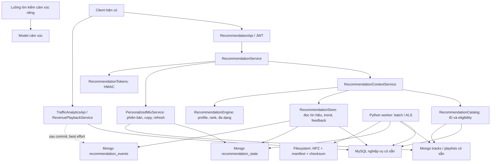
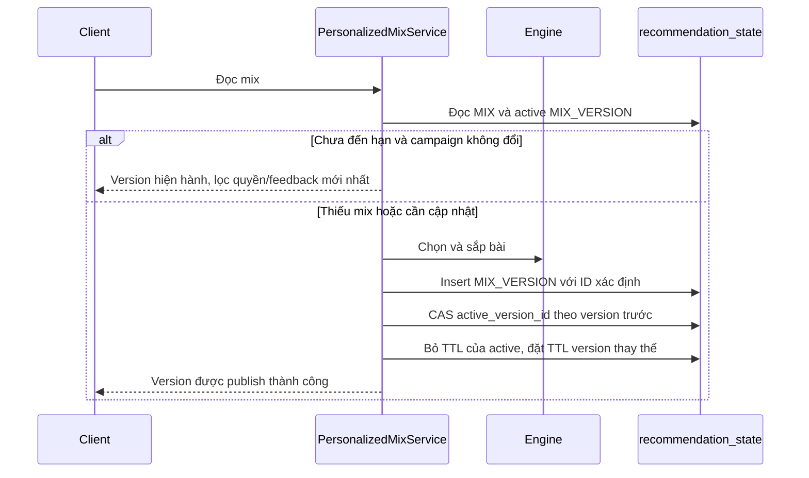
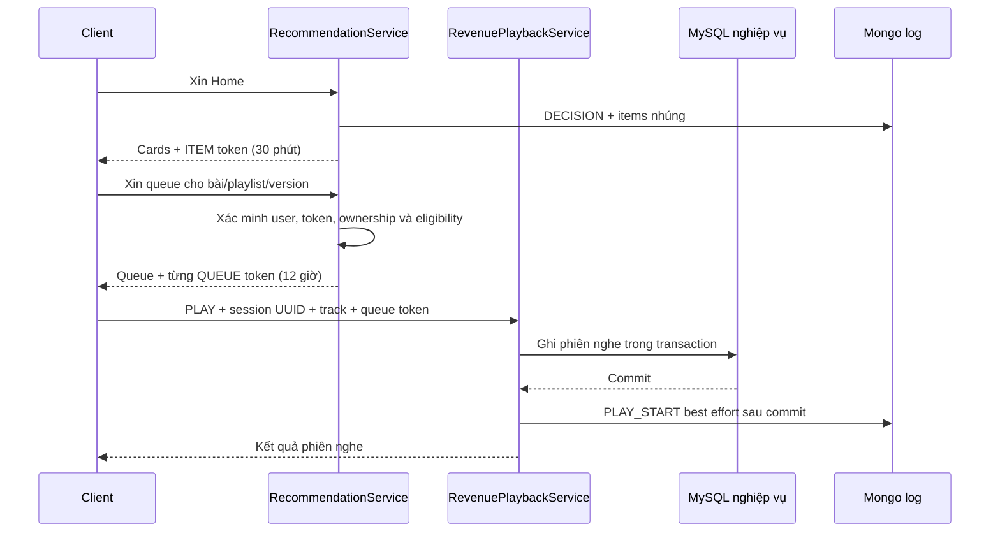

# Hệ đề xuất Moodify: cách hoạt động và kiến trúc hiện hành

**Phiên bản tài liệu:** 1.2 — 29/10/2026.  
**Phạm vi:** mã hiện có sau khi thu gọn và dọn persistence cũ.  
**Tài liệu đi cùng:** [đánh giá dữ liệu và chiến lược production](RECOMMENDATION_PRODUCTION_REVIEW.md), [audit dữ liệu](recommendation-data-audit-20261027.json), [vận hành hiện hành](RECOMMENDATION_IMPLEMENTATION.md).

**Cập nhật v1.2:** [runbook hiện hành](RECOMMENDATION_V1_2_OPERATIONS.md) mô tả outcome async sau commit, hàng đợi/circuit/deadline, targeted heartbeat và controls/metrics/preview ADMIN theo process. [Audit 29/10](recommendation-data-audit-v1.2-20261029.json) vẫn có 0 bài đủ policy. Các phần hành vi/thuật toán v1.1 bên dưới giữ nguyên.

**Cập nhật sau khảo sát nguồn:** [chi tiết triển khai v1.1](RECOMMENDATION_V1_1_IMPLEMENTATION.md) bổ sung follow artist, favorite album, selected result, resolver SQL/Mongo, fingerprint mix, worker snapshot, canonical trend và owner ID. Phần nền bên dưới được giữ và cập nhật những điểm thay đổi; công thức/API mới và các giới hạn chi tiết nằm trong tài liệu v1.1. [Khảo sát nguồn](RECOMMENDATION_SIGNAL_REASSESSMENT.md) là biên bản trước cải thiện, không còn là trạng thái serving hiện tại. [Audit mới](recommendation-data-audit-v1.1-20261027.json) vẫn có 0 bài đủ policy.

## 1. Kết luận về chức năng hiện tại

Moodify có hệ đề xuất lai ở cấp backend: thuật toán dựa trên nội dung và hành vi gần đây là nền; điểm collaborative từ implicit ALS là thành phần tùy điều kiện; xu hướng nội bộ và chiến dịch theo lịch bổ sung tính thời điểm. Hệ trả đề xuất bài hát, xếp hạng playlist công khai, tạo bản phối cá nhân và đề xuất nội dung tiếp nối.

Kiến trúc dùng **MySQL nghiệp vụ có sẵn + đúng hai collection Mongo mới + artifact model trên filesystem**. Tám bảng MySQL và bốn collection của phương án trước đã được dọn; không phải điều kiện chạy của bản này.

**Model cảm xúc chỉ phục vụ tìm kiếm và nằm ngoài pipeline đề xuất.** Nếu người dùng tìm bằng cảm xúc rồi thực sự nghe một bài, lượt nghe đó vẫn có thể là hành vi nghe thông thường. Hệ không lấy nhãn cảm xúc, confidence hoặc điểm của model tìm kiếm làm hồ sơ sở thích.

Tài liệu dùng ba cách đánh dấu:

- **Đã có:** đối chiếu được trong mã hiện hành.
- **Giới hạn:** khác biệt hoặc thiếu sót hiện tại, không được hiểu là đã giải quyết.
- **Đề xuất production:** phương án cần triển khai/đo thêm, không phải tính năng đang chạy.

Việc các API đã vượt qua kiểm thử chức năng không đồng nghĩa thuật toán đã được chứng minh cải thiện trải nghiệm. Audit local hiện có 0 bài đủ policy phục vụ và dữ liệu tương tác quá ít để đánh giá ML.

## 2. Các sản phẩm đầu ra

| Đầu ra | Đã có | Ý nghĩa |
| --- | --- | --- |
| Dành cho bạn | Xếp hạng từng track | Nội dung gần sở thích và phiên nghe |
| Playlist hợp gu | Xếp hạng playlist công khai | Chọn tuyển tập có sẵn; không sửa thứ tự của chủ sở hữu |
| Bản phối hôm nay | Playlist riêng do hệ tạo | Kết hợp phù hợp, khám phá và nội dung theo thời điểm |
| Khám phá tuần này | Playlist riêng do hệ tạo | Ưu tiên bài chưa có trong tín hiệu quan tâm; giảm lặp bản trước |
| Xu hướng hợp gu | Playlist riêng có điều kiện | Chỉ xuất hiện khi có ứng viên được phân loại là trend |
| Gợi ý nghe tiếp | Track từ một bài/playlist làm seed | Trả đề xuất; không tự thêm vào playlist người dùng |
| Tuyển chọn theo đợt | Track/playlist trong campaign | Có thời hạn, ưu tiên và bộ lọc thể loại nội dung |

Weekly Discovery không có nghĩa là “nhạc mới phát hành tuần này”. Hiện thuật toán dùng mức mới với người nghe; ngày phát hành không tham gia score.

## 3. Kiến trúc thành phần



Không có Python inference service trong request path. Java nhận điểm CF đã được worker xuất sang hồ sơ Mongo. Một HTTP request không train ALS, không đọc toàn bộ file factor và không gọi model cảm xúc.

### 3.1. Trách nhiệm các lớp

| Mã | Trách nhiệm |
| --- | --- |
| [RecommendationApi](../src/main/java/com/laphuth/moodify/recommendation/RecommendationApi.java) | Endpoint, validation, principal; security rule hiện có bảo vệ admin |
| [RecommendationCatalog](../src/main/java/com/laphuth/moodify/recommendation/RecommendationCatalog.java) | Catalog, chuẩn hóa ID, giấy phép, playlist có quyền truy cập |
| [RecommendationStore](../src/main/java/com/laphuth/moodify/recommendation/RecommendationStore.java) | Đọc MySQL; state/log Mongo; campaign; không ghi bảng SQL recommendation |
| [RecommendationContextService](../src/main/java/com/laphuth/moodify/recommendation/RecommendationContextService.java) | Ghép dữ liệu thành ngữ cảnh tại thời điểm yêu cầu |
| [RecommendationEngine](../src/main/java/com/laphuth/moodify/recommendation/RecommendationEngine.java) | Hàm chấm điểm và chọn/sắp bài theo quy tắc |
| [PersonalizedMixService](../src/main/java/com/laphuth/moodify/recommendation/PersonalizedMixService.java) | ID ổn định, snapshot, publish CAS, lịch, copy riêng |
| [RecommendationPersistence](../src/main/java/com/laphuth/moodify/recommendation/RecommendationPersistence.java) | Khởi tạo sáu index ở hai collection Mongo |
| [RecommendationTokens](../src/main/java/com/laphuth/moodify/recommendation/RecommendationTokens.java) | Ký/xác minh context đề xuất và hàng đợi |
| [worker.py](../supporting-services/recommendation-worker/worker.py) | Extract, aggregate RAM, đánh giá/fit ALS, artifact và projection |

## 4. Nguồn dữ liệu và ý nghĩa

| Nguồn | Trường/tín hiệu được dùng | Không được suy diễn |
| --- | --- | --- |
| `listening_history` | User, track, thời gian bắt đầu, thời lượng, source | Mỗi hàng không chắc là một phiên nghe đã xác minh bằng audio thật |
| `playback_events` | Có `SKIP_NEXT` trong phiên | Skip có thể do lỗi phát hoặc đổi nhu cầu; không chắc ghét nghệ sĩ/thể loại |
| `user_library_tracks` | Bài lưu và thời gian lưu | Có lưu không có nghĩa thích toàn bộ playlist chứa bài |
| `revenue_playback_sessions` | Nhận diện phiên mới ghi UTC và pipeline phát hiện hành | Qualified stream không phải nhãn tối ưu hóa bắt buộc của recommender |
| `users` | ID, role, status; worker/trend chỉ dùng USER ACTIVE | USER ACTIVE không chứng minh tài khoản là người nghe production thật |
| `favorite_artists`, `favorite_albums` | Preference trực tiếp sau resolve ID/owner; prior giới hạn | Không sinh played/save giả cho từng track để train ALS |
| `search_history` selected target | Context TRACK/ARTIST hai giờ, decay và dedupe actual play | Không dùng keyword/nhãn/confidence cảm xúc làm gu |
| Mongo `tracks` | Genre, artist ID, năm feature audio, trạng thái, audio path | Có đường dẫn chưa chứng minh file phát được; có feature chưa chứng minh extractor chính xác |
| Mongo `playlists` | `owner_user_id`, fallback username/email, `is_public`, `track_spotify_ids` | Playlist legacy thiếu quyền/visibility không tự được hiểu là công khai |
| `song_licenses` | Track ID, status, ngày hiệu lực | Không tự tạo/quy đổi giấy phép để tăng số candidate |
| Hai collection recommendation | Phản hồi, projection, phiên bản, campaign, log | Impression/open hiện không tự biến thành “thích bài” cho ALS |

## 5. Cửa kiểm soát nội dung trước khi xếp hạng

### 5.1. Canonical ID

Canonical key của recommender là Mongo track `_id`. Spotify ID là alias để nối dữ liệu legacy. Resolver ưu tiên ID nội bộ; alias mơ hồ không được dùng như một liên kết chắc chắn. Java loại alias xung đột; worker dừng nếu phát hiện xung đột thay vì train trên mapping sai.

License có thể tham chiếu ID nội bộ hoặc alias. License gắn trực tiếp ID nội bộ được ưu tiên hơn alias; trong cùng key tham chiếu, bản ghi có ID lớn hơn được chọn. Chính sách này ngăn một license alias ACTIVE ghi đè một quyết định canonical đã thu hồi. Nó không thay cho quy trình quản trị nhiều hợp đồng cùng bài nếu nghiệp vụ cần trường hợp đó.

**Cập nhật v1.1:** Java trend hợp nhất alias rồi distinct listener; một người nghe cùng track qua hai ID chỉ được tính một lần. Worker ưu tiên canonical ID bất kể thứ tự document và vẫn từ chối external alias mơ hồ. Mapping/version replay xuyên SQL/Mongo chưa thành snapshot phân tán đầy đủ.

### 5.2. Eligibility mặc định

Một track chỉ vào tập candidate nếu đồng thời:

1. Có ID nội bộ.
2. `status = published`.
3. `visibility = public`.
4. `moderation_status = approved`.
5. `local_path` không rỗng.
6. Có license ACTIVE, đã đến ngày bắt đầu và chưa hết hạn, tính ngày theo `Asia/Ho_Chi_Minh`.

So sánh status không phân biệt hoa/thường. Thiếu dữ liệu không được ngầm hiểu là đã duyệt/xuất bản. Flag `recommendations.require-active-license=false` bỏ yêu cầu phải có license, nhưng không làm một license đã có mà không hợp lệ trở thành hợp lệ; mặc định là true.

**Giới hạn:** eligibility kiểm tra metadata audio path, không HEAD/đọc file audio; không khẳng định file tồn tại hoặc CDN trả Range đúng. Worker huấn luyện hiện chưa lọc cùng tập eligibility: serving vẫn chặn bài không hợp lệ, nhưng đánh giá offline chưa đại diện tập bài thực tế có thể phục vụ.

## 6. Hồ sơ sở thích được tạo thế nào

### 6.1. Tín hiệu nghe trực tuyến

Backend đọc tối đa 3.000 hàng lịch sử gần nhất trong cửa sổ truy vấn khoảng 181 ngày. Hàng không thuộc nhánh revenue hiện hành được chuẩn hóa từ thời gian legacy; hàng có revenue session được coi là UTC.

Với thời lượng `d` mili giây và tuổi `a` ngày:

```text
early_skip = có SKIP_NEXT và d < 15.000
strength   = -0,35                  nếu early_skip
             min(2, d / 30.000)     nếu không
listen_weight = strength × 0,5^(a / 45)
```

Hàng nghe dưới 5 giây bị bỏ, trừ early skip. Thời lượng càng lớn chỉ tăng weight đến giới hạn của một lượt. Các hàng lặp vẫn có thể cộng dồn; cuối cùng tổng weight một user–track được chặn trong `[-2, 10]`.

Một lần nghe 60 giây gần hiện tại cho weight khoảng 2; sau 45 ngày còn khoảng 1. Đây là ví dụ tính toán theo quy tắc hiện tại, không phải xác suất người dùng thích bài.

### 6.2. Tín hiệu lưu và playlist riêng

- Bài trong thư viện: cộng weight 4.
- Bài trong playlist do user tự tạo: cộng weight 2 cho mỗi playlist chứa nó.
- Playlist là bản sao từ mix hệ thống bị loại khỏi nguồn “playlist người dùng” để tránh vòng lặp tự xác nhận.
- Weight thư viện và playlist hiện không áp cùng hàm giảm theo tuổi như lượt nghe.

Backend chưa có chuẩn giới hạn đóng góp theo ngày giống worker; chặn tổng weight giúp giảm nhưng không loại hoàn toàn khác biệt online/offline.

### 6.3. Ngữ cảnh phiên nghe

Lấy tối đa 10 bài khác nhau có tín hiệu nghe dương, không phải save/early skip, trong hai giờ gần nhất. Điểm phiên là trung bình similarity của candidate với nhóm bài này. Đây là cửa sổ thời gian đơn giản, chưa phải session model học chuỗi; không dùng giờ/thiết bị/địa lý như feature riêng dù có một số trường được ghi nhận.

### 6.4. Đa gu

Chọn tối đa 30 bài có weight dương cao nhất làm các seed. Với mỗi candidate, dùng trung bình ba seed phù hợp nhất sau khi xét độ mạnh của weight. Không ép mọi bài người dùng thích thành một vector trung bình duy nhất, giúp giữ các nhóm gu khác nhau.

```text
seed_match = similarity(candidate, seed) × (0,5 + 0,5 × min(1, seed_weight/4))
affinity = trung bình tối đa 3 seed_match cao nhất
```

Nếu những bài trong lịch sử không thuộc catalog đủ điều kiện, chúng không thành seed hiện hành. Vì thế “có lịch sử” chưa chắc đồng nghĩa online ranker có hồ sơ dương.

## 7. So sánh hai bài bằng feature

```text
similarity = 0,35 × genre_similarity
           + 0,25 × same_artist
           + 0,40 × audio_similarity
```

- Genre: Jaccard trên tập nhãn đã bỏ dấu, lowercase và bỏ ký tự phân cách; `vpop`/`vietnamesepop` được gộp sang `pop`.
- Nghệ sĩ: cùng artist Spotify ID không rỗng thì bằng 1; ngược lại bằng 0.
- Audio: energy, valence, danceability, acousticness, BPM. Bốn feature đầu phải hữu hạn trong `[0,1]`; BPM phải dương.

Với `k` feature có thể so sánh, sai khác được chặn tối đa 1; BPM chia sai khác cho 120, feature khác chia cho 1:

```text
audio_similarity = (1 - sqrt(mean(delta²))) × k / 5
```

Thiếu feature làm giảm độ tin cậy thay vì tự gán giá trị 0,5. Hai bài cùng ID có similarity bằng 1. Key signature và nhãn mood không được dùng trong công thức này.

**Giới hạn:** các hệ số và scale BPM là heuristic. Genre taxonomy còn thô, đặc biệt gộp V-Pop vào pop; valence là feature bài hát, không phải cảm xúc người nghe. Feature coverage dùng trong cold start hiện chỉ đếm giá trị hữu hạn, chưa kiểm tra miền số chặt như `audioSimilarity`.

## 8. Công thức xếp hạng hiện hành

### 8.1. Người có seed dương

```text
score = 0,52 × affinity
      + 0,18 × collaborative
      + 0,15 × session
      + 0,08 × trend
      + 0,07 × campaign
```

`affinity` là mức hợp với nhóm seed. `collaborative` là điểm ALS chuẩn hóa trong `[0,1]` nếu projection còn hạn. Chưa có projection thì điểm CF bằng 0; các hệ số còn lại hiện không được tự chuẩn hóa lại.

Candidate có tổng weight âm bị trừ 0,15; bài vừa có trong nhóm phiên bị trừ 0,1. Hide/not interested loại nội dung trước khi xếp hạng, không chỉ trừ điểm.

### 8.2. Không có seed dương

```text
score = 0,45 × popularity_24h
      + 0,25 × feature_coverage
      + 0,20 × trend
      + 0,10 × campaign

popularity_24h = min(1, log(1 + recent_unique_listeners) / log(51))
```

Không sử dụng trực tiếp trường Mongo `popularity` 0–100. Nếu không có activity/trend/campaign, độ phủ feature quyết định phần lớn thứ tự và tie được giải bằng ID; chưa có chiến lược exploration ngẫu nhiên để tránh cùng một nhóm bài luôn lên đầu.

Các hệ số trên là quy tắc cấu hình trong mã, **không phải kết quả tối ưu từ dữ liệu Moodify hoặc thông số của Spotify**.

**Bổ sung v1.1 vào cả hai nhánh điểm nền:** `+0.12 × followed_artist +0.08 × album_prior +0.04 × max(track_intent,artist_intent)`. Album prior chia `1/n` theo thành viên canonical, lấy max qua các album; selected result có half-life một giờ và tối đa hai giờ. Chi tiết nguồn, dedupe, namespace và giới hạn ở [v1.1](RECOMMENDATION_V1_1_IMPLEMENTATION.md). Không hiểu các hệ số này thành xác suất/phần trăm.

### 8.3. Nhãn lý do

Mỗi bài được gán một nguồn chính theo thứ tự: campaign → trend vượt ngưỡng → followed artist → favorite album → search intent → collaborative mạnh hơn affinity → content/catalog. Nhãn giúp giải thích đơn giản, nhưng chưa phải phân rã đóng góp đầy đủ. Một bài hợp gu và đang trend có thể được gán CAMPAIGN khi thuộc chiến dịch. Vì vậy log nhãn không đủ để làm ablation các nguồn.

## 9. Trend theo thời gian

Hai cửa sổ bằng nhau: `[now−24h, now]` và `[now−48h, now−24h)`. Chỉ tính USER ACTIVE; người nghe một bài ít nhất 30 giây mới đóng góp vào số unique listener của bài. Distinct user được tính sau canonicalization. Tổng người hoạt động của cửa sổ dùng lịch sử hoạt động trong cửa sổ, không bắt buộc tất cả đều nghe đủ 30 giây.

Gọi `r`, `p` là unique listener của bài, `A_r`, `A_p` là người hoạt động:

```text
trend = 0                                        nếu r < 3 hoặc A_r <= 0 hoặc A_p <= 0
growth = log( ((r+2)/(A_r+10)) / ((p+2)/(A_p+10)) )
trend = clamp(growth/2, 0, 1) × r/(r+5)           các trường hợp khác
```

Đếm theo người làm giảm hiệu ứng một tài khoản replay nhiều lần; smoothing giảm dao động mẫu nhỏ. Tuy nhiên ngưỡng 3 chỉ là hàng rào heuristic, chưa chứng minh trend đáng tin ở production. Ba tài khoản phối hợp vẫn có thể tác động. Hệ chưa có nguồn chart ngoài hoặc mô hình cộng đồng/vùng miền.

Nghiên cứu của Spotify xem tính kịp thời như một chiều đánh giá khác độ phù hợp; Moodify mới dùng trend nội bộ toàn hệ thống, không tái hiện mô hình cộng đồng của nghiên cứu. [Nguồn nghiên cứu](https://www.research.atspotify.com/publications/socially-motivated-music-recommendation).

## 10. Chọn danh sách và playlist

### 10.1. Danh sách từng bài

Home lấy tối đa 8 bài ở mỗi khối track, giới hạn 2 bài/nghệ sĩ trong khối. Candidate trùng track ID không lặp trong cùng khối. Chưa có một bước khử trùng bắt buộc trên toàn bộ mọi khối của Home.

### 10.2. Playlist công khai có sẵn

Hệ chỉ truy vấn playlist có `is_public=true`. Các bài bên trong được nối qua `track_spotify_ids`, kiểm tra eligibility và phản hồi của user. Điểm playlist dựa trên:

```text
playlist_score = (trung bình score các bài khả dụng + 0,1 × campaign_fit_playlist)
                 × tỷ lệ bài khả dụng / tổng số tham chiếu trong playlist
```

Loại playlist không còn bài khả dụng. Danh sách gần trùng playlist đã chọn bị bỏ nếu Jaccard tập bài lớn hơn 0,85. Thứ tự track playlist do chủ sở hữu đặt được giữ nguyên.

**Giới hạn dữ liệu local:** 25 playlist hiện dùng `tracks`, `created_by`, `total_tracks`, `source_spotify_id`; không có bộ trường canonical nêu trên. Chúng không được tự nâng thành public hoặc tự nhận chủ sở hữu. Cần kế hoạch chuyển đổi/adapter được duyệt trên collection hiện có, không thêm collection mới.

### 10.3. Tạo bản phối 30 bài

Giới hạn nghệ sĩ là `max(2, ceil(30/10)) = 3`. Chọn track không trùng ID qua các bước:

1. Giảm ưu tiên bài có trong version trước: 0,3 cho khám phá tuần, 0,06 cho loại khác.
2. Weekly: thử lấy đến 22 bài mới với user. Trend mix: thử lấy đến 15 bài có nhãn TREND. Daily: lấy đến 15 bài xếp hạng cao từ toàn bộ candidate.
3. Thử bổ sung TREND đến tổng 21 bài; bổ sung CAMPAIGN đến tổng 24 bài.
4. Bổ sung bài mới với user rồi phần còn lại theo score đến tối đa 30.
5. Sắp chuyển tiếp: kết hợp score, độ gần audio và giảm hai bài cùng artist ID liên tiếp.

Các số 15/21/24 là **mốc lấp danh sách**, không phải quota cứng 50% core/20% trend/10% event. Bước đầu Daily cũng chưa bắt buộc là bài quen thuộc. Vì vậy bản hiện hành khuyến khích cân bằng, nhưng chưa bảo đảm tỷ lệ nội dung cốt lõi hoặc trần campaign toàn Home. Thiếu candidate thì trả mix ngắn hơn, không lặp bài cho đủ 30.

### 10.4. Tiếp nối playlist/bài đang nghe

Loại các seed đã có trong playlist và chấm lại:

```text
continuation_score = 0,35 × personal_score + 0,65 × max_similarity_to_seed
```

Trả tối đa 20 bài, giới hạn 3 bài/nghệ sĩ. Endpoint không tự thay đổi playlist hoặc tự nối vô hạn vào hàng đợi; client phải chủ động yêu cầu/thực hiện thao tác.

## 11. Phiên bản và lịch làm mới mix

ID mix ổn định theo user ID và loại mix. Generation key kết hợp chu kỳ, chữ ký các campaign ID/revision và nonce rebuild. Version ID xác định từ mix ID + generation key; nhiều request cùng thế hệ không tạo nhiều version khác nhau.



| Loại | Chu kỳ theo mã |
| --- | --- |
| Daily | Nửa đêm kế tiếp theo giờ Việt Nam |
| Weekly | Đầu ngày thứ Hai kế tiếp theo giờ Việt Nam |
| Trend | Mốc 6 giờ trên epoch UTC; không nhất thiết là 0/6/12/18 giờ Việt Nam |
| Campaign | Đổi revision/tập campaign khi đọc; hạn refresh không vượt thời điểm campaign kết thúc gần nhất |
| Manual | Chặn refresh nếu version được sinh chưa đủ 5 phút |

Scheduler kiểm tra tối đa 100 mix đến hạn mỗi lượt, mặc định cách nhau 15 phút. Request đọc cũng kiểm tra hạn. Feedback đánh dấu mix cần rebuild; nghe thêm bình thường không xáo nội dung mix ngay mỗi heartbeat.

Mongo bảo đảm atomic ở cấp một document; CAS active pointer sử dụng tính chất này. Chuỗi insert version → publish pointer → đặt TTL là nhiều write, không phải một transaction nguyên khối. Cần thêm xử lý orphan/race và điều phối nhiều instance trước production rộng. [MongoDB atomicity](https://www.mongodb.com/docs/manual/core/write-operations-atomicity/).

## 12. Hàng đợi, phát nhạc và attribution



Token dùng HMAC-SHA256, ràng buộc user, purpose ITEM/QUEUE, item/request, parent playlist/version, track và vị trí. Payload được ký, không mã hóa; không đặt bí mật vào payload. Token không cho phép truy cập chéo user hoặc thay track trong context.

Playlist/version cá nhân kiểm tra user ID. Playlist thông thường kiểm tra public hoặc quyền chủ sở hữu: v1.1 ưu tiên `owner_user_id` bất biến và ghi trường này khi tạo/copy; nếu đã có ID thì username cũ không được nhận quyền. Legacy thiếu ID còn fallback username/email; thiếu visibility mặc định private. Dữ liệu legacy vẫn cần đối soát trước production.

Khi tạo queue và đọc mix, eligibility/feedback được lọc lại. Version cũ đã bị thay thế và hết hạn đề xuất bị từ chối khi xin queue mới. Không có lời hứa rằng hệ này tự dừng một file audio đang stream ngay khi trạng thái thay đổi; điều đó thuộc policy endpoint phát nhạc hiện có.

PLAY_START là yêu cầu bắt đầu được server chấp nhận, không phải chứng cứ người dùng đã nghe đủ 30/60 giây hoặc audio đã phát thành công. Quy tắc qualified stream/doanh thu hiện có tách biệt với score recommender.

**Cập nhật v1.2:** callback sau commit chỉ enqueue PLAY_START, worker RAM một thread ghi EVENT với deadline 2 giây mặc định, queue 128 và circuit cooldown. Không có CallerRuns; queue đầy hoặc dependency lỗi không kéo phần insert vào HTTP thread. Heartbeat dùng lookup đúng track/license/owner/block thay vì full snapshot. Read path catalog/quyền vẫn cần Mongo/SQL và fail-closed; đây chưa phải bảo đảm Mongo mất kết nối không ảnh hưởng mọi luồng phát. Chi tiết mất log/timeout/metrics ở [runbook](RECOMMENDATION_V1_2_OPERATIONS.md).

## 13. Sự kiện, phản hồi và copy

- Client chỉ được gửi IMPRESSION và OPEN; batch tối đa 50, có UUID từng event, timestamp trong cửa sổ chấp nhận và ITEM token hợp lệ.
- Frontend hiện ghi impression khi card hiển thị ít nhất 50% trong một giây và tab visible. Đây là cách ghi ở client, không phải đo sự chú ý thực tế.
- UUID giữ nguyên khi retry; insert trùng không cộng thêm event.
- PLAY_START và SAVE_COPY do server ghi theo action đã kiểm tra. Chúng chưa được worker dùng làm label train.
- HIDE/NOT_INTERESTED lưu trạng thái theo user/entity; enabled=false hoàn tác. Từ v1.1, FOLLOW chỉ nhận ARTIST, chuyển vào `favorite_artists` có sẵn và tăng prior nghệ sĩ; không ghi thêm Mongo FOLLOW. Unfollow bỏ prior, không thành dislike; block luôn thắng.
- Copy dùng ID xác định từ user + request UUID, mặc định private, có nguồn mix/version; retry không tạo thêm bản sao khi version còn truy cập được.
- Copy và log SAVE_COPY là hai write; nếu log lỗi sau khi copy thành công, client có thể nhận lỗi dù playlist đã lưu. Version cũ hết TTL cũng giới hạn khả năng retry thao tác copy cũ.

Chưa có endpoint chỉnh sửa campaign/user để thay mọi preference thay cho feedback. Không tự sửa playlist đã lưu khi mix mới được sinh.

## 14. Campaign và nội dung theo đợt

Campaign gồm ID, tên, trạng thái, revision, timezone, `starts_at_utc`, `ends_at_utc`, priority 0–100, danh sách target track/playlist và genres. Admin tạo/sửa; cập nhật chỉ thành công nếu expectedRevision khớp, tránh ghi đè cấu hình cũ.

Hiệu lực là `start <= now < end`. Genre hiện là bộ lọc của **nội dung target**, không phải audience segment của người dùng. Campaign chưa hỗ trợ nhóm tuổi, vùng, lịch sự kiện lặp hằng năm hoặc tự nhận biết lịch Tết.

```text
campaign_fit = max(0,5 + priority/200) trên campaign target phù hợp
```

Không cộng dồn không giới hạn nhiều chiến dịch vào cùng bài. Bài vẫn phải qua eligibility và feedback. Khi campaign kết thúc, bài có thể tiếp tục được chọn nhờ affinity, không còn boost campaign.

Chưa có quy trình phê duyệt hai người, audit chỉnh sửa đầy đủ hoặc ngân sách exposure cho campaign. Trường `updated_by` và revision hỗ trợ truy vết cơ bản, chưa đủ để tuyên bố kiểm toán biên tập hoàn chỉnh.

## 15. Worker và implicit ALS

### 15.1. Extract và aggregate

Worker v1.1 chỉ lấy tương tác USER ACTIVE, đã loại BANNED; test account có role/status giống người thật vẫn chưa được nhận diện bằng provenance riêng. Truy vấn tối đa 1.000.001 history rows để phát hiện vượt giới hạn một triệu. Lịch sử, thư viện và metadata đọc vào bộ nhớ; không ghi bảng aggregate SQL.

Theo user–track–ngày UTC:

- Thời lượng cộng dồn chặn tối đa 3.600.000 ms/ngày; mỗi hàng tối đa 900.000 ms.
- Engaged play nếu duration >=30 giây, chặn 5/ngày.
- Early skip được đếm, nhưng chưa tham gia confidence matrix.
- Save là 0/1 trong bucket.

Trọng số ma trận chỉ dùng ngày trước cutoff, trong 180 ngày:

```text
raw_weight = Σ_ngày [(min(5, engaged) + 4×save) × 0,5^(age_days/45)]
interaction_weight = min(raw_weight, 30)
```

Phần history của ngày UTC hiện tại không vào train. Bản sao mix không được tự biến thành toàn bộ save labels.

### 15.2. Bài toán ALS

```text
preference_ui = 1 nếu interaction_weight_ui > 0, ngược lại 0
confidence_ui = 1 + 8 × ln(1 + interaction_weight_ui)

min Σ_ui confidence_ui × (preference_ui - user_factor_u · item_factor_i)²
    + 0,2 × (||user_factors||² + ||item_factors||²)
```

Factor dimension tối đa 16 và không vượt kích thước nhỏ nhất của ma trận; 12 vòng; seed 42. Đây là dense implementation dành cho catalog nhỏ, không phải solver sparse tối ưu theo quy mô của bài báo gốc.

Implicit feedback cần phân biệt preference với độ tin cậy; một cặp chưa quan sát không có nghĩa user đã chủ động không thích. Cơ sở thuật toán: [Hu, Koren, Volinsky — Collaborative Filtering for Implicit Feedback Datasets](https://yifanhu.net/PUB/cf.pdf).

### 15.3. Đánh giá và publish hiện tại

1. Chọn cutoff đánh giá bằng đầu ngày UTC cách hiện tại 7 ngày.
2. Train trên ngày trước cutoff; holdout là các ngày sau cutoff, trước hôm nay.
3. Chỉ xét user/item đã có ở train; cho phép repeat listening, không loại tất cả bài đã nghe.
4. So NDCG@10 với popularity theo số user có tương tác.
5. Cần ít nhất 5 train users, 5 train items, 30 cặp dương để đi tiếp; ít nhất 5 evaluation users và NDCG hơn baseline 0,005 để accepted.
6. Nếu accepted, fit lại bằng dữ liệu đến cutoff phục vụ hiện tại, xuất NPZ, mapping, config, evaluation và checksum.
7. Chuẩn hóa min–max điểm trong từng user; giữ top 500 track trong PROFILE. Java không tải NPZ trong request.

Các ngưỡng 5/5/30 chỉ là sanity check của mã, không phải tiêu chuẩn đủ dữ liệu production. Hiện không có confidence interval, rolling backtest, model champion comparison hoặc A/B tự động.

Nếu candidate bị từ chối, worker giữ projection học trước đó khi còn mới; nếu không có thì dùng `content-session-v1`. Profile có hạn phục vụ và TTL 3 ngày. Run không yêu cầu train không xóa/refresh projection học trước đó.

Publish diễn ra từng user, chưa có global active model pointer chuyển nguyên tử cho toàn bộ người dùng. `feature_snapshot_id` của mix chỉ là timestamp label, chưa trỏ tới một snapshot feature bất biến có thể replay.

### 15.4. Lịch và vấn đề freshness đã phát hiện

`watch` kiểm tra mỗi 900 giây và thử train tối đa một lần/24 giờ. Những lượt không train chỉ aggregate trong RAM và xuất summary; không tạo bảng trend hoặc cập nhật liên tục feature serving.

**Đã sửa ở v1.1:** mỗi `load_sources` kết thúc transaction cũ, mở READ ONLY và rollback trong finally; batch kế tiếp thấy commit mới từ connection khác. Smoke kiểm tra cả thêm/xóa qua ba batch và loại BANNED; advisory lock session không bị rollback mất. SQL/Mongo vẫn không có snapshot phân tán nguyên tử và chưa có benchmark production. Job one-shot vẫn là cách triển khai đơn giản ban đầu.

## 16. Thiết kế lưu trữ hai collection

### 16.1. `recommendation_state`

| kind | Khóa | Vai trò | Hạn lưu hiện tại |
| --- | --- | --- | --- |
| PROFILE | `profile:<userId>` | CF scores, version, as-of, evaluation | 3 ngày |
| FEEDBACK | UUID xác định từ user/entity/type | Hide/not interested; FOLLOW mới dùng SQL authority | Đến khi user hoàn tác hoặc có tác vụ xóa |
| MIX | UUID xác định từ user/type | Tên, active/previous version, due time | Không TTL |
| MIX_VERSION | UUID xác định từ mix/generation | Snapshot tối đa 30 track + score/reason | Active không TTL; superseded 7 ngày |
| CAMPAIGN | `campaign:<id>` | Lịch và targets | Không TTL |

Document PROFILE ví dụ minh họa, không phải dữ liệu thật:

```json
{
  "_id": "profile:123",
  "kind": "PROFILE",
  "user_id": 123,
  "model_version": "implicit-als-example",
  "as_of": "BSON Date UTC",
  "collaborative_scores": {"example-track-a": 0.93},
  "expires_at": "BSON Date UTC"
}
```

Ngày trong ví dụ là mô tả; dữ liệu thật dùng BSON Date. Profile online đầy đủ không được lưu lại mỗi request; nhiều tín hiệu được tính trực tiếp từ MySQL và playlist.

### 16.2. `recommendation_events`

| kind | Khóa | Nội dung | TTL |
| --- | --- | --- | --- |
| DECISION | `decision:<requestUUID>` | Model/policy, user, danh sách items nhúng: entity/version/score/reason/position | 7 ngày |
| EVENT | `event:<eventUUID>` | Loại, user, item, track, parent/version, session/history ID nếu có, thời gian | 30 ngày |

Một decision chứa danh sách bounded theo endpoint nên không cần collection item riêng. Token không được lưu nguyên vào log. Payload hiện chưa có đầy đủ component scores, experiment bucket hoặc propensity.

### 16.3. Index hiện có

```text
recommendation_state:
  (kind ASC, user_id ASC)
  (kind ASC, status ASC, starts_at_utc ASC)
  (kind ASC, refresh_due_at ASC)
  (expires_at ASC), expireAfterSeconds=0

recommendation_events:
  (kind ASC, user_id ASC, occurred_at DESC)
  (expires_at ASC), expireAfterSeconds=0
```

Hai collection còn có index `_id` mặc định. TTL là dọn nền; không dùng việc document đã bị xóa vật lý làm điều kiện duy nhất xác nhận hết hạn. MongoDB mô tả rõ cơ chế và độ trễ dọn này: [TTL indexes](https://www.mongodb.com/docs/manual/core/index-ttl/).

**Giới hạn:** logs event sống lâu hơn decision nên attribution join có thể mất sau ngày thứ 7. Version orphan do crash trước publish có thể chưa có TTL. Không có cơ chế lưu mọi generation vô hạn phục vụ replay. Những phần này cần policy bổ sung trên chính hai collection hoặc artifact lưu trữ, không mặc định mở thêm database.

## 17. API và quy ước lỗi

| API | Chức năng |
| --- | --- |
| GET `/api/recommendations/home` | Các khối track, playlist, mix, trend/campaign có điều kiện |
| GET `/api/recommendations/playlists` | Xếp hạng playlist |
| GET `/api/recommendations/next?seedTrackId=...` | Tiếp nối từ track |
| GET `/api/recommendations/playlist-continuation?playlistId=...` | Tiếp nối từ playlist |
| GET `/api/me/personalized-playlists` | Mix của người đang đăng nhập |
| GET `/api/me/personalized-playlists/{id}` | Version hiện hành |
| GET `/api/me/personalized-playlists/{id}/versions/{versionId}` | Snapshot còn tồn tại, đúng owner |
| POST `.../{id}/refresh` | Refresh có throttle |
| POST `.../{id}/copies` | Lưu bản sao private theo request UUID |
| POST `/api/playback/queues` | Kiểm tra quyền và cấp queue context |
| POST `/api/recommendations/events` | Nhận batch impression/open |
| PUT `/api/recommendations/feedback` | Bật/tắt phản hồi |
| GET `/api/admin/recommendations/readiness` | Chẩn đoán eligibility |
| GET/POST `/api/admin/recommendations/campaigns` | Liệt kê/tạo campaign |
| PUT `/api/admin/recommendations/campaigns/{id}` | Sửa với expectedRevision |

Các API cá nhân yêu cầu authentication; `/api/admin/**` yêu cầu ADMIN theo SecurityConfig. Lỗi thường gặp: 401 chưa đăng nhập; 403 token context sai/hết hạn hoặc không đúng role; 404 nội dung/version không có quyền đọc; 409 revision/phiên bản xung đột; 429 refresh quá sớm.

Thiếu nội dung đủ eligibility có thể trả 200 với danh sách rỗng. Mongo/SQL hỏng không đồng nghĩa catalog rỗng; cần phân biệt trong vận hành. Bản hiện tại chưa có một cơ chế failover/circuit breaker hoàn chỉnh cho mọi endpoint.

## 18. Thời gian, cấu hình và vận hành

| Cấu hình hiện có | Giá trị mặc định | Ý nghĩa |
| --- | --- | --- |
| `recommendations.require-active-license` | true | Policy license serving |
| `recommendations.mix-refresh-ms` | 900000 | Scheduler Java |
| `recommendations.legacy-offset-minutes` | −420 | UTC = legacy DATETIME + offset |
| Worker `RECOMMENDATIONS_LEGACY_TIMEZONE` | Asia/Ho_Chi_Minh | Giải mã legacy DATETIME |
| `recommendations.token-secret` | Fallback JWT secret | HMAC context; nên tách key khi production |

Mix daily/weekly dùng giờ Việt Nam; event và outcome mới ghi UTC. `LocalDateTime` UTC truyền JDBC tránh đổi offset lần hai khi cột DATETIME. Timestamp không có provenance không thể tự đoán chắc timezone; audit hiện dựa giả định legacy Việt Nam.

Các lệnh kiểm tra có thể chạy từ backend:

```powershell
# Chỉ đọc database, ghi báo cáo tổng hợp ra file local
.\supporting-services\recommendation-worker\.venv\Scripts\python.exe `
  .\supporting-services\recommendation-worker\audit_production.py `
  --output .\docs\recommendation-data-audit-20261027.json

# Xác nhận không còn cấu trúc legacy
.\scripts\recommendations.ps1 -Mode review-storage
```

Lệnh train/init ghi profile/index Mongo nên thuộc bước triển khai được kiểm soát. Không cần chạy cleanup cũ lại. Khi đóng gói phải dùng `mvnw clean ... package` để tránh resource SQL obsolete sót trong target.

## 19. Kiểm chứng và ranh giới khẳng định

v1.1 đạt 66 backend tests ngoài EmotionServiceTest, 15 worker/migration tests và 31 tình huống HTTP tích hợp trên database fixture thật. Có kiểm tra preference score/refresh, namespace, dedupe, ownership rename, worker freshness, canonical trend, campaign expiry, revocation, failure của Mongo log, operation không có bảng SQL mới và giới hạn hai collection. [Biên bản và lệnh chạy lại](RECOMMENDATION_V1_1_IMPLEMENTATION.md).

v1.2 nâng kiểm chứng lên **79 backend tests ngoài EmotionServiceTest, 15 Python tests và 37 tình huống HTTP fixture**, package thành công. Bổ sung thử nghiệm executor/timeout/circuit/rollback, controls, targeted lookup và empty/error metrics. [Runbook hiện hành](RECOMMENDATION_V1_2_OPERATIONS.md).

Đây là bằng chứng chức năng được kiểm tra, không phải SLA, penetration test toàn hệ thống, load test, kiểm chứng audio thật hoặc hiệu quả recommendation. Audit mới phát hiện vấn đề watcher freshness, schema legacy, ownership và feature quality cần các test bổ sung trước production. Không có thay đổi UI, schema hoặc dữ liệu ứng dụng được thực hiện trong lượt viết tài liệu này.

## 20. Những gì chưa được triển khai

V1.2 có kill switch generation/CF/campaign theo process và counters vận hành tối thiểu. Chưa có external chart connector, region/community trend, learned ranker, session Transformer, contextual bandit, ANN/vector database, global rollout pointer, rate limiting chuyên biệt, orphan reconciler, full unlearning, feature snapshots replay, A/B assignment hoặc kill switch phân tán toàn cụm. Không cần thêm toàn bộ những thứ đó ngay; thứ tự ưu tiên và cổng ra production nằm trong [đánh giá production](RECOMMENDATION_PRODUCTION_REVIEW.md).
