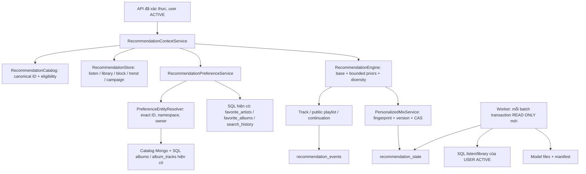

# Cải thiện hệ đề xuất v1.1 sau khảo sát dữ liệu

**Ngày:** 27/10/2026. **Trạng thái:** đã triển khai backend/worker và kiểm thử trên database fixture riêng; chưa deploy production.

**Phiên bản tiếp theo:** [v1.2 — vận hành và bảo vệ đường phát](RECOMMENDATION_V1_2_OPERATIONS.md) đã xử lý outcome async, lookup heartbeat và controls/metrics theo process. Các giới hạn ghi đồng bộ/thiếu cờ trong mục 12 bên dưới là trạng thái tại thời điểm v1.1; giới hạn dữ liệu, quyền và đánh giá chất lượng vẫn cần đối soát.

Tài liệu này là phần cập nhật hiện hành của [kiến trúc nền](RECOMMENDATION_SYSTEM_ARCHITECTURE.md), dựa trên [khảo sát nguồn tín hiệu](RECOMMENDATION_SIGNAL_REASSESSMENT.md). [Kế hoạch thực hiện](plans/recommendation-v1.1-plan.md) và [audit dữ liệu chỉ đọc sau cải thiện](recommendation-data-audit-v1.1-20261027.json) đi cùng bản này.

Ràng buộc giữ nguyên: **không sửa frontend/giao diện, không thêm bảng/cột/index MySQL, không thêm collection Mongo ngoài hai collection recommendation đã có**. Không sửa trạng thái xuất bản, giấy phép, owner hay ID legacy trên database ứng dụng. Model cảm xúc tiếp tục chỉ phục vụ tìm kiếm.

## 1. Vấn đề và quyết định

Trước v1.1, ranker đọc lịch sử nghe, library và playlist nhưng bỏ sót quan hệ nghệ sĩ/album đã có trong SQL. Feedback FOLLOW mới chỉ được lưu; album yêu thích có lỗi namespace SQL/Mongo; search selection chưa vào context. Worker có thể giữ snapshot MySQL cũ giữa các batch. Một bài lưu qua nhiều ID có thể bị cộng nhiều lần.

v1.1 bổ sung preference trực tiếp có giới hạn vào ranker, cùng resolver và đường ghi nhất quán. Không mở rộng ma trận ALS bằng những lượt nghe hoặc lượt thích track suy diễn từ follow/album. Vì dữ liệu local quá thưa và catalog chưa đủ quyền phục vụ, hệ tiếp tục ưu tiên baseline content/session; không có tuyên bố chất lượng ML đã tăng.

## 2. Kế hoạch đã thực hiện

1. Đối soát producer UI/API/database; xác định nguồn chuẩn và resolver cho artist, album, track.
2. Đọc follow/album favorite thành prior; nối API ghi vào bảng nghiệp vụ hiện có.
3. Kiểm tra namespace album, private ownership, ID không tồn tại, alias và tính idempotent.
4. Đưa selected result vào context hai giờ; hỗ trợ genre ở API; refresh mix khi preference ổn định thay đổi.
5. Sửa transaction worker, population ACTIVE, distinct trend sau canonicalization và ownership playlist mới.
6. Kiểm thử unit, HTTP/SQL/Mongo fixture, cập nhật tài liệu và kiểm tra lại dữ liệu local bằng truy vấn chỉ đọc.

## 3. Nguồn dữ liệu và cách hiểu

| Nguồn có sẵn | Cách dùng trong v1.1 | Điều không suy diễn |
| --- | --- | --- |
| `user_library_tracks` | Nguồn chuẩn của lưu/tim track; canonical dedupe | Không cộng lại `favorite_songs` legacy |
| Playlist riêng user tạo | Seed nhẹ, dedupe theo track; library thắng seed playlist | Không nhân trọng số theo số playlist chứa cùng bài; không học bản copy mix như ý định mới |
| `favorite_artists` | Quan hệ follow/favorite nghệ sĩ cá nhân; prior trực tiếp | Không dùng con số `artists.followers` thay quan hệ user–artist |
| `favorite_albums` | Resolve album, thành viên track, chia budget | Không gán tất cả track thành liked/played cho ALS |
| `search_history` đã chọn TRACK/ARTIST | Intent ngắn hạn, decay và dedupe actual play | Không đọc keyword, nhãn hoặc confidence cảm xúc |
| `listening_history`, `playback_events` | Giữ tín hiệu nghe/skip hiện có | Không coi download redirect, queue/repeat ở client là outcome đã xác nhận |
| Catalog/audio features, license | Giữ similarity và eligibility hiện có | Không tự cấp quyền phát khi thiếu metadata |
| Trend và campaign hiện có | Giữ tín hiệu thời điểm, kiểm tra hạn | Không gọi nhãn TIKTOK legacy là chart xu hướng bên ngoài |

`favorite_songs` vẫn tồn tại như dữ liệu nghiệp vụ legacy nhưng không được union vào runtime preference. Nếu muốn nhập lịch sử này về library cần preview/mapping riêng; v1.1 không thực hiện import.

## 4. Kiến trúc chạy thực tế



Các class mới là `PreferenceEntityResolver` và `RecommendationPreferenceService`. Reader online kết hợp preference với profile cũ; worker tiếp tục chỉ học từ tương tác track thật. Không thêm Redis, Kafka, vector DB hoặc feature store service.

Trong Home, ranker vẫn xét toàn catalog đủ điều kiện vì quy mô nhỏ; đây chưa phải retrieval phân tán. Thay đổi preference được đọc ở request mới, không cần chờ train. Chẩn đoán chỉ trả cho chính user qua API đã xác thực.

## 5. Công thức đã hiện thực hóa

Giữ điểm nền v1:

```text
Nếu có seed track dương:
  base = 0.52 affinity + 0.18 CF + 0.15 session + 0.08 trend + 0.07 campaign
Nếu chưa có seed track dương:
  base = 0.45 popularity + 0.25 featureCoverage + 0.20 trend + 0.10 campaign

score = base
      + 0.12 × isFollowingArtist
      + 0.08 × albumPrior(track)
      + 0.04 × max(trackIntent, artistIntent)
      - các penalty negative/recent hiện có
```

Đây là điểm xếp hạng, **không phải xác suất hay phần trăm**. Các hệ số 0.12/0.08/0.04 là heuristic ban đầu của Moodify, chưa được A/B hoặc ablation xác nhận. Không diễn giải chúng là công thức của Spotify hoặc nền tảng lớn.

### 5.1. Follow nghệ sĩ

- Track của artist đã follow nhận `+0.12`, sau khi qua eligibility và block.
- Unfollow bỏ bonus, không biến thành dislike và không loại artist khỏi khám phá.
- HIDE/NOT_INTERESTED thắng follow, album, intent và campaign.
- User chỉ có follow hợp lệ cũng được nhận diện có preference cá nhân, dù chưa có seed nghe/lưu bài.
- Giữ cap diversity: Home tối đa hai track/nghệ sĩ ở section track; continuation ba; mix 30 mục tiêu có cap ba. Chưa có exposure cap toàn Home qua nhiều section.

### 5.2. Album favorite

Với album có `n` thành viên canonical phân biệt, mỗi track nhận prior `1/n`; điểm cộng là `0.08/n`. Nếu track thuộc nhiều album đã thích thì lấy **max**, không cộng dồn. Track không đủ quyền vẫn bị loại; việc loại thành viên không làm các bài còn lại nhận toàn bộ budget của những bài bị loại.

Album một bài cho tối đa `+0.08`; album mười bài cho tối đa `+0.008` mỗi bài. Không sinh thêm library rows, listening history hay label ALS.

### 5.3. Selected search result

- Chỉ đọc `selected_target_type`, `selected_target_id`, `searched_at` trong tối đa 50 search gần nhất của hai giờ.
- TRACK selection: `intent = 0.5^(age_seconds/3600)`.
- ARTIST selection: `intent = 0.6 × 0.5^(age_seconds/3600)`.
- Chọn lặp cùng target lấy max. Với track/artists đã có actual listen/skip gần đây, bỏ intent tương ứng để tránh tính hai lần dấu vết của cùng ý định.
- Search cũ không có timestamp selection riêng nên tuổi intent được xấp xỉ bằng `searched_at`; selection cập nhật rất muộn có thể không được dùng. Không thêm cột để che giấu giới hạn này.
- Selection không trở thành preference lâu dài, không tham gia ma trận ALS và không làm mix đang nghe đổi version theo từng click.

### 5.4. Dedupe bài lưu

Các alias Spotify/Mongo của cùng saved track trở thành một saved fact. Track cùng xuất hiện trong nhiều playlist cũng chỉ nhận một playlist seed; nếu đã có library thì không cộng thêm playlist seed. Lượt nghe thật vẫn là hành vi riêng và giữ cách tính hiện có.

API library nhận cả ID nội bộ và Spotify ID. Bỏ lưu xóa cả hai biểu diễn nếu có; kiểm tra tồn tại đọc cả hai; thêm lại qua alias không tạo row thứ hai. Legacy `favorite_songs` không làm một bài vừa bỏ lưu sống lại.

## 6. Quy tắc identity và quyền album

Artist resolve theo `_id` (String hoặc BSON ObjectId) hay `spotify_id`; canonical ưu tiên `spotify_id`. Nếu không có artist document nhưng catalog có chính xác `artist_spotify_id` tương ứng thì có thể dùng ID đó. Không đoán artist từ tên. Alias mơ hồ bị từ chối.

Album có hai namespace:

| Ví dụ | Đích | Giá trị lưu trong `favorite_albums.album_id` |
| --- | --- | --- |
| `sql:77` | Album SQL số 77 | `sql:77` |
| `mongo:77` | Album Mongo `_id="77"` | `mongo:77` |
| `album-external` | Album Mongo xác định duy nhất bằng Spotify ID | `mongo:<internal-id>` |

ID không có prefix vẫn được hỗ trợ khi xác định duy nhất. Nếu số `77` có cả ở SQL và Mongo, trả **409**, client/API caller phải chỉ rõ namespace. Unknown hoặc album không được truy cập trả **404**; identity không hợp lệ trả **400**.

SQL album phải ACTIVE, công khai hoặc do user sở hữu. Mongo album explicit private chỉ owner được dùng; status có khai báo phải ACTIVE/PUBLISHED. Album catalog Mongo import thiếu visibility/status vẫn được đọc như album catalog; **track bên trong luôn phải qua policy phát nghiêm ngặt**. Quy tắc đọc metadata album không đồng nghĩa cấp license track.

API detail/favorites cũ nay đọc được album cả SQL lẫn Mongo. ID SQL trong JSON vẫn là số; ID Mongo là string. Các mutation quản lý album SQL hiện có giữ namespace quản lý cũ; v1.1 không thêm trình quản lý Mongo album hay tự đổi danh sách catalog công khai toàn bộ.

## 7. API mới và tương thích

| API | Tác dụng |
| --- | --- |
| `GET /api/me/followed-artists` | Set canonical artist IDs của chính user |
| `PUT /api/me/followed-artists/{id}` | `{"enabled":true}` follow; false unfollow |
| `PUT /api/me/favorite-albums/{id}` | Trạng thái album favorite idempotent |
| `GET /api/me/recommendation-preferences` | Follow, album priors, intent, fingerprint và diagnostics riêng user |
| `GET /api/recommendations/home?genre=indie` | Context genre cho candidate track/đánh giá playlist của request |

Thiếu `enabled` bị validation 400. Mutation preference khóa row user hiện có trong transaction để serialize retry/alias; không thêm lock table. Row alias hợp lệ được chuẩn hóa khi chính user thực hiện mutation, không chạy bulk sửa dữ liệu cũ. Có thể xóa exact legacy preference không resolve được bằng `enabled=false` trong scope chính user.

`PUT /api/recommendations/feedback` với FOLLOW chỉ chấp nhận ARTIST, chuyển sang cùng `favorite_artists`; không tạo thêm Mongo FOLLOW. POST toggle favorite album cũ vẫn dùng được, được nối cùng resolver/authority. Nếu đã có FOLLOW Mongo từ phiên bản trước thì v1.1 không tự migrate; reader mới không coi đó là nguồn cạnh tranh.

`genre` hỗ trợ danh sách phân cách dấu phẩy, chuẩn hóa tên cơ bản; `all` dùng context chung. Nó không ghi gu dài hạn. Mix Daily/Weekly/Trend vẫn là mix toàn cục của user; một request genre không tái tạo ba mix thành playlist riêng từng genre. Playlist công khai được đánh giá trên thành viên phù hợp context, nhưng khi user phát playlist gốc vẫn phát nội dung của playlist gốc.

**Frontend chưa được sửa để tự gửi genre hoặc tạo nút follow mới.** Các nguồn đã có producer như library và favorite album được backend đọc ngay; thao tác follow mới có API nhưng cần client gọi API đó mới phát sinh quan hệ mới. Dữ liệu follow legacy chưa resolve được không tự được sửa bằng cách đoán tên/ID.

## 8. Mix khi thay đổi sở thích

`preference_fingerprint` được lưu ngay trong MIX_VERSION của `recommendation_state`, kết hợp:

- Set artist đã resolve và canonical album keys.
- Set saved-track canonical cùng trọng số nguồn library/playlist đã dedupe.

Khi follow/unfollow, thích/bỏ thích album hoặc lưu/bỏ lưu bài làm fingerprint đổi, lần đọc mix/Home kế tiếp tạo hoặc chọn version đúng fingerprint. Stable mix ID giữ nguyên; request idempotent không tạo version mới vô ích. Version v1 thiếu fingerprint được làm mới một lần khi đọc theo logic mới.

Fingerprint không chứa tuổi intent, từng lượt nghe, genre request hoặc mọi feature catalog; các thay đổi đó theo chu kỳ refresh hiện có. Đây không phải snapshot replay đầy đủ. HIDE vẫn invalidation bằng `rebuild_nonce`; CAS kiểm tra nonce để không bỏ qua invalidation đồng thời. Queue đang phát không bị tự sắp lại; khi đọc/phát lại vẫn kiểm tra block và quyền hiện hành.

## 9. Worker, trend và playlist ownership

### Worker

Mỗi `load_sources` bắt đầu bằng rollback transaction đọc cũ, mở `START TRANSACTION READ ONLY`, đọc SQL rồi rollback trong `finally`. Batch sau nhìn thấy commit mới từ connection khác; advisory lock ở session vẫn giữ được. Lấy history/library từ tài khoản **role USER và status ACTIVE**. Follow/album không được nhét vào dữ liệu train track.

SQL và Mongo vẫn không có snapshot phân tán nguyên tử. Test freshness không chứng nhận chịu tải, publish cohort nguyên tử hoặc replay catalog as-of. Các hạn chế ML trong đánh giá production còn hiệu lực.

### Trend

Hợp nhất alias trước khi distinct user theo track và cửa sổ 24 giờ; một người nghe cùng bài qua hai ID chỉ tính một người. Chỉ tài khoản USER ACTIVE được tính; giữ ngưỡng ba người nghe engaged và chuẩn hóa theo active listeners như v1. Không có đủ mẫu/cửa sổ so sánh thì không bịa trend.

### Playlist

Playlist tạo mới và bản copy mix ghi `owner_user_id` đã có sẵn trong Mongo entity; quyền kiểm tra ID này trước, không cho username tái sử dụng nhận playlist của chủ cũ. List/mutation kiểm tra cùng ownership. Legacy chưa có owner ID còn fallback username/email để tương thích; ownerless không cấp quyền. Playlist legacy thiếu `is_public` được đọc mặc định private. Không bulk gán owner/public hay chuyển 990 tham chiếu legacy.

## 10. Chẩn đoán và lưu trữ

Đọc tối đa 1.000 preference artist và 1.000 preference album gần nhất. Diagnostics báo số row nguồn, số target resolve được, unresolved và dấu hiệu bị cắt giới hạn. Legacy sai ID bị bỏ qua có chẩn đoán, không làm cả Home lỗi; lỗi hạ tầng thật vẫn được trả/quan sát như lỗi hạ tầng.

Không thêm collection feature/metrics. Giữ:

- `recommendation_state`: PROFILE, FEEDBACK, MIX, MIX_VERSION, CAMPAIGN.
- `recommendation_events`: DECISION, EVENT.

Hệ số và reason codes mới nằm trong response/decision hiện có: FOLLOWED_ARTIST, FAVORITE_ALBUM, SEARCH_INTENT. Một item vẫn chỉ có một reason chính; chưa log đầy đủ mọi component score. Retention/index hiện có giữ nguyên. Không tái tạo tám bảng SQL cũ hoặc bốn collection cũ.

## 11. Kiểm thử và cách chạy lại

Kết quả trên mã v1.1:

| Lớp | Kết quả | Giới hạn |
| --- | --- | --- |
| Maven backend | **66 tests, 0 failure/error**, package thành công | Loại `EmotionServiceTest` phụ thuộc dịch vụ cảm xúc ngoài; không tuyên bố full suite đó đạt |
| Python worker/migration | **15 tests đạt** | Dữ liệu unit/synthetic |
| HTTP + MySQL + MongoDB thật | **31 tình huống đạt** | Database fixture riêng, audio giả, không chứng nhận CDN/phát audio thật |
| Frontend | Không có thay đổi trong v1.1 | Không tuyên bố đã thêm UI follow/genre |

Smoke kiểm tra cả: anonymous/banned/owner, generation đồng thời, private copy, event retry, queue attribution, Mongo outcome lỗi không rollback SQL, campaign revision/expiry, license revoke, follow/unfollow/idempotency, HIDE thắng, namespace SQL/Mongo, ObjectId artist, album private, library alias/unlike, unresolved diagnostics, search/play dedupe, genre request, đổi username, trend distinct và worker freshness. Có kiểm tra trực tiếp không tồn tại tám bảng SQL recommendation cũ, đúng hai collection, retention active/superseded version, và cleanup allowlist trên fixture.

```powershell
# Chạy từ Moodify-Backend
.\mvnw.cmd '-Dtest=!EmotionServiceTest' test package
.\recommendation-worker\.venv\Scripts\python.exe -m pytest recommendation-worker -q
.\scripts\recommendations.ps1 -Mode smoke
```

Smoke chỉ cho database server loopback, tự tạo tên database có prefix an toàn, chỉ seed dữ liệu tổng hợp và drop fixture trong finally. Hai bảng albums/album_tracks có khai báo tạo trong fixture vì annotated schema test cũ thiếu bảng nghiệp vụ này; **đây không phải migration hoặc DDL thêm vào database ứng dụng**.

## 12. Trạng thái production và việc tiếp theo

| Hạng mục phát hiện trước đây | Trạng thái sau v1.1 |
| --- | --- |
| Worker giữ snapshot cũ | Đã sửa, có test commit từ connection khác qua ba batch |
| Follow/album/selection chưa được dùng | Đã tích hợp có validation, giới hạn và chẩn đoán |
| Alias saved-track bị nhân / unlike sót | Đã dedupe reader và sửa library mutation |
| Trend raw ID, account BANNED | Đã canonical distinct và lọc USER ACTIVE |
| Ownership theo username | Đã dùng owner ID cho dữ liệu có ID và tất cả playlist mới; legacy chưa đối soát vẫn còn hạn chế |
| Catalog đủ quyền phục vụ | Vẫn **0/153 bài** theo audit local; không tự sửa trạng thái/license |
| Playlist legacy | Vẫn cần preview đối soát owner/schema/track; không tự public hóa |
| Fault isolation đường playback | Còn callback đồng bộ và đọc catalog/queue; chưa có circuit breaker/async đầy đủ |
| Chất lượng thuật toán | Chưa A/B/ablation; dữ liệu chưa đủ chứng minh ALS, chưa có rolling-window/CI đầy đủ |
| Rollout và scale | Chưa kill switch/bucket/observability đầy đủ, full-catalog reads cần benchmark/cache |
| Quota core/trend/campaign | Giữ diversity/mix heuristic; chưa có quota cứng hoặc exposure cap toàn Home |

Bước tiếp theo trước pilot là đối soát catalog và playlist legacy qua preview, xử lý fault isolation/metrics/kill switch rồi đo content baseline trên người nghe thật có provenance. Sau đó mới đánh giá thêm từng nguồn preference và cân nhắc learned ranker. Không tự tăng số bảng để thay thế việc làm sạch nguồn và đo chất lượng.

## 13. Cơ sở nghiên cứu và suy luận thiết kế

Google mô tả hệ đề xuất gồm candidate generation, scoring và re-ranking. Moodify giữ cách tách trách nhiệm này ở mức catalog nhỏ; không cần triển khai toàn bộ hạ tầng retrieval lớn chỉ để thêm follow. [Google Recommendation systems overview](https://developers.google.com/machine-learning/recommendation/overview/types).

Tài liệu re-ranking của Google giải thích việc dùng filter/điều chỉnh điểm và metadata để xét freshness, diversity, fairness. Việc Moodify giữ block/eligibility trước bonus và cap nghệ sĩ là quyết định triển khai phù hợp nguyên tắc đó; các hệ số cụ thể là suy luận của dự án, không lấy từ tài liệu. [Google Re-ranking](https://developers.google.com/machine-learning/recommendation/dnn/re-ranking).

Nghiên cứu không chứng minh phiên bản này khách quan tuyệt đối. Đánh giá cần kiểm tra thiên lệch popularity, mức tiếp cận nghệ sĩ ít phổ biến, tỷ lệ core/trend/event, skip/engaged/save và cohort user mới/cũ; không tối ưu CTR đơn lẻ rồi gọi đó là chất lượng âm nhạc.
