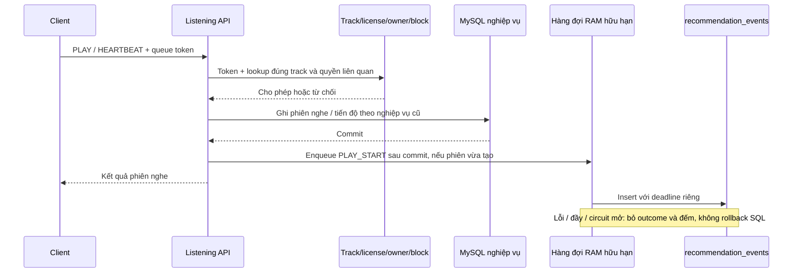

# Recommendation v1.2 — cô lập outcome, điều khiển và quan sát vận hành

**Bắt đầu:** 28/10/2026. **Hoàn thiện:** 29/10/2026, Asia/Saigon. Chưa deploy production.

Tiếp nối [v1.1](RECOMMENDATION_V1_1_IMPLEMENTATION.md), đợt này xử lý phần ghi analytics sau commit, full-catalog lookup trên heartbeat, khả năng tắt generation/CF/campaign và preview nội dung trước pilot. [Kế hoạch](plans/recommendation-v1.2-plan.md) xác định phạm vi. Không sửa frontend, không thêm bảng/cột/index MySQL hoặc collection Mongo, không thay công thức qualified stream/thanh toán, không tự sửa metadata/license/catalog legacy. Các thay đổi cấu hình deploy đang có được giữ nguyên.

## 1. Luồng phát và ghi outcome



`RevenuePlaybackService` đăng ký callback transaction; callback sau commit chỉ gọi `RecommendationOutcomeDispatcher.submit`. Transaction rollback không enqueue. Worker analytics chạy trên một thread riêng, không dùng CallerRunsPolicy và không chờ Mongo trên HTTP thread. Ordinary playback không có queue token không đọc recommendation store để tạo attribution; luồng nghiệp vụ vẫn cần catalog track và SQL như trước.

Mặc định:

| Cấu hình | Giá trị | Tác dụng |
| --- | --- | --- |
| `RECOMMENDATIONS_OUTCOME_QUEUE_CAPACITY` | 128 | Số outcome đang chờ, ngoài tối đa một outcome đang ghi |
| `RECOMMENDATIONS_EVENT_TIMEOUT_MS` | 2000 | Deadline driver cho mỗi insert EVENT, gồm thời gian chọn server/chờ connection/thao tác |
| `RECOMMENDATIONS_OUTCOME_FAILURE_THRESHOLD` | 3 | Số lần ghi lỗi liên tiếp để mở circuit |
| `RECOMMENDATIONS_OUTCOME_COOLDOWN_MS` | 30000 | Thời gian tạm ngừng trước khi thử ghi lại |

`RecommendationStore.event` dùng MongoCollection `withTimeout`; giới hạn này áp dụng cho EVENT gồm outcome và client events/save-copy. DECISION insert, catalog, ownership và các truy vấn khác chưa được bảo vệ bởi deadline này. Không được diễn giải đây là timeout chung của mọi endpoint.

Outcome insert dùng event ID xác định theo user/session như trước. Duplicate key được tính là duplicate, không phải dependency failure và không mở circuit. Các lỗi thật được đếm; sau cooldown, một worker thử lại, thành công thì đóng circuit, lỗi thì mở lại. Những outcome bị bỏ không được giữ để retry tự động.

Đóng ứng dụng có tối đa hai giây drain executor rồi dừng; các job còn chờ bị bỏ có đếm. Crash/kill process mất log RAM mà không thể cập nhật bộ đếm sau crash. Timeout còn có thể tạo kết quả không chắc chắn: insert đã tới server nhưng client hết hạn trước khi nhận ack. Vì vậy số `failed` là số thao tác thất bại ở client, không phải chứng minh document không tồn tại.

**Giới hạn bảo đảm:** đây là analytics best effort. Không có durable outbox, broker hoặc đảm bảo exactly once. MySQL vẫn là nguồn phiên nghe và tài chính. Metrics drop/failed cần được vận hành thu thập; không thể dùng outcome log đơn lẻ làm nguồn thanh toán hoặc cho rằng funnel luôn đầy đủ.

## 2. Heartbeat chỉ đọc đúng phạm vi cần kiểm tra

`RecommendationService.playbackContext` đã bỏ `catalog.snapshot()` khỏi đường xác minh queue token. Thay bằng:

1. Xác minh chữ ký, user và thời hạn token.
2. `RecommendationCatalog.playableTrack` resolve đúng track, kiểm tra license/canonical alias cần thiết và policy published/public/approved/audio như trước.
3. Kiểm tra block track, artist và parent playlist/mix của user.
4. Kiểm tra public/owner của playlist hoặc owner ID của personalized mix.

Resolver targeted vẫn giữ ưu tiên license canonical và không mượn license của một Spotify alias trùng internal ID của bài khác. Có truy vấn identity liên quan để phát hiện shadow/collision; không đọc tất cả track chỉ để kiểm tra một heartbeat. `RevenuePlaybackService` vẫn đọc track cho duration và logic qualified stream hiện có.

Token cũ bị từ chối nếu bài vừa bị ẩn hoặc license thu hồi. Không có fail-open khi thiếu quyền. Nếu Mongo catalog/owner/block hoặc SQL license không truy cập được, request queue playback vẫn có thể lỗi. **V1.2 cô lập phần ghi analytics và bỏ full-catalog scan trên heartbeat; chưa làm playback độc lập hoàn toàn với Mongo.** Chưa đo p95/p99 hoặc lỗi toàn cụm production.

## 3. Cơ chế bật/tắt

Startup defaults đặt trong application.properties, có thể cấu hình bằng môi trường:

```properties
RECOMMENDATIONS_ENABLED=true
RECOMMENDATIONS_COLLABORATIVE_ENABLED=true
RECOMMENDATIONS_CAMPAIGNS_ENABLED=true
```

Mặc định true để giữ tương thích trạng thái chức năng đang có. Môi trường chưa đạt pilot gate nên đặt `RECOMMENDATIONS_ENABLED=false` trong cấu hình triển khai. Đợt này không sửa `.env` ứng dụng hoặc chạy deploy.

| Cờ | Khi false |
| --- | --- |
| `enabled` | Home, playlist recommendations, continuation, list mix và refresh/generate mới trả 503; scheduler bỏ qua refresh |
| `collaborative` | Bỏ đọc collaborative scores/model version khi xếp hạng; dùng baseline content/session |
| `campaigns` | Không lấy active campaigns cho ranking; quản trị campaign vẫn hoạt động |

Tắt generation vẫn cho đọc version/mix đã có, copy và tạo queue từ nội dung đã có quyền. Token/hide/license/ownership vẫn được kiểm tra. Follow/favorite và negative feedback vẫn có thể cập nhật. Queue và phiên đang nghe không bị sắp lại chỉ vì cờ thay đổi. Cờ campaign không phải lệnh thu hồi quyền phát của những bài hợp lệ đã nằm trong queue/snapshot trước đó.

Mix version có `runtime_key` ngay trong document MIX_VERSION hiện có. Lần đọc bình thường khi generation bật sẽ refresh theo thay đổi cờ; version v1.1 thiếu key được làm mới. Context kiểm tra key đầu/cuối quá trình đọc và trước generation; thay đổi trong lúc tính có thể trả 409 để retry. Request đã chạy đồng thời với thao tác tắt vẫn có thể hoàn tất; đây không phải hàng rào phân tán hủy mọi request đang bay.

## 4. API vận hành dành cho ADMIN

Các đường dưới đây được bảo vệ bởi `/api/admin/**` và kiểm tra user ACTIVE:

| API | Nội dung |
| --- | --- |
| `GET /api/admin/recommendations/operations` | Flags/revision, thời gian bắt đầu process, counters, độ dài queue, in-flight và circuitOpen |
| `PUT /api/admin/recommendations/controls` | Thay ba cờ với expectedRevision; 409 nếu đã có cập nhật khác |
| `GET /api/admin/recommendations/catalog-review?offset=0&limit=50` | Preview nội dung không đạt eligibility và nguyên nhân cần kiểm chứng; limit 1–100 |

Ví dụ body điều khiển, sau khi lấy revision mới nhất:

```json
{
  "enabled": false,
  "collaborative": false,
  "campaigns": false,
  "expectedRevision": 1
}
```

Thiếu trường Boolean hoặc revision không hợp lệ trả 400. Không dùng API ghi control như một phép retry mù: đọc revision lại khi 409. Mỗi PUT hợp lệ tăng revision, kể cả cùng giá trị; revision là thế hệ điều khiển và có thể làm mix được xem xét lại.

**Scope là THIS_PROCESS:** flags thay đổi tức thời trên instance nhận request, không ghi DB. Restart trở về biến môi trường. Với nhiều instance, phải đặt cấu hình môi trường đồng nhất hoặc gửi trực tiếp tới từng instance và kiểm tra từng instance; gọi qua load balancer một lần không tắt cả cụm. Chưa có experiment bucket, rollout theo phần trăm hoặc distributed control plane. Log ứng dụng ghi giá trị cờ/revision, không ghi token/credentials.

## 5. Chỉ số và cách diễn giải

Metric chỉ dùng nhóm operation cố định: recommendation, mix, queue, events, playback. Không tạo nhãn theo user, track, request ID, URL raw hoặc exception message.

- `<operation>.requests`: số request đi qua filter của operation.
- `.server_errors`, `.unavailable`, `.throttled`: số response tương ứng >=500, 503, 429; 503 do ADMIN tắt cũng nằm trong unavailable.
- `.latency_ms.le25/le100/le500/le1000/le5000/gt5000`: các bucket rời nhau của thời gian xử lý HTTP; không phải histogram tích lũy Prometheus.
- `recommendation.empty`: response ranking thành công có mọi section rỗng; phân biệt lỗi dependency hoặc generation disabled.
- `outcome.enqueued`, `stored`, `duplicate`, `failed`, `dropped_queue`, `dropped_circuit`, `dropped_shutdown`, `circuit_opened`: chất lượng đường ghi analytics.

Filter ở sau security chain nên request bị từ chối sớm bởi security có thể không xuất hiện; error dispatch không đếm lại. Counters là RAM tích lũy từ process start, đọc đồng thời chỉ là snapshot gần đúng. Khi tính rate hãy dùng delta và phát hiện restart, không lấy số tích lũy chia tổng user. Không tuyên bố có p95 chính xác từ các bucket thô này.

API này chưa nối hệ thống scrape/alert bên ngoài và không bổ sung dashboard UI. Vận hành có thể dùng hạ tầng hiện có thu thập định kỳ; đợt này không tự tạo automation gửi dữ liệu hoặc cài dịch vụ monitoring.

## 6. Preview nội dung và dữ liệu thực

Preview chỉ đọc track/license, trả ID/tên bài và các mã VERIFY_PUBLICATION, VERIFY_VISIBILITY, VERIFY_MODERATION, VERIFY_AUDIO, VERIFY_LICENSE hoặc VERIFY_LICENSE_EFFECTIVE_DATES_AND_STATUS. Đây là danh sách việc cần kiểm chứng, **không phải đề nghị tự đặt tất cả cờ thành đạt**. Không trả credential, nội dung tìm kiếm hoặc danh sách hành vi cá nhân.

Pagination giới hạn response tối đa 100 mục; implementation vẫn đọc catalog nhỏ trong RAM trước khi phân trang. Chưa có cursor snapshot bất biến khi dữ liệu đang thay đổi. Playlist legacy vẫn cần đối soát owner/schema/track riêng; không bulk sửa 25 playlist hoặc 990 tham chiếu legacy.

[Audit local chỉ đọc ngày 29/10/2026](recommendation-data-audit-v1.2-20261029.json) vẫn ghi nhận 153 track, 0 bài đủ policy, ma trận 2 user × 3 track, không có overlap nhiều user ở cùng bài. Tám bảng SQL recommendation và bốn collection Mongo legacy vẫn không còn. Không train/publish model vào database ứng dụng trong đợt này.

## 7. Kiểm thử và chạy lại

Kiểm thử backend bao gồm executor chậm/đầy, duplicate, circuit cooldown/recovery, shutdown rejection, transaction rollback/afterCommit, driver operation deadline với socket loopback không phản hồi, lookup không gọi findAll, alias shadow license và block trên token đã phát.

HTTP smoke dùng MySQL/Mongo thật trên database fixture riêng: giữ toàn bộ regression v1.1, chờ outcome bất đồng bộ có deadline, ép validator Mongo từ chối PLAY_START, xác nhận SQL commit, kiểm tra controls/revision/CF/campaign, disabled generation vẫn đọc/play queue cũ, revocation/block, preview ADMIN/validation và metrics. Không dừng server Mongo dùng chung hoặc gieo dữ liệu giả vào catalog ứng dụng.

```powershell
# Từ Moodify-Backend
.\mvnw.cmd '-Dtest=!EmotionServiceTest' test package
.\recommendation-worker\.venv\Scripts\python.exe -m pytest recommendation-worker -q
.\scripts\recommendations.ps1 -Mode smoke
```

`EmotionServiceTest` phụ thuộc dịch vụ cảm xúc ngoài và được loại rõ khi kiểm tra recommendation. Fixture audio là giả: test queue/session không chứng nhận phát file hoặc CDN thật. Kết quả cuối cùng được ghi ở [tài liệu triển khai chung](RECOMMENDATION_IMPLEMENTATION.md) sau khi hoàn tất kiểm thử.

**Kết quả hoàn tất 29/10/2026:** 79 backend tests đạt (0 failure/error), package thành công; 15 worker/migration tests đạt; 37 tình huống HTTP/MySQL/Mongo fixture đạt, bao gồm phân biệt empty success với lỗi ghi DECISION. Fixture database/server và socket timeout test được dọn sau kiểm tra. Không có thay đổi frontend trong v1.2.

## 8. Những gate còn mở

1. Catalog pilot có quyền/metadata/audio thực sự, playlist legacy có owner/schema đã đối soát.
2. Benchmark tải và lỗi SQL/Mongo/catalog toàn hệ, deadline cho read path, pool và rate limits; bộ nhớ cache cần invalidation quyền rõ.
3. Scrape/alert, rollback nhiều instance và stable experiment bucket trước canary theo phần trăm.
4. Dữ liệu nghe có provenance, feature/eligibility as-of, rolling-window evaluation và ablation các prior; chưa đủ cơ sở quảng bá ALS đã cải thiện chất lượng.
5. Quota/exposure core–trend–campaign toàn Home, full unlearning, orphan reconciler và retention/metrics join còn là các việc riêng.

V1.2 hoàn thành bước bảo vệ outcome và cung cấp công cụ vận hành tối thiểu; không thay kết luận chưa đủ điều kiện mở production rộng.
