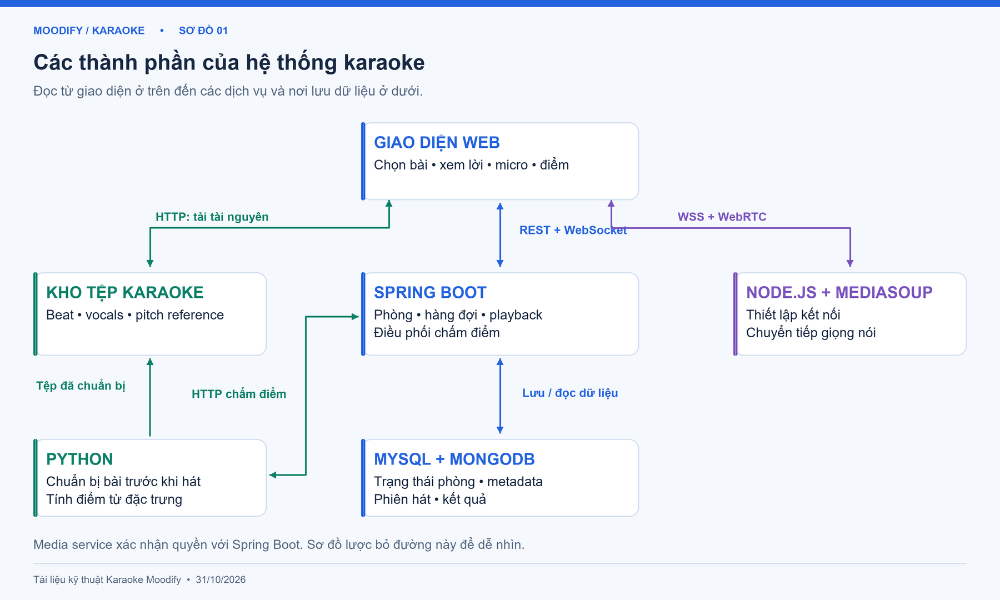
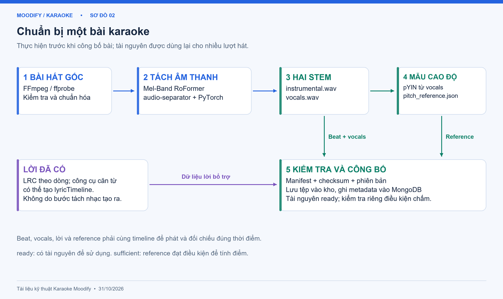
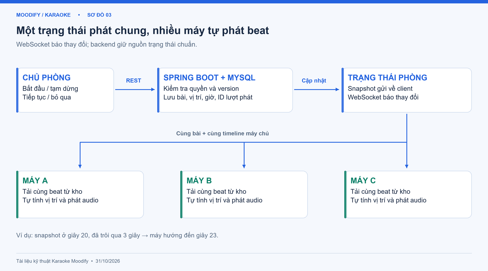
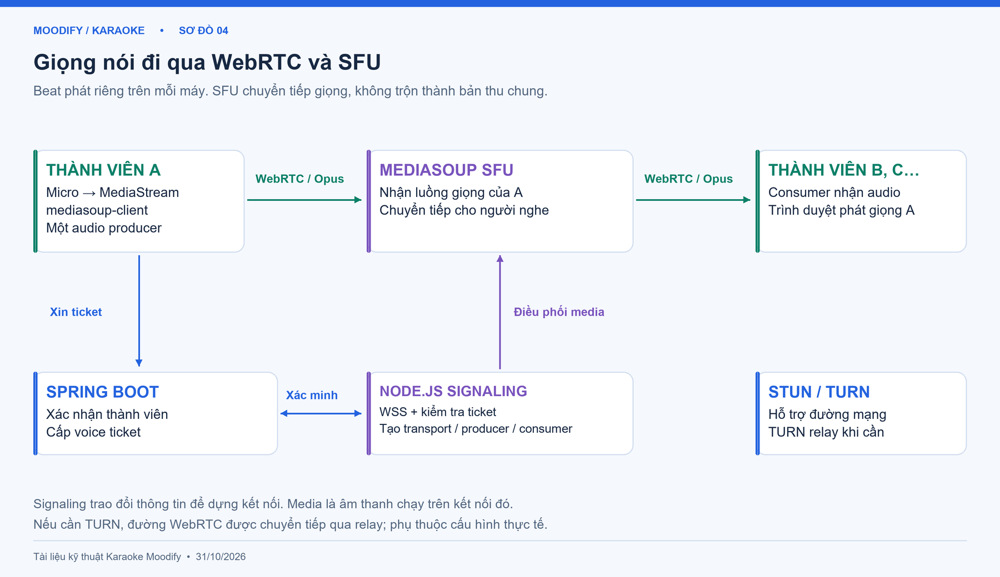
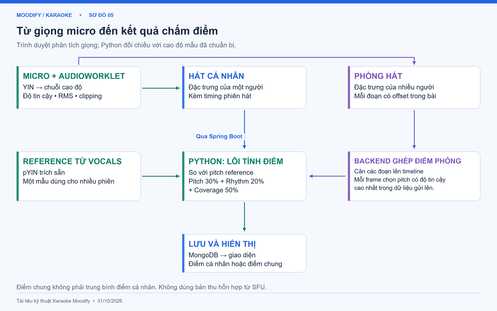

# TÀI LIỆU KỸ THUẬT CHỨC NĂNG KARAOKE — MOODIFY

**Phiên bản:** 1.0 • **Ngày biên soạn:** 31/10/2026  
**Mục đích:** Giải thích công nghệ, khái niệm, luồng xử lý và vai trò của từng thành phần bằng lời và sơ đồ dễ đọc.

Tài liệu được đối chiếu với mã nguồn web, backend, dịch vụ media và dịch vụ xử lý âm thanh trong workspace. Phạm vi gồm chuẩn bị bài karaoke, hát cá nhân, phòng hát nhiều người và chấm điểm. Nội dung phản ánh cách triển khai trong mã nguồn, chưa phải biên bản kiểm thử hoặc xác nhận các dịch vụ đang chạy trên máy chủ thật.

> **Cách đọc:** Đọc mục 1 và 2 để nắm tổng thể; mục 3 giải thích công nghệ; mục 4–8 mô tả từng luồng. Các hình nằm trong thư mục `karaoke-doc-assets` bên cạnh file Markdown; khi di chuyển tài liệu cần giữ thư mục này đi cùng.

## Mục lục

1. [Karaoke trong Moodify gồm những gì?](#1-karaoke-trong-moodify-gồm-những-gì)
2. [Kiến trúc tổng thể](#2-kiến-trúc-tổng-thể)
3. [Công nghệ sử dụng: khái niệm và vai trò](#3-công-nghệ-sử-dụng-khái-niệm-và-vai-trò)
4. [Luồng chuẩn bị một bài karaoke](#4-luồng-chuẩn-bị-một-bài-karaoke)
5. [Luồng hát cá nhân](#5-luồng-hát-cá-nhân)
6. [Luồng phòng hát nhiều người và đồng bộ bài hát](#6-luồng-phòng-hát-nhiều-người-và-đồng-bộ-bài-hát)
7. [Luồng truyền giọng nói trong phòng](#7-luồng-truyền-giọng-nói-trong-phòng)
8. [Luồng chấm điểm và cách tính điểm](#8-luồng-chấm-điểm-và-cách-tính-điểm)
9. [Dữ liệu và các API chính](#9-dữ-liệu-và-các-api-chính)
10. [Giới hạn cần hiểu đúng](#10-giới-hạn-cần-hiểu-đúng)
11. [Nguồn mã và tài liệu tham khảo](#11-nguồn-mã-và-tài-liệu-tham-khảo)

## 1. Karaoke trong Moodify gồm những gì?

Chức năng karaoke cho phép người dùng hát trên nhạc nền đã tách từ bài hát gốc. Hệ thống có hai hình thức sử dụng:

| Hình thức | Cách hoạt động |
| --- | --- |
| **Hát cá nhân** | Người dùng chọn bài, nghe beat, xem lời và bật chấm điểm. Giọng từ micro được phân tích ngay trong trình duyệt; đặc trưng thu được gửi về máy chủ để tính điểm. |
| **Phòng hát nhiều người** | Các thành viên cùng vào một phòng, đăng ký bài vào hàng đợi, nghe nhạc theo trạng thái phát chung và bật micro để nghe nhau. Hệ thống có luồng chấm điểm chung cho lượt phát của phòng. |

Trước khi một bài có thể dùng để hát, hệ thống cần chuẩn bị **nhạc nền**, **giọng ca sĩ đã tách** và **dữ liệu cao độ tham chiếu**. Lời bài hát được lấy từ dữ liệu bài hát hiện có; công cụ tách âm thanh không tự tạo ra văn bản lời.

## 2. Kiến trúc tổng thể



*Hình 1. Giao diện giao tiếp với backend để xử lý nghiệp vụ, với kho tệp để tải beat, và với media server để truyền giọng nói. Khâu chuẩn bị bài chạy trước thời điểm người dùng hát.*

Có thể hình dung hệ thống như một phòng karaoke có các bộ phận sau:

- **Giao diện web:** màn hình chọn bài, điều khiển nghe, lời bài hát, micro và điểm số.
- **Spring Boot:** bộ phận quản lý phòng, quyền người dùng, hàng đợi và phiên chấm điểm.
- **MySQL và MongoDB:** nơi giữ trạng thái nghiệp vụ và thông tin bài hát/phiên hát.
- **Kho tệp karaoke:** nơi chứa beat, vocals và file cao độ tham chiếu.
- **Dịch vụ Python:** chuẩn bị tài nguyên trước khi hát và tính điểm khi nhận dữ liệu phiên hát.
- **Node.js + mediasoup:** nơi thiết lập kết nối và chuyển tiếp giọng nói giữa các thành viên.

### 2.1. Ba loại dữ liệu đi trên ba đường khác nhau

| Đường truyền | Dữ liệu đi qua | Ví dụ |
| --- | --- | --- |
| **REST và WebSocket nghiệp vụ** | Lệnh, thông báo và trạng thái phòng | Vào phòng, thêm bài, tạm dừng, thông báo thành viên mới. |
| **HTTP/HTTPS tải tài nguyên** | Tệp đã chuẩn bị | Trình duyệt tải `instrumental.wav` để phát nhạc nền. |
| **WebRTC** | Giọng nói trực tiếp | Thành viên A hát và thành viên B nghe giọng A. |

Ngoài ra, trình duyệt dùng **WSS signaling** đến dịch vụ Node.js để thương lượng kết nối media. Signaling là thông tin thiết lập đường truyền; audio thực tế đi bằng WebRTC.

**Ví dụ:** Khi A bấm tạm dừng, lệnh đi tới Spring Boot. Khi A hát, giọng đi tới mediasoup. Khi máy A cần beat, nó tải từ kho tệp. Ba việc này có thể diễn ra đồng thời nhưng do các thành phần khác nhau xử lý.

## 3. Công nghệ sử dụng: khái niệm và vai trò

Các phiên bản dưới đây lấy từ file khai báo phụ thuộc của dự án; không khẳng định phiên bản đang chạy trên máy chủ.

### 3.1. Giao diện và xử lý âm thanh trên trình duyệt

| Công nghệ | Khái niệm dễ hiểu | Vai trò trong karaoke |
| --- | --- | --- |
| **Next.js 16.3.1, React 19.2.8** | Công cụ xây dựng trang web và chia giao diện thành các thành phần có trạng thái. | Tạo các trang danh mục, hát cá nhân, danh sách phòng và phòng hát; cập nhật màn hình khi bài, thành viên hoặc điểm thay đổi. |
| **TypeScript** | JavaScript có bổ sung kiểm tra kiểu dữ liệu. | Mô tả dữ liệu API như bài hát, phòng, trạng thái playback, đặc trưng âm thanh và kết quả chấm điểm. |
| **CSS Modules** | Cách viết CSS với phạm vi riêng cho từng thành phần. | Định dạng màn hình karaoke, khu vực lời, thành viên và hộp thoại điểm. |
| **HTMLAudioElement** | Đối tượng phát âm thanh của trình duyệt, tương ứng với thẻ `<audio>`. | Tải và phát beat, đọc vị trí phát, tạm dừng và chuyển tới thời điểm cần đồng bộ. |
| **getUserMedia / MediaStream** | API xin quyền mở thiết bị và nhận luồng âm thanh từ micro. | Lấy giọng người dùng để kiểm tra micro, phân tích cao độ hoặc phát cho những người trong phòng. |
| **Web Audio API** | Bộ công cụ tạo chuỗi xử lý âm thanh trong trình duyệt. | Đưa tín hiệu micro qua các nút xử lý, đo mức âm lượng và nối tới bộ phân tích. |
| **AudioWorklet** | Cơ chế chạy xử lý trên luồng âm thanh riêng của trình duyệt. | Phân tích micro theo từng khung âm thanh trong lúc hát, giảm việc xử lý nặng trên luồng giao diện. |
| **YIN** | Thuật toán ước lượng tần số cơ bản từ tính lặp của sóng âm. | File worklet tự triển khai cách ước lượng cao độ dựa trên YIN, tạo chuỗi `f0_hz` và độ tin cậy từ micro. |
| **LRC** | Định dạng lời có mốc thời gian, ví dụ `[00:15.20]Dòng lời`. | Xác định dòng lời cần làm nổi bật khi bài chạy đến 15,2 giây. |

### 3.2. Backend, dữ liệu và giao tiếp

| Công nghệ | Khái niệm dễ hiểu | Vai trò trong karaoke |
| --- | --- | --- |
| **Java 21, Spring Boot 4.1.0** | Nền tảng xây dựng dịch vụ backend và API. | Xử lý danh mục karaoke, tạo/vào/rời phòng, hàng đợi, quyền điều khiển, ticket voice và điều phối chấm điểm. |
| **Spring Security và JWT** | Công cụ xác thực/phân quyền; JWT là token có chữ ký để kiểm tra thông tin người dùng hoặc quyền kết nối. | Bảo vệ API và cấp ticket voice gắn với tài khoản, phòng và phiên kết nối. |
| **REST API, JSON** | Cách gửi yêu cầu HTTP và trao đổi dữ liệu có cấu trúc. | Gửi lệnh nghiệp vụ và dữ liệu đặc trưng; lấy ảnh chụp trạng thái hiện tại của phòng. |
| **Spring WebSocket** | Kết nối hai chiều được giữ mở để đẩy thông báo nhanh. | Báo thay đổi thành viên, hàng đợi, playback và điểm; frontend dùng thông báo để cập nhật dữ liệu. |
| **MySQL, Spring Data JPA** | Cơ sở dữ liệu quan hệ và lớp truy cập dữ liệu từ Java. | Lưu phòng, thành viên, hàng đợi và trạng thái phát chung. Transaction và khóa bản ghi phòng giúp xử lý thao tác đồng thời. |
| **MongoDB, MongoTemplate** | Cơ sở dữ liệu document và công cụ truy vấn từ Spring. | Lưu metadata bài hát, tài nguyên karaoke, phiên chấm điểm cá nhân và phiên chấm điểm phòng. |
| **SHA-256** | Hàm tạo dấu kiểm tra từ nội dung dữ liệu; thay đổi nội dung sẽ làm dấu kiểm tra thay đổi. | Kiểm tra tệp/model/reference và nhận diện phiên bản; mã mời phòng riêng cũng được băm trước khi lưu. SHA-256 không phải mã hóa để giải ngược. |

### 3.3. Chuẩn bị bài hát và chấm điểm

| Công nghệ | Khái niệm dễ hiểu | Vai trò trong karaoke |
| --- | --- | --- |
| **Python** | Ngôn ngữ thuận tiện cho xử lý âm thanh và tính toán. | Chạy công cụ chuẩn bị bài, căn lời và dịch vụ tính điểm. |
| **FFmpeg / ffprobe** | Công cụ chuyển đổi và kiểm tra tệp âm thanh/video. | Đọc thông tin file, giải mã đầu vào và đưa âm thanh về sample rate, số kênh và định dạng cần thiết. |
| **python-audio-separator** | Thư viện chạy các mô hình đã huấn luyện để tách bài hát thành những phần âm thanh riêng, gọi là stem. | Nạp mô hình và xuất hai stem `instrumental.wav`, `vocals.wav`. [Tài liệu dự án](https://github.com/nomadkaraoke/python-audio-separator). |
| **Mel-Band RoFormer** | Mô hình tách nguồn nhạc sử dụng các dải tần theo thang Mel và cơ chế Transformer để học đặc điểm âm thanh theo thời gian/tần số. | Ước lượng giọng và phần nhạc từ bài gốc. Bundle được cấu hình trong dự án dùng checkpoint `mel_band_roformer_karaoke_aufr33_viperx_sdr_10.1956.ckpt`. Khái niệm kiến trúc tham khảo [bài báo Mel-Band RoFormer](https://arxiv.org/abs/2310.01809). |
| **PyTorch, CUDA** | PyTorch thực thi mô hình học sâu; CUDA cho phép dùng GPU NVIDIA. | Chạy mô hình tách âm thanh; công cụ chuẩn bị có thể chọn GPU khi khả dụng hoặc CPU. Không cần chạy lại mô hình tách cho mỗi người hát. |
| **librosa và pYIN** | librosa là thư viện phân tích âm thanh; pYIN là phương pháp ước lượng cao độ có tính xác suất. | Trích cao độ từ vocals để tạo dữ liệu tham chiếu; cũng được dùng ở đường chấm bằng file ghi âm. [Tài liệu pYIN](https://librosa.org/doc/0.11.0/generated/librosa.pyin.html). |
| **NumPy, SciPy, SoundFile** | Các thư viện tính toán mảng, xử lý tín hiệu và đọc/ghi âm thanh. | Đọc waveform, thao tác chuỗi cao độ, kiểm tra chất lượng và tính các thành phần điểm. |
| **FastAPI, Pydantic, Uvicorn** | Framework API Python, công cụ kiểm tra dữ liệu và máy chủ chạy API. | Cung cấp API chấm điểm nội bộ, kiểm tra đặc trưng/timing/reference và trả kết quả về Spring Boot. |
| **Wav2Vec2, Transformers, TorchAudio, CTC forced alignment** | Mô hình và thuật toán ghép văn bản đã biết với âm thanh để tìm thời điểm của từng từ. | Công cụ căn lời bổ trợ dùng model mặc định `nguyenvulebinh/wav2vec2-base-vi-vlsp2020`, tạo `lyricTimeline` từ lời hiện có và vocals. [Giải thích forced alignment của TorchAudio](https://docs.pytorch.org/audio/2.3/tutorials/ctc_forced_alignment_api_tutorial.html). |

### 3.4. Truyền giọng nói và hạ tầng

| Công nghệ | Khái niệm dễ hiểu | Vai trò trong karaoke |
| --- | --- | --- |
| **Node.js từ phiên bản 22, ws 8.18.3** | Môi trường chạy JavaScript phía máy chủ và thư viện WebSocket. | Nhận signaling từ trình duyệt, kiểm tra ticket với backend và quản lý tài nguyên media của từng người. |
| **WebRTC, Opus** | WebRTC hỗ trợ truyền media thời gian thực; Opus là bộ mã hóa/giải mã âm thanh. | Truyền giọng nói trong phòng với độ trễ thấp. Mã nguồn media cấu hình audio Opus. |
| **mediasoup 3.32.0, mediasoup-client 3.25.3** | Thư viện máy chủ/client cho mô hình SFU: máy chủ nhận luồng media và chuyển tiếp cho người khác. | Một thành viên gửi giọng lên; media server chuyển tiếp đến các thành viên cần nghe. SFU không trộn các giọng thành một bản thu chung. [Tổng quan mediasoup](https://mediasoup.org/documentation/overview/). |
| **ICE, STUN, TURN / coturn** | ICE tìm đường kết nối; STUN hỗ trợ nhận biết địa chỉ qua NAT; TURN chuyển tiếp media khi đường trực tiếp không dùng được. | Giúp thiết bị kết nối WebRTC trong các điều kiện mạng khác nhau. Compose có coturn 4.6 ở profile tùy chọn; hiệu quả thực tế phụ thuộc cấu hình triển khai. |
| **Docker Compose** | Công cụ khai báo và chạy nhiều dịch vụ bằng container. | Đóng gói các dịch vụ, cấu hình môi trường, cổng và kiểm tra trạng thái. |
| **Nginx, HTTPS/WSS** | Reverse proxy và các kết nối HTTP/WebSocket được bảo vệ bằng TLS. | Chuyển request đến dịch vụ phù hợp, phục vụ tài nguyên karaoke và cung cấp ngữ cảnh HTTPS cho micro/AudioWorklet. |
| **Kho tệp trên VM Google Cloud** | Thư mục lưu tài nguyên trên máy chủ. | Công cụ publish hiện ánh xạ tài nguyên vào `/srv/moodify/karaoke/{songId}/{assetVersion}/`. MongoDB giữ metadata và đường dẫn tương ứng. Đây là cơ chế lưu tệp trên VM trong mã nguồn; không suy ra đang dùng Google Cloud Storage bucket. |

## 4. Luồng chuẩn bị một bài karaoke

Khâu này chạy **trước khi công bố bài cho người dùng**. Một bộ tài nguyên đã chuẩn bị có thể phục vụ nhiều lượt hát.



*Hình 2. Từ bài gốc, hệ thống tạo beat và vocals; từ vocals tiếp tục tạo cao độ mẫu. Lời là một nguồn dữ liệu riêng.*

### Bước 1 — Đọc bài gốc và chuẩn hóa

Công cụ `prepare_song.py` nhận file âm thanh, `songId` và thư mục đầu ra. FFprobe kiểm tra thông tin; FFmpeg giải mã về WAV, mặc định 44.100 Hz, hai kênh trong đường tách âm thanh. Hệ thống kiểm tra thời lượng và tín hiệu đầu vào.

**Vai trò:** Python điều phối; FFmpeg/ffprobe bảo đảm model nhận dữ liệu phù hợp.

### Bước 2 — Tách beat và giọng ca sĩ

`SeparationEngine` nạp bundle model đã kiểm tra checksum. Thư viện audio-separator chạy Mel-Band RoFormer qua PyTorch để tạo:

- `instrumental.wav`: phần nhạc nền dùng để hát.
- `vocals.wav`: phần giọng ca sĩ được ước lượng từ bài gốc.

Stem đầu ra được kiểm tra để khớp thời lượng/timeline với bài gốc. Giữ timeline là cần thiết để beat, lời và cao độ tham chiếu cùng nói về một thời điểm của bài.

**Ví dụ:** Giọng ở giây 30 của bài gốc cần vẫn ở quanh giây 30 trong vocals; nếu tự cắt bỏ đoạn mở đầu, dữ liệu chấm điểm sẽ lệch.

### Bước 3 — Tạo dữ liệu cao độ mẫu

Vocals được đổi về mono, 22.050 Hz. `librosa.pyin` trích cao độ theo từng khung và ghi vào `pitch_reference.json`.

File này chứa chuỗi tần số `f0_hz`, độ tin cậy có giọng `voiced_probability`, thời lượng, mức tín hiệu và thông tin phiên bản. Hop 512 mẫu tại 22.050 Hz tương ứng khoảng **23,2 ms** giữa hai vị trí phân tích.

**Vai trò:** Vocals là âm thanh mẫu; pitch reference là phần mô tả cao độ rút ra từ âm thanh đó. Khi chấm, hệ thống so sánh chuỗi đặc trưng với reference.

### Bước 4 — Chuẩn bị lời bài hát

Hệ thống tái sử dụng `lyrics_plain` và `lyrics_synced` trong `tracks`:

- `lyrics_plain`: văn bản lời thông thường.
- `lyrics_synced`: lời có mốc thời gian kiểu LRC.

Một công cụ bổ trợ có thể căn từng từ bằng Wav2Vec2 và CTC forced alignment, rồi lưu `lyricTimeline`. Công cụ này dùng **lời đã có**, kết hợp vocals để tìm thời gian; không phải bước tự nhận dạng và viết mới toàn bộ lời bài hát.

**Trạng thái giao diện hiện tại:** các trang karaoke cá nhân và phòng đang phân tích `lyricsSynced` để hiển thị theo dòng. API đã trả `lyricTimeline`, nhưng hai trang này chưa dùng timeline từng từ để tô màu từng chữ. Không có LRC thì giao diện hiển thị lời văn bản theo khả năng của từng trang.

### Bước 5 — Kiểm tra và công bố tài nguyên

Công cụ tạo manifest chứa thông tin file, checksum, model, phiên bản xử lý và chất lượng reference. Luồng publish tải tệp lên kho, kiểm tra hash và nguồn gốc, rồi ghi document `karaoke_assets` có trạng thái `ready`.

**Phân biệt hai trạng thái:** `ready` cho biết tài nguyên bài đã được công bố; `scoringReference.status = sufficient` cho biết reference đủ điều kiện chấm. Bài có thể có beat để hát nhưng chưa có reference phù hợp để chấm.

## 5. Luồng hát cá nhân

1. **Chọn bài.** Giao diện gọi API danh mục; backend đọc `tracks` và `karaoke_assets`, trả tên bài, URL beat, lời và khả năng chấm điểm.
2. **Tải và phát beat.** HTMLAudioElement phát `instrumentalUrl`. Trang chọn dòng lời dựa trên thời gian phát hiện tại và mốc LRC.
3. **Bắt đầu chấm điểm.** Giao diện xin quyền micro, tạo phiên ở backend. Backend kiểm tra reference và ghi `karaoke_sessions`, gắn phiên với tài khoản, bài và phiên bản tài nguyên.
4. **Chuẩn bị đường phân tích.** Trình duyệt nối `MediaStream → Web Audio → AudioWorklet`. Worklet lấy tín hiệu, đưa về lưới phân tích 22.050 Hz/hop 512 và ước lượng cao độ theo YIN.
5. **Hát theo bài.** Luồng bắt đầu chấm hiện đưa beat về đầu bài, bắt đầu phát và ghi lại offset lúc phân tích khởi động. Các mảng cao độ/độ tin cậy được thu thập trong trình duyệt trong lúc hát.
6. **Chốt và gửi đặc trưng.** Khi lượt hát hoàn tất, frontend gửi JSON đặc trưng và timing đến API chấm điểm của Spring Boot. Đường này gửi dữ liệu phân tích, không cần upload toàn bộ file giọng thu.
7. **Tính điểm và hiển thị.** Backend kiểm tra phiên/reference, gọi FastAPI Python, lưu kết quả và trả về giao diện. Người dùng thấy điểm sau khi lượt hát được chốt.

| Khâu | Thành phần giữ vai trò chính | Đầu ra |
| --- | --- | --- |
| Chọn bài | React/Next.js + Spring Boot + MongoDB | Metadata, URL beat, lời. |
| Nghe và xem lời | HTMLAudioElement + bộ đọc LRC | Nhạc nền và dòng lời hiện tại. |
| Lấy giọng | getUserMedia + Web Audio | Tín hiệu từ micro. |
| Phân tích giọng | AudioWorklet + YIN | Cao độ, độ tin cậy, mức âm lượng và tỉ lệ clipping. |
| Chấm và lưu | Spring Boot + Python + MongoDB | Kết quả của phiên hát. |

Việc kiểm tra micro và việc tham gia chấm điểm là các thao tác có mục đích riêng. Chỉ cho phép micro hoặc xem thanh âm lượng chưa đủ để kết luận đã có một phiên chấm điểm.

## 6. Luồng phòng hát nhiều người và đồng bộ bài hát



*Hình 3. Backend giữ trạng thái phát chuẩn. Mỗi máy nhận trạng thái và tự phát cùng beat tại vị trí tương ứng.*

### 6.1. Tạo phòng và vào phòng

Người dùng đăng nhập tạo phòng công khai hoặc riêng. Service đặt giới hạn phòng là **6 tài khoản**, tính cả chủ phòng và người chỉ nghe. Backend ghi phòng và membership vào MySQL.

Khi một người vào phòng, backend kiểm tra phòng còn mở, mã mời nếu cần và số chỗ còn lại. Phòng riêng vẫn được liệt kê trong danh sách; mã mời dùng để kiểm soát việc vào phòng. Một tài khoản vào lại không tạo thêm một chỗ mới trong cùng phòng.

**Vai trò công nghệ:** Spring Security nhận diện người gọi; Spring Boot kiểm tra quy tắc; MySQL giữ dữ liệu; transaction và khóa bản ghi giúp tránh trường hợp hai yêu cầu cùng chiếm chỗ cuối.

### 6.2. Đăng ký bài và bắt đầu phát

Thành viên chọn một bài có tài nguyên sẵn sàng và thêm vào hàng đợi. Mỗi tài khoản có tối đa một bài đang chờ trong một phòng. Hàng đợi được xếp theo thời điểm đăng ký, dùng ID để phân định khi trùng thời điểm.

Chủ phòng điều khiển bắt đầu, tạm dừng, tiếp tục và bỏ qua. Khi lấy bài tiếp theo, backend xóa mục đó khỏi queue, đặt bài hiện tại và tạo `playbackRunId` mới cho lượt phát. ID lượt phát giúp phân biệt hai lần hát cùng một bài, đặc biệt khi chấm điểm chung.

### 6.3. Các máy biết phải phát đến đâu bằng cách nào?

Backend trả một **snapshot**, tức ảnh chụp trạng thái phòng tại một thời điểm, gồm bài, trạng thái phát, vị trí, giờ máy chủ, phiên bản và ID lượt phát.

Khi đang phát, frontend ước lượng:

```text
Vị trí bài hiện tại = vị trí trong snapshot
                   + thời gian đã trôi qua kể từ snapshot
```

Frontend có tính chênh lệch đồng hồ với máy chủ và cập nhật timeline khoảng 250 ms/lần. Nếu vị trí của audio lệch mục tiêu hơn **400 ms**, trang chuyển audio về vị trí cần phát.

**Ví dụ:** Snapshot báo đang ở giây 20. Sau khoảng 3 giây, máy mới vào phòng sẽ hướng đến giây 23, thay vì bắt đầu lại từ giây 0.

### 6.4. WebSocket và version làm gì?

Khi có thay đổi, Spring WebSocket gửi event như cập nhật queue hoặc playback để frontend tải/cập nhật trạng thái. Nếu kết nối realtime mất, trang có cơ chế lấy lại trạng thái định kỳ khoảng 1 giây khi đang hiển thị.

Lệnh điều khiển mang `expectedVersion`. Backend so sánh với phiên bản hiện tại; nếu lệnh dựa trên trạng thái cũ, nó bị từ chối để frontend cập nhật lại. Cơ chế này cùng khóa bản ghi tránh hai lệnh cũ cùng làm thay đổi playback không đúng ý định.

### 6.5. Rời phòng và chuyển bài

Rời chủ động sẽ cập nhật membership; mất kết nối có khoảng chờ kết nối lại theo cấu hình. Khi chủ rời, hệ thống tạm dừng và có thể chuyển quyền cho thành viên còn kết nối phù hợp. Scheduler backend theo dõi hết bài để chuyển bài theo quy tắc phòng; nếu hàng đợi rỗng, phòng trở về trạng thái chưa có bài phát.

Ba trạng thái playback chính là `IDLE` (chưa có bài), `PLAYING` (đang phát) và `PAUSED` (tạm dừng).

## 7. Luồng truyền giọng nói trong phòng



*Hình 4. Giọng đi qua WebRTC và mediasoup. Beat được tải, phát riêng trên mỗi máy theo trạng thái phòng.*

### Bước 1 — Xin quyền kết nối voice

Frontend gọi backend lấy **voice ticket**. Spring Boot xác minh người dùng là thành viên hợp lệ, rồi cấp JWT ngắn hạn gắn với phòng/tài khoản. Ticket có thời hạn cấu hình trong mã là 60 giây.

**Vai trò:** JWT là giấy thông hành cho bước thiết lập media. Token đăng nhập dùng cho API và ticket voice phục vụ hai mục đích khác nhau.

### Bước 2 — Mở signaling

Trình duyệt kết nối WSS tới Node.js và gửi ticket. Node kiểm tra token và gọi API nội bộ của Spring Boot để xác nhận quyền. Sau đó client/server trao đổi khả năng codec và thông số cần thiết để tạo transport.

- **Transport:** đường kết nối WebRTC để gửi hoặc nhận media.
- **Producer:** luồng giọng do một người gửi lên media server.
- **Consumer:** luồng mà người khác nhận về để nghe producer đó.

Đây là các khái niệm của mediasoup, không phải các bảng dữ liệu trong MySQL.

### Bước 3 — Bật micro và chuyển tiếp audio

Khi người dùng bật micro, getUserMedia tạo MediaStream; mediasoup-client đưa track vào producer. Giọng được truyền bằng WebRTC/Opus tới mediasoup. Media server chuyển tiếp luồng đó đến consumer của các thành viên khác; trình duyệt nhận và phát audio.

Trong phòng 6 người, một người có thể gửi một luồng giọng và nhận tối đa 5 luồng của người khác. Theo cấu hình hiện tại, mỗi peer có tối đa hai transport và một audio producer.

**Beat và giọng được nghe cùng nhau trên thiết bị người dùng.** SFU chuyển tiếp giọng, không ghép beat vào giọng thành một tệp âm thanh mới.

### Bước 4 — Xử lý đường mạng và vòng đời kết nối

ICE tìm đường WebRTC phù hợp. STUN/TURN hỗ trợ khi có NAT hoặc đường kết nối bị hạn chế; coturn là thành phần có thể bật trong cấu hình để cung cấp vai trò này.

Node định kỳ gia hạn quyền media với backend, mặc định khoảng 5 giây/lần với lease 15 giây. **Lease** là quyền hoạt động tạm thời cần được làm mới; khi không còn hợp lệ hoặc không gia hạn được đến hết hạn, kết nối voice được dọn.

Tắt micro/rời phòng sẽ đóng hoặc giải phóng tài nguyên liên quan. Thay thiết bị đầu vào khi đang phát dùng cơ chế thay track trong producer.

## 8. Luồng chấm điểm và cách tính điểm



*Hình 5. Cá nhân và phòng dùng cùng lõi tính điểm. Phòng có thêm bước căn các đoạn giọng và chọn đặc trưng theo từng thời điểm.*

### 8.1. Những khái niệm cần biết

| Khái niệm | Ý nghĩa trong hệ thống |
| --- | --- |
| **Waveform / mẫu âm thanh** | Dãy giá trị biên độ biểu diễn tín hiệu âm thanh theo thời gian. |
| **Sample rate** | Số mẫu âm thanh mỗi giây; đường phân tích cao độ dùng 22.050 mẫu/giây. |
| **Frame và hop** | Frame là cửa sổ âm thanh dùng để phân tích; hop là bước di chuyển cửa sổ. Hiện dùng frame 2.048 mẫu và hop 512 mẫu. |
| **F0 / pitch / cao độ** | Tần số cơ bản của giọng, tính bằng Hz. Đây là đại lượng mô tả nốt cao hay thấp. |
| **Voiced probability / độ tin cậy có giọng** | Giá trị thể hiện mức tin cậy rằng khung âm thanh có cao độ hữu ích; không phải xác suất hát đúng lời. |
| **RMS dBFS** | Mức năng lượng trung bình của âm thanh theo thang dB so với mức toàn thang số; giúp nhận diện tín hiệu quá nhỏ. |
| **Clipping** | Tín hiệu bị chạm/tràn giới hạn biên độ, có thể gây méo. `clipped_fraction` là tỉ lệ mẫu nằm gần giới hạn đó. |
| **Offset và capture latency** | Offset mô tả vị trí của bài khi bắt đầu lấy giọng; capture latency mô tả độ trễ thu tín hiệu cần bù. |
| **Reference** | Chuỗi cao độ và độ tin cậy trích sẵn từ vocals để làm mẫu đối chiếu. |
| **Octave / quãng tám** | Hai cao độ có tần số gấp đôi hoặc bằng một nửa nhau. Hệ thống có tùy chọn chấp nhận dịch toàn cục một quãng tám khi đối chiếu. |

### 8.2. Luồng chấm điểm cá nhân

Frontend gửi các trường chính `duration_seconds`, `f0_hz`, `voiced_probability`, `rms_dbfs`, `clipped_fraction` và timing. Backend kiểm tra chủ sở hữu phiên, hạn dùng, trạng thái và phiên bản/checksum reference, rồi chuyển dữ liệu sang Python.

Python đưa chuỗi giọng người hát lên cùng timeline với reference. Chỗ người hát có dữ liệu đáng tin và mẫu cũng có giọng sẽ được đối chiếu. Hệ thống giữ timeline cố định; không tự kéo giãn từng câu để xóa sai lệch nhịp.

### 8.3. Luồng chấm điểm chung cho phòng

1. **Tạo/tìm phiên của lượt phát.** Backend dùng cặp `roomId + playbackRunId` để bảo đảm các thành viên cùng tham chiếu một phiên chấm điểm phòng. Dữ liệu nằm ở `karaoke_room_score_sessions`.
2. **Đăng ký người tham gia.** Khi có micro hoạt động và đủ điều kiện, client đăng ký tham gia, dùng AudioWorklet phân tích cùng nguồn micro đang dùng cho voice.
3. **Thu từng đoạn.** Khi bài đang phát, mỗi client ghi đặc trưng kèm offset đoạn đó trong bài. Khi micro tắt hoặc playback tạm dừng, đoạn hiện tại được chốt; bật lại có thể tạo đoạn mới.
4. **Gửi contribution.** Client gửi danh sách các đoạn đã có. Contribution là phần dữ liệu đặc trưng một tài khoản đóng góp, không phải file audio lấy từ SFU.
5. **Kết thúc và chờ dữ liệu.** Khi lượt phát được client chốt ở cuối bài, backend đánh dấu kết thúc và chờ contribution của những người đã đăng ký. Scheduler có xử lý sau khoảng chờ 30 giây để bỏ khỏi tập chờ các người chưa nộp; thời gian thực tế còn phụ thuộc lần scheduler quét.
6. **Ghép theo timeline.** Với mỗi frame, backend chọn pitch có độ tin cậy cao nhất trong các contribution hợp lệ có dữ liệu ở thời điểm đó.
7. **Tính một kết quả chung.** Chuỗi đã ghép được gửi vào cùng lõi tính điểm Python. Backend lưu kết quả; frontend lấy trạng thái/kết quả và hiển thị điểm chung.

**Ví dụ:** A hát từ giây 0–30, B hát từ giây 30–60 thì các đoạn có thể phủ hai phần của bài. Nếu A và B cùng hát ở giây 20, backend chọn đặc trưng có độ tin cậy cao hơn tại từng frame; không cộng hai tần số và không lấy trung bình điểm hai người.

Hook hiện chốt lượt chấm khi playback đến gần cuối bài hoặc nhận sự kiện hết bài. Nếu bỏ qua/đổi bài trước đó, dữ liệu đang thu có thể bị hủy theo nhánh xử lý của client; không nên hiểu rằng mọi lần bấm bỏ qua đều tạo kết quả điểm.

**Vai trò của mediasoup trong chấm điểm:** mediasoup giúp người trong phòng nghe nhau. Dữ liệu để chấm được trích ở máy người dùng và gửi qua API, không được lấy bằng cách thu âm hỗn hợp từ mediasoup.

### 8.4. Ba thành phần điểm

Lõi hiện tại dùng phiên bản `pitch-rhythm-v3-30-20-50`:

| Thành phần | Cách hiểu | Trọng số |
| --- | --- | --- |
| **Pitch — cao độ** | Cao độ người hát gần mẫu đến mức nào. Khung cần hát nhưng bị thiếu đóng góp 0 vào thành phần này. | 30% |
| **Rhythm — nhịp** | Thời điểm bắt đầu/kết thúc giọng và thay đổi cao độ có gần các sự kiện của mẫu không. Thuật toán ghép sự kiện trong cửa sổ 150 ms và giảm điểm theo sai lệch. | 20% |
| **Coverage — độ phủ** | Tỉ lệ khung có giọng đáng tin của người hát trùng với các khung mẫu cần có giọng. | 50% |

```text
Điểm tổng = 0,30 × Pitch + 0,20 × Rhythm + 0,50 × Coverage
```

**Ví dụ minh họa:** Pitch 80, Rhythm 70, Coverage 90 thì điểm tổng bằng `24 + 14 + 45 = 83`. Đây là ví dụ giải thích công thức, không phải kết quả đo thực nghiệm.

Coverage chiếm tỉ trọng lớn nên hát một đoạn rất ngắn đúng nốt sẽ không đạt điểm tổng cao cho cả bài. Điểm không đánh giá trực tiếp phát âm đúng lời, cảm xúc, độ truyền cảm hay kỹ thuật thanh nhạc.

### 8.5. Khi nào có thể không có điểm?

- Reference không đủ tin cậy: chẳng hạn thiếu thời gian có giọng hoặc vocals có chất lượng không phù hợp.
- Dữ liệu gửi không khớp thời lượng/số frame, sai phiên bản reference hoặc không hợp lệ.
- Tín hiệu bị clipping nặng; lõi hiện không trả điểm khi tỉ lệ clipping từ 10% trở lên.
- Phiên phòng không có người tham gia, hoặc không có đặc trưng giọng để ghép.
- Micro không được cấp quyền, trình duyệt không hỗ trợ, hoặc quá trình gọi dịch vụ gặp lỗi.

Nếu reference hợp lệ nhưng dữ liệu ghi không có giọng đáng tin, đường tính điểm có thể trả điểm 0. Cần phân biệt trường hợp **không đủ điều kiện trả điểm** với **đã tính và nhận điểm thấp/0**.

## 9. Dữ liệu và các API chính

### 9.1. Dữ liệu nằm ở đâu?

| Nơi lưu | Dữ liệu | Vì sao cần trong luồng |
| --- | --- | --- |
| MySQL `karaoke_rooms` | Phòng, chủ, loại phòng và playback, gồm nhận diện lượt phát. | Là nguồn trạng thái chuẩn cho các thành viên. |
| MySQL `karaoke_room_members` | Tài khoản, phòng, thời điểm vào/rời. | Kiểm tra thành viên và sức chứa. |
| MySQL `karaoke_room_queue` | Bài đang chờ và người đăng ký. | Sắp xếp thứ tự phát; mục đã lấy để hát được xóa khỏi queue. |
| MongoDB `tracks` | Tên bài, nghệ sĩ, thời lượng, lời. | Cung cấp nội dung bài hát hiện có. |
| MongoDB `karaoke_assets` | Trạng thái tài nguyên, đường dẫn, hash, phiên bản, chất lượng reference, timeline bổ trợ. | Xác định bài có thể hát/chấm và tìm đúng tệp. |
| MongoDB `karaoke_sessions` | Phiên chấm cá nhân và kết quả. | Gắn bài và reference với người hát. |
| MongoDB `karaoke_room_score_sessions` | Phiên chung, participants, contributions và kết quả. | Gom đặc trưng của các thành viên cho một lượt phát. |
| Kho tệp | Beat, vocals, pitch reference và manifest. | Chứa nội dung file; database giữ metadata/tham chiếu. |
| RAM của các dịch vụ | Socket, presence, lease, transport, producer, consumer. | Quản lý kết nối đang sống; không phải dữ liệu bền vững sau restart. |

`trackId` trong MySQL tham chiếu logic đến bài ở MongoDB. Đây không phải khóa ngoại SQL xuyên hai hệ quản trị; backend chịu trách nhiệm kiểm tra bài/tài nguyên khi xử lý.

### 9.2. Các nhóm API để đọc mã dễ hơn

| Nhóm | API tiêu biểu | Vai trò |
| --- | --- | --- |
| Danh mục | `GET /api/karaoke/tracks`, `GET /api/karaoke/tracks/{songId}` | Trả bài, lời và tài nguyên karaoke. |
| Phiên cá nhân | `POST /api/karaoke/tracks/{songId}/sessions` | Tạo phiên chấm. |
| Chấm cá nhân | `POST /api/karaoke/sessions/{sessionId}/score/features` | Nhận JSON đặc trưng từ giao diện hiện tại. |
| Đường chấm bằng file | `POST /api/karaoke/sessions/{sessionId}/score` | Backend cũng hỗ trợ upload bản ghi; đây là đường khác với JSON đặc trưng. |
| Quản lý phòng | `/api/karaoke/rooms` và các nhánh `join`, `leave`, `queue`, `close` | Xử lý phòng/thành viên/hàng đợi. |
| Playback | `/api/karaoke/rooms/{roomId}/playback/{start\|pause\|resume\|skip}` | Lệnh điều khiển của chủ phòng. |
| Ticket voice | `POST /api/karaoke/rooms/{roomId}/voice-ticket` | Cho phép thiết lập media. |
| Điểm phòng | Nhánh `/api/karaoke/rooms/{roomId}/score-sessions/...` | Tạo phiên hiện tại, đăng ký người tham gia, gửi contribution, kết thúc, lấy kết quả. |
| Realtime phòng | WebSocket `/ws/karaoke` | Thông báo trạng thái và duy trì presence. |
| Media signaling | WebSocket `/ws` trên media service theo URL cấu hình | Xác thực và điều phối WebRTC. |
| Python nội bộ | `POST /v1/score/features`, `POST /v1/score` | Tính điểm đặc trưng hoặc file ghi âm. |

Các nhánh trong bảng được rút gọn để giải thích vai trò; controller/API là nguồn đối chiếu khi cần tích hợp chính xác request và response.

## 10. Giới hạn cần hiểu đúng

1. **Tách nhạc là ước lượng.** Beat có thể còn giọng; vocals có thể lẫn nhạc, bè hoặc hiệu ứng. Chất lượng reference ảnh hưởng điểm.
2. **Đồng bộ beat không xóa độ trễ giọng.** Các máy theo cùng timeline, nhưng WebRTC, mạng và bộ đệm vẫn tạo độ trễ nghe. Chưa thể từ mã nguồn kết luận mọi thiết bị nghe khớp tuyệt đối.
3. **Chấm điểm là thuật toán tham khảo.** Lõi dùng cao độ, nhịp và độ phủ; không phải mô hình đã được kiểm định để đánh giá toàn diện năng lực ca hát.
4. **Điểm chung là điểm của chuỗi đặc trưng đã ghép.** Cách chọn frame theo độ tin cậy không thể hiện riêng năng lực từng người và không bảo đảm chọn người hát đúng nốt nhất.
5. **YIN ở trình duyệt và pYIN ở reference là hai bộ trích khác nhau.** Có thể có sai số khác nhau dù dùng chung sample rate và hop.
6. **Timing chưa được hiệu chuẩn tự động đầy đủ.** Payload có trường latency, nhưng các đường frontend đang gửi `capture_latency_ms = 0`; độ trễ thiết bị thực vẫn có thể ảnh hưởng đối chiếu. Với phòng, offset đoạn được chụp trước một số thao tác bất đồng bộ nên có thể có sai số lúc bắt đầu.
7. **Chấm điểm dùng đặc trưng do client gửi.** Kiểm tra cấu trúc, quyền phiên và checksum reference không chứng minh được dữ liệu đó là giọng thu thật. Không nên coi điểm là cơ chế chống gian lận đã được bảo đảm.
8. **Đường chấm hiện giới hạn 600 giây.** Công cụ chuẩn bị có thể hỗ trợ bài dài hơn, nhưng điều đó không có nghĩa mọi bài đã chuẩn bị đều chấm được ở các đường hiện tại.
9. **HTTPS và quyền micro là điều kiện sử dụng.** Trình duyệt cũng có thể yêu cầu người dùng tương tác để bắt đầu phát audio.
10. **Timeline từng từ là công cụ bổ trợ.** Có dữ liệu căn lời trong API không đồng nghĩa giao diện karaoke đã hiển thị từng từ.

Tài liệu này tập trung vào công nghệ và luồng. Có thể bổ sung sau các phần cấu hình triển khai, cấu trúc request/response đầy đủ, kiểm thử nhiều thiết bị và đánh giá chất lượng chấm điểm khi cần.

## 11. Nguồn mã và tài liệu tham khảo

### 11.1. Mã nguồn đã đối chiếu

Các đường dẫn được ghi theo workspace hiện tại để thuận tiện tra cứu; tên file là mốc tham chiếu, không yêu cầu người đọc phải hiểu mã mới theo dõi được các phần trên.

| Nội dung | Nguồn chính |
| --- | --- |
| Giao diện cá nhân | `E:/Moodify/frontend/features/dashboard/karaoke/components/karaoke-solo-page.tsx` |
| Giao diện phòng, đồng bộ beat và lời | `E:/Moodify/frontend/features/dashboard/karaoke/components/karaoke-room-page.tsx` |
| Realtime và voice client | `E:/Moodify/frontend/features/dashboard/karaoke/hooks/use-karaoke-room-live.ts`, `use-mediasoup-room.ts` trong cùng thư mục |
| Phân tích pitch trên trình duyệt | `E:/Moodify/frontend/public/karaoke-pitch-worklet.js` |
| Thu đặc trưng và gửi điểm chung | `E:/Moodify/frontend/features/dashboard/karaoke/hooks/use-karaoke-room-scoring.ts` |
| Danh mục, phiên cá nhân, gọi Python | `E:/moodify-backend/src/main/java/com/laphuth/moodify/api/KaraokeController.java` |
| API phòng và điểm phòng | `E:/moodify-backend/src/main/java/com/laphuth/moodify/api/KaraokeRoomsApi.java` |
| Nghiệp vụ phòng | `E:/moodify-backend/src/main/java/com/laphuth/moodify/services/KaraokeRoomService.java` |
| Ghép đặc trưng và lưu điểm phòng | `E:/moodify-backend/src/main/java/com/laphuth/moodify/services/KaraokeRoomScoringService.java` |
| Ticket và WebSocket nghiệp vụ | `E:/moodify-backend/src/main/java/com/laphuth/moodify/services/KaraokeMediaTicketService.java`, `KaraokeRoomRealtimeGateway.java` trong cùng thư mục |
| Media server và container | `E:/moodify-backend/supporting-services/karaoke-media/server.js`, `compose.yaml` trong cùng thư mục |
| Chuẩn bị tài nguyên | `E:/python-audio-separator/services/karaoke/tools/prepare_song.py` |
| Model, tách và chuẩn hóa audio | `E:/python-audio-separator/services/karaoke/assets.py`, `engine.py`, `audio.py` trong cùng thư mục |
| Publish tài nguyên | `E:/python-audio-separator/services/karaoke/tools/remote_store.py` |
| Căn lời từng từ | `E:/python-audio-separator/services/karaoke/tools/align_word_lyrics.py` |
| API Python và thuật toán điểm | `E:/python-audio-separator/services/karaoke/api.py`, `scoring.py` trong cùng thư mục |
| Phiên bản thư viện | `E:/Moodify/frontend/package.json`, `E:/moodify-backend/pom.xml`, `E:/moodify-backend/supporting-services/karaoke-media/package.json`, các file `requirements*.txt` trong `E:/python-audio-separator/services/karaoke/` |

### 11.2. Tài liệu nền tảng

- [python-audio-separator](https://github.com/nomadkaraoke/python-audio-separator): khái niệm tách nguồn bằng mô hình đã huấn luyện.
- [Mel-Band RoFormer for Music Source Separation](https://arxiv.org/abs/2310.01809): kiến trúc mô hình theo các dải Mel.
- [librosa.pyin 0.11.0](https://librosa.org/doc/0.11.0/generated/librosa.pyin.html): trích cao độ và xác suất có giọng.
- [TorchAudio: CTC forced alignment](https://docs.pytorch.org/audio/2.3/tutorials/ctc_forced_alignment_api_tutorial.html): ghép văn bản với timeline âm thanh; dùng làm tài liệu giải thích thuật toán.
- [mediasoup overview](https://mediasoup.org/documentation/overview/): mô hình SFU chuyển tiếp media.

Các tài liệu nền tảng giải thích công nghệ chung. Cách Moodify thực sự sử dụng chúng được xác định từ mã nguồn nêu ở mục 11.1.
