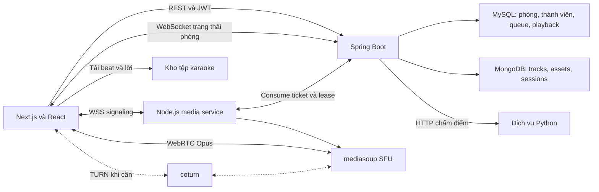
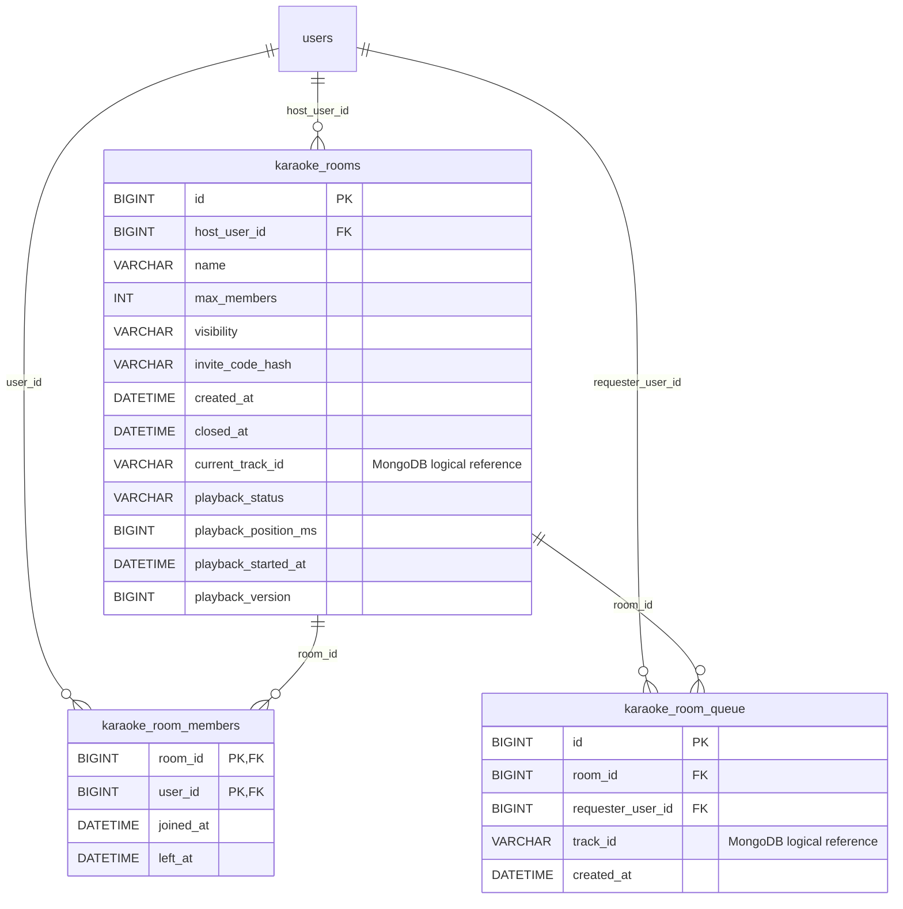

# Tài liệu kỹ thuật chức năng Karaoke

**Hệ thống Moodify**

Phiên bản 1.0  |  Ngày cập nhật 30 tháng 10 năm 2026

Tài liệu dành cho nhóm phát triển, người bảo trì và người đọc đồ án. Nội dung mô tả chức năng hát cá nhân, phòng karaoke nhiều người, phát nhạc và lời đồng bộ, trò chuyện bằng micro, cùng cấu trúc dữ liệu và các thay đổi cơ sở dữ liệu liên quan.

Kiến trúc hiện tại dùng MySQL làm nguồn chuẩn cho phòng, thành viên, hàng đợi và trạng thái phát; MongoDB quản lý danh mục và tài nguyên karaoke; WebSocket cập nhật trạng thái; WebRTC qua mediasoup chuyển giọng nói. Mỗi phòng tối đa 6 tài khoản và chỉ chủ phòng điều khiển playback chung.

## Phạm vi và trạng thái

Các mô tả triển khai được đối chiếu với mã nguồn và script migration trong workspace. Script đã được chuẩn bị không đồng nghĩa schema hoặc dịch vụ trên máy chủ thật đã được cập nhật. Phần kiểm chứng triển khai và các giới hạn còn lại nằm ở cuối tài liệu.

### Tổng hợp thay đổi dữ liệu

| Đối tượng | Thay đổi cấu trúc hoặc cách sử dụng |
| --- | --- |
| `karaoke_rooms` | Bảng mới có 8 cột quản lý phòng ban đầu, sau đó thêm 5 cột playback; tổng cộng 13 cột trong mô hình hiện tại. |
| `karaoke_room_members` | Bảng mới có 4 cột; dùng khóa chính ghép `(room_id, user_id)`. |
| `karaoke_room_queue` | Bảng mới có 5 cột; một lượt chờ cho mỗi tài khoản trong một phòng. |
| `users` | Tái sử dụng `id`, `full_name` và `avatar_url`; các migration phòng không thêm cột vào bảng này. |
| MongoDB `tracks` | Tái sử dụng metadata bài hát và lời; phần quản lý phòng không thêm field vào collection này. |
| MongoDB `karaoke_assets` | Schema tài nguyên của chức năng karaoke đã có trong pipeline; module phòng đọc lại. Công cụ căn lời có thể cập nhật thêm `lyricTimeline`. |
| MongoDB `karaoke_sessions` | Collection phiên chấm điểm cá nhân hiện có; controller tạo document và cập nhật trạng thái, kết quả, hash và thời điểm xử lý theo từng phiên. |

“Thêm cột” là thay đổi schema; “cập nhật giá trị” là thay đổi dữ liệu khi người dùng thao tác. Các phần từ điển dữ liệu và ma trận nghiệp vụ bên dưới trình bày cả hai, không tính 5 cột playback thành một bảng mới.

## Nội dung tài liệu

- [1. Chức năng và vai trò người dùng](#phan-1)
- [2. Kiến trúc và công nghệ](#phan-2)
- [3. Luồng nghiệp vụ phòng và playback](#phan-3)
- [4. Từ điển dữ liệu karaoke_rooms](#phan-4)
- [5. Từ điển dữ liệu thành viên và hàng đợi](#phan-5)
- [6. Quan hệ dữ liệu và nguyên tắc tránh dư thừa](#phan-6)
- [7. MongoDB karaoke_assets và tracks](#phan-7)
- [8. MongoDB karaoke_sessions](#phan-8)
- [9. API phòng và giao thức realtime](#phan-9)
- [10. Hát cá nhân và chấm điểm](#phan-10)
- [11. Bảo mật và vận hành](#phan-11)
- [12. Migration và nguồn tham chiếu](#phan-12)
- [13. Phụ lục SQL](#phan-13)

<a id="phan-1"></a>

## 1 Chức năng và vai trò người dùng

### Chức năng đã có trong mã nguồn

| Nhóm | Hành vi |
| --- | --- |
| Danh mục | Tìm và chọn bài có tài nguyên karaoke sẵn sàng; tải beat, vocals, lời và trạng thái chấm điểm. |
| Hát cá nhân | Phát nhạc nền, hiển thị lời, kiểm tra micro và thu thập đặc trưng cao độ để gửi chấm điểm. |
| Danh sách phòng | Hiển thị cả phòng công khai và phòng riêng đang mở. Phòng riêng có biểu tượng khóa và yêu cầu mã khi cần. |
| Thành viên | Tạo phòng, vào phòng, rời phòng; xem tên, avatar, vai trò chủ phòng và số thành viên. |
| Hàng đợi | Mỗi thành viên giữ tối đa một bài đang chờ trong mỗi phòng; rút bài của mình; chủ phòng có thể xóa bài chờ. |
| Playback chung | Chủ phòng bắt đầu, tạm dừng, tiếp tục hoặc bỏ qua. Máy chủ quyết định bài hiện tại và thời gian phát. |
| Voice | Thành viên bật hoặc tắt micro, nghe các giọng khác, xem người đang nói, chọn thiết bị và chỉnh âm lượng cục bộ. |

### Quyền của từng vai trò

| Thao tác | Chủ phòng | Thành viên |
| --- | --- | --- |
| Đăng ký bài và rút bài của mình | Có | Có |
| Xem phòng và nghe sân khấu | Có | Có |
| Bật micro hoặc chọn thiết bị | Có | Có |
| Bắt đầu tạm dừng tiếp tục bỏ qua | Có | Không |
| Xóa bài chờ của người khác | Có | Không |
| Đóng phòng | Có | Không |

### Quy tắc cốt lõi

Sức chứa tính theo tài khoản đang có membership hoạt động, bao gồm chủ phòng và người chỉ nghe. Tắt micro không trả lại chỗ. Vào lại bằng cùng tài khoản không tạo thêm membership hoặc chiếm thêm chỗ. Mở nhiều tab không được tạo nhiều peer voice cho cùng tài khoản trong một phòng.

Phòng riêng vẫn xuất hiện trong danh sách. Mã mời chỉ phục vụ kiểm tra quyền vào phòng; mã rõ không được lưu vào MySQL. Người đang có membership hoạt động có thể kết nối lại mà không cần xác minh mã lần nữa.

<a id="phan-2"></a>

## 2 Kiến trúc và công nghệ



| Thành phần | Công nghệ và trách nhiệm |
| --- | --- |
| Giao diện | Next.js 16.3.1, React 19.2.8, TypeScript và CSS Modules. Client Components xử lý audio, micro, WebSocket và thiết bị trình duyệt. |
| Backend nghiệp vụ | Java 21, Spring Boot 4.1.0, Spring Security, Spring Data JPA, MongoTemplate và Spring WebSocket. |
| Dữ liệu quan hệ | MySQL và InnoDB: phòng, membership, queue và playback. Transaction cùng khóa row bảo vệ các lệnh đồng thời. |
| Dữ liệu nội dung | MongoDB: tracks, karaoke_assets, karaoke_sessions. Lưu metadata và tham chiếu tệp; không lưu luồng audio realtime. |
| Media server | Node.js từ phiên bản 22, mediasoup 3.32.0, ws 8.18.3 và jsonwebtoken 9.0.2. Một worker trong cấu hình MVP. |
| Media client | mediasoup-client 3.25.3; WebRTC Opus audio qua SFU. Mỗi người có tối đa một audio producer. |
| Chuẩn bị và chấm điểm | Dịch vụ Python chuẩn bị stem và pitch reference; backend gọi API chấm điểm qua HTTP với khóa dịch vụ. |
| Hạ tầng | Docker Compose, reverse proxy HTTPS và WSS; coturn 4.6 tùy chọn cho STUN/TURN; VM Google Cloud theo kế hoạch triển khai. |

### Các đường truyền

Trình duyệt → REST Spring Boot → MySQL hoặc MongoDB: xử lý quyền, dữ liệu phòng, hàng đợi và snapshot playback.

Trình duyệt ↔ WebSocket Spring Boot: nhận thông báo có thay đổi rồi tải snapshot chuẩn. Kết nối này không mang giọng nói.

Trình duyệt ↔ WSS Node.js ↔ mediasoup worker: signaling tạo transport, producer và consumer. Gói audio đi qua WebRTC, có thể dùng TURN khi đường trực tiếp không khả dụng.

Mỗi trình duyệt tải và phát beat từ nguồn asset theo timeline chung. SFU chỉ chuyển tiếp giọng; không trộn giọng với beat. Việc nghe và lời đồng bộ phụ thuộc độ trễ mạng, bộ đệm audio và giới hạn trình duyệt, không phải đồng bộ tuyệt đối từng mẫu âm thanh.

### Phân bổ dữ liệu

Cả ba cấu trúc karaoke_rooms, karaoke_room_members và karaoke_room_queue đều nằm ở MySQL. Realtime do tầng giao tiếp và cơ chế đồng bộ cung cấp; chuyển một bảng sang MongoDB không tự tạo tính realtime.

<a id="phan-3"></a>

## 3 Luồng nghiệp vụ phòng và playback

### Tạo và vào phòng

Người dùng đăng nhập tạo phòng có tên tối đa 40 ký tự và chọn PUBLIC hoặc PRIVATE. Service đặt max_members bằng 6, tạo membership cho chủ và sinh mã ngẫu nhiên nếu là phòng riêng. Hệ thống trả mã rõ trong kết quả tạo phòng; MySQL chỉ giữ SHA-256 của mã.

Khi join, backend khóa row phòng, kiểm tra phòng chưa đóng, mã mời khi cần và membership của tài khoản. Chỉ tạo hoặc kích hoạt membership nếu tổng thành viên chưa rời nhỏ hơn min(max_members, 6). Thành viên vào lại được cập nhật joined_at và left_at trở về NULL.

### Đăng ký bài và chuyển bài

Thành viên gửi track_id. Backend kiểm tra ObjectId hợp lệ, bản ghi tracks tồn tại và karaoke_assets có status ready với instrumental và vocals. Queue sắp FIFO theo created_at rồi id. Khi bắt đầu bài, mục đầu queue bị xóa và track_id được chuyển sang current_track_id. Queue không phải bảng lịch sử hát.

| Trạng thái hoặc lệnh | Kết quả |
| --- | --- |
| IDLE | Chưa có bài hiện tại; khi queue rỗng, bắt đầu vẫn kết thúc ở IDLE. |
| `start` | Chủ phòng lấy bài đầu hàng đợi và phát; service hiện cho phép start cả khi đang PAUSED. |
| `pause` | Chỉ hợp lệ lúc PLAYING; cộng thời gian đã chạy vào playback_position_ms rồi bỏ mốc started_at. |
| `resume` | Chỉ hợp lệ lúc PAUSED và có bài hiện tại; giữ position, đặt mốc thời gian mới. |
| skip hoặc hết bài | Lấy bài tiếp; nếu queue rỗng thì về IDLE. Hết bài lúc chủ vắng thì pause, không tự bắt đầu bài mới. |

### Đồng bộ và chống xử lý lặp

Mỗi lệnh điều khiển mang expectedVersion. Backend kiểm tra quyền chủ, khóa row và so sánh playback_version; lệnh thành công tăng version. Hai lệnh cùng version chỉ một lệnh cập nhật được. Không tự gửi lại skip với version mới sau timeout.

Snapshot gồm positionMs tại serverTimeMs, track, status và version. Frontend ước lượng lệch clock qua thời gian request, cập nhật timeline mỗi 250 ms và seek audio khi lệch trên 400 ms. Snapshot cũ bị lọc theo thời điểm request và version.

### Rời phòng và mất kết nối

Rời chủ động đánh dấu left_at ngay. Mất WebSocket cuối cùng bắt đầu grace mặc định 30 giây, cleanup quét mỗi 5 giây. Mất mạng im lặng còn cần timeout heartbeat 30 giây và sweep tối đa 15 giây để phát hiện. Chủ rời hoặc hết grace làm pause và chuyển quyền cho thành viên còn session realtime có joined_at sớm nhất; nếu chưa có người phù hợp, quyền được phục hồi khi thành viên join lại.

<a id="phan-4"></a>

## 4 Từ điển dữ liệu karaoke_rooms

Bảng mới lưu một phòng và trạng thái playback dùng chung. Tám cột đầu thuộc migration quản lý phòng; năm cột cuối được bổ sung bởi migration shared playback. Tên cột dưới đây theo script SQL hiện tại.

| Cột | Kiểu và ràng buộc | Ý nghĩa |
| --- | --- | --- |
| `id` | BIGINT NOT NULL<br>PK AUTO_INCREMENT | Định danh phòng. |
| `name` | VARCHAR(40) NOT NULL | Tên hiển thị do người dùng đặt. |
| `host_user_id` | BIGINT NOT NULL<br>FK users.id | Tài khoản chủ hiện tại; thay đổi khi chuyển quyền. |
| `max_members` | INT NOT NULL<br>CHECK từ 1 đến 6 | Giới hạn đã lưu. Service tạo phòng mới luôn đặt 6. |
| `visibility` | VARCHAR(16) NOT NULL<br>CHECK PUBLIC hoặc PRIVATE | Loại phòng; phòng riêng vẫn có thể được liệt kê. |
| `invite_code_hash` | VARCHAR(64) NULL | SHA-256 mã mời dạng hex; công khai thường NULL. |
| `created_at` | DATETIME NOT NULL<br>DEFAULT CURRENT_TIMESTAMP | Thời điểm tạo; không cập nhật khi đổi chủ. |
| `closed_at` | DATETIME NULL | NULL là chưa đóng; có thời gian là đã đóng. |
| `current_track_id` | VARCHAR(64) NULL<br>Cột bổ sung | Tham chiếu logic tracks._id trong MongoDB; không có SQL FK. |
| `playback_status` | VARCHAR(12) NOT NULL<br>DEFAULT IDLE<br>Cột bổ sung | IDLE, PLAYING hoặc PAUSED theo enum ứng dụng; script chưa thêm CHECK cho enum này. |
| `playback_position_ms` | BIGINT NOT NULL<br>DEFAULT 0<br>Cột bổ sung | Vị trí nền tích lũy tại lúc bắt đầu hoặc tạm dừng, đơn vị ms. |
| `playback_started_at` | DATETIME NULL<br>Cột bổ sung | Mốc bắt đầu phần đang chạy; NULL khi không PLAYING. |
| `playback_version` | BIGINT NOT NULL<br>DEFAULT 0<br>Cột bổ sung | Phiên bản nghiệp vụ để phát hiện lệnh cũ; không phải JPA @Version. |

### Chỉ mục và khóa ngoại

idx_karaoke_rooms_public (visibility, closed_at, created_at, id); idx_karaoke_rooms_playback (playback_status, closed_at). Tên index public được giữ dù truy vấn danh sách hiện trả cả phòng PUBLIC và PRIVATE.

fk_karaoke_rooms_host liên kết users(id), ON DELETE CASCADE. Xóa tài khoản chủ ở mức cơ sở dữ liệu có thể kéo theo xóa phòng và các bản ghi con. Đóng phòng thông thường chỉ cập nhật closed_at.

<a id="phan-5"></a>

## 5 Thành viên và hàng đợi

### Bảng mới karaoke_room_members

| Cột | Kiểu và ràng buộc | Ý nghĩa |
| --- | --- | --- |
| `room_id` | BIGINT NOT NULL<br>PK ghép và FK | Liên kết karaoke_rooms.id. |
| `user_id` | BIGINT NOT NULL<br>PK ghép và FK | Liên kết users.id; không sao chép tên hoặc avatar. |
| `joined_at` | DATETIME NOT NULL<br>DEFAULT CURRENT_TIMESTAMP | Thời điểm vào gần nhất; cập nhật khi tái kích hoạt membership. |
| `left_at` | DATETIME NULL | NULL nghĩa là membership hoạt động; được đặt khi rời hoặc hết grace. |

Khóa chính (room_id, user_id) ngăn một tài khoản chiếm nhiều chỗ trong cùng phòng. Index idx_karaoke_room_members_user (user_id). Hai FK room và user đều ON DELETE CASCADE. Không có cột role: chủ phòng được suy ra từ karaoke_rooms.host_user_id.

### Bảng mới karaoke_room_queue

| Cột | Kiểu và ràng buộc | Ý nghĩa |
| --- | --- | --- |
| `id` | BIGINT NOT NULL<br>PK AUTO_INCREMENT | Định danh lượt chờ. |
| `room_id` | BIGINT NOT NULL<br>FK karaoke_rooms.id | Phòng sở hữu lượt chờ. |
| `requester_user_id` | BIGINT NOT NULL<br>FK users.id | Tài khoản đăng ký bài. |
| `track_id` | VARCHAR(64) NOT NULL | Tham chiếu logic MongoDB tracks._id; backend kiểm tra tài nguyên trước khi thêm. |
| `created_at` | DATETIME NOT NULL<br>DEFAULT CURRENT_TIMESTAMP | Kết hợp id để xếp FIFO ổn định. |

UNIQUE uk_karaoke_room_queue_requester (room_id, requester_user_id) bảo đảm mỗi tài khoản chỉ có một mục đang chờ trong một phòng. Không ngăn hai tài khoản đăng ký cùng một bài. Index FIFO: (room_id, created_at, id); index người đăng ký: (requester_user_id). FK room và requester đều ON DELETE CASCADE.

### Giới hạn mô hình hiện tại

Membership giữ lần vào và rời gần nhất, không lưu tất cả phiên ra vào. Queue không có status hoặc position riêng; mục được xóa khi phát hoặc rút. Không có bảng lịch sử lệnh hay bảng lưu lịch sử phòng mới trong phạm vi migration này.

<a id="phan-6"></a>

## 6 Quan hệ dữ liệu và tránh dư thừa



`track_id` và `current_track_id` tham chiếu logic tới `tracks._id`; sơ đồ không biểu diễn chúng thành khóa ngoại SQL.

| Quan hệ | Cách bảo đảm |
| --- | --- |
| users 1 → N karaoke_rooms | host_user_id là FK; tên và avatar chủ được JOIN từ users. |
| users N ↔ N karaoke_rooms | Qua karaoke_room_members; PK ghép room_id và user_id. |
| karaoke_rooms 1 → N queue | room_id là FK; xóa phòng kéo theo dữ liệu con. |
| users 1 → N queue | requester_user_id là FK; ứng dụng kiểm tra đang ở trong phòng. |
| MongoDB tracks 1 → N queue hoặc rooms | Dùng chuỗi track_id/current_track_id. Không có FK xuyên MySQL và MongoDB; service xác minh khi dùng. |

### Các trường được tái sử dụng

Không thêm host_name, member_name, avatar_url, song_title, artist_name, image_url, lyrics hoặc URL âm thanh vào ba bảng MySQL. Dữ liệu người dùng lấy từ users; dữ liệu bài lấy từ tracks và karaoke_assets. memberCount được COUNT từ membership hoạt động; canManage và host là giá trị tính toán theo người gọi.

serverTimeMs, positionMs trả cho frontend, danh sách người đang nói, trạng thái mic và lựa chọn thiết bị là dữ liệu tính toán hoặc runtime; không phải cột mới của MySQL. current_track_id và queue.track_id cùng tham chiếu bài nhưng có hai ý nghĩa khác nhau: bài đang phát và các bài chưa phát.

### Ma trận cập nhật nghiệp vụ

| Nghiệp vụ | Dữ liệu thay đổi |
| --- | --- |
| Tạo phòng | INSERT rooms và INSERT membership chủ. |
| Join hoặc reconnect sau đã rời | INSERT membership hoặc UPDATE joined_at/left_at. |
| Rời hoặc hết grace | UPDATE membership.left_at; nếu là chủ thì pause, tăng playback_version và có thể đổi host_user_id. |
| Thêm hoặc rút bài | INSERT hoặc DELETE queue; không sao chép metadata bài. |
| Start skip hết bài | DELETE mục queue được lấy; UPDATE current_track_id và các cột playback. |
| Pause hoặc resume | UPDATE playback_position_ms, playback_started_at, playback_status và playback_version theo thao tác. |
| Đóng phòng | UPDATE closed_at; xóa queue; đánh dấu membership rời và dừng playback. |
| Backend khởi động lại | Pause các phòng đang PLAYING, tăng version, đánh dấu membership đang hoạt động đã rời để kết nối lại từ đầu. |

Kiểm tra thành viên của queue được thực hiện ở service; script không có FK ghép từ queue tới membership. Cần giữ kiểm tra này khi thêm đường ghi dữ liệu khác.

<a id="phan-7"></a>

## 7 MongoDB danh mục và tài nguyên karaoke

### Collection tracks được tái sử dụng

Các trường đọc: _id (ObjectId), name, artist_name, image_url, duration_ms, lyrics_plain, lyrics_synced và local_path trong công cụ chuẩn bị asset. Phần phòng không thêm bản sao những trường này vào MySQL hoặc sửa schema tracks. ObjectId được chuyển sang chuỗi khi lưu tham chiếu ở MySQL.

### Collection karaoke_assets

Collection phục vụ chuẩn bị nội dung và chấm điểm đã có trong hệ thống karaoke. Module phòng đọc lại asset ready; không tạo collection rooms hoặc queue tương ứng trong MongoDB.

| Trường hoặc nhóm trường | Kiểu dữ liệu và vai trò |
| --- | --- |
| _id | Định danh document MongoDB. |
| songId, originalTrackId | songId dạng String liên kết bài; originalTrackId giữ định danh gốc. Công cụ publish tạo unique index songId. |
| status, assetVersion | Trạng thái tài nguyên và phiên bản asset. Bài được phục vụ khi status = ready. |
| `source` | Document gồm filename, sha256, durationSeconds, sampleRate và localPath; truy vết nguồn tạo stem. |
| `assets.instrumental` | Document chứa storageKey, sha256, bytes, format, sampleRate, channels, durationSeconds của beat. |
| `assets.vocals` | Cùng nhóm metadata của stem giọng; hỗ trợ hát cá nhân và tham chiếu xử lý. |
| assets.pitchReference | storageKey, sha256, bytes, format, referenceVersion, extractorVersion, sampleRate, hopLength của JSON cao độ chuẩn. |
| scoringReference | status, voicedSeconds, warnings; đánh giá có đủ dữ liệu tham chiếu để chấm điểm hay không. |
| `processing` | Metadata model, cấu hình, thiết bị, thời gian xử lý và preparedAt do pipeline Python ghi. |
| `storage` | provider, root, baseUrl. Hiện công cụ publish dùng provider gcp-vm và tệp trên VM. |
| lyricTimeline | Document tùy chọn do công cụ align_word_lyrics cập nhật; có thể chưa có trên mọi bài. |
| createdAt, updatedAt | Date do công cụ publish ghi khi insert hoặc cập nhật. |

### Phân biệt metadata với tệp

MongoDB lưu đường dẫn và metadata. instrumental.wav, vocals.wav và pitch_reference.json nằm ở kho tệp với khóa karaoke/{songId}/{assetVersion}/...; không nhúng dữ liệu audio lớn vào ba bảng MySQL. Phòng hiện đồng bộ lời theo LRC lyrics_synced; trường lyricTimeline trong response không đồng nghĩa UI phòng đã có tô từng từ.

<a id="phan-8"></a>

## 8 MongoDB phiên hát và chấm điểm

karaoke_sessions phục vụ phiên hát cá nhân. Collection này độc lập với membership của phòng nhiều người; chưa có liên kết room_id, queue_item_id hoặc nghiệp vụ chấm điểm tập thể trong module phòng.

| Trường | Kiểu và ý nghĩa |
| --- | --- |
| _id | String UUID làm định danh document phiên. |
| sessionId | String UUID hiện lặp lại _id trong implementation; là định danh trả về API. |
| userId | String authentication.getName() của người gọi, hiện là tên đăng nhập; không phải FK số users.id. |
| songId | String tham chiếu tracks._id. |
| assetVersion | String phiên bản tài nguyên được chốt khi tạo phiên. |
| referenceVersion | String phiên bản pitch reference đã chốt. |
| referenceSha256 | String checksum tham chiếu; kiểm tra trước khi chấm. |
| referenceStorageKey | String khóa tệp pitch_reference.json đã chốt. |
| `status` | String: started → scoring → completed; có thể quay về started nếu upstream lỗi. |
| createdAt, expiresAt | Date: thời điểm tạo và hạn dùng 2 giờ theo mã controller. |
| scoringStartedAt | Date thêm lúc claim phiên để ngăn hai lượt chấm đồng thời; có thể unset khi hoàn tác lỗi. |
| scoreResult | Document kết quả được lọc: status và score.overall; không lưu toàn bộ response upstream. |
| recordingSha256 | String hash bản ghi hoặc payload đặc trưng; tên trường hiện được dùng cho cả hai đường chấm. |
| timingSignature | String nhận diện thông tin thời gian của lượt chấm để đối chiếu retry. |
| completedAt | Date được thêm khi chấm thành công. |
| scoringVersion | Giá trị scoring_version từ upstream, thêm khi hoàn tất. |
| lastScoringHttpStatus | Number lưu mã HTTP upstream khi trả trạng thái phiên về started. |

### Lý do giữ snapshot phiên bản

assetVersion, referenceVersion, referenceSha256 và referenceStorageKey lặp một phần metadata asset nhưng là snapshot có chủ đích: một phiên đã bắt đầu phải chấm bằng đúng bộ tham chiếu của phiên đó, ngay cả khi danh mục asset được cập nhật sau này.

### Giới hạn và điểm cần rà

sessionId và _id đang chứa cùng giá trị; có thể cân nhắc chỉ giữ _id và ánh xạ tên ở API khi có migration tương thích. expiresAt là hạn logic; chưa có bằng chứng trong các file được đối chiếu rằng TTL index tự xóa karaoke_sessions đã được tạo. Không suy ra dữ liệu sẽ tự bị xóa sau 2 giờ.

<a id="phan-9"></a>

## 9 API phòng và giao thức realtime

Tiền tố REST: /api/karaoke/rooms. Backend lấy tài khoản từ authentication; client không quyết định userId hoặc quyền điều khiển bằng trường gửi lên.

| Method và đường dẫn sau tiền tố | Mục đích và quyền |
| --- | --- |
| GET / | Danh sách phòng đang mở, bao gồm phòng riêng. |
| POST / | Tạo phòng; body name, visibility, maxMembers theo DTO hiện có. |
| GET /{roomId} | Snapshot chi tiết; yêu cầu membership hoạt động. |
| POST /{roomId}/join | Vào phòng; có thể nhận inviteCode. |
| POST /{roomId}/leave | Rời phòng và ngắt WebSocket của user trong phòng. |
| POST /{roomId}/queue | Thêm bài; body trackId; thành viên hoạt động. |
| DELETE /{roomId}/queue/{itemId} | Rút bài của mình hoặc chủ xóa bài người khác. |
| POST /{roomId}/close | Chủ đóng phòng và ngắt các kết nối room. |
| POST /{roomId}/playback/start | Chủ bắt đầu bài; body expectedVersion. |
| POST /{roomId}/playback/pause | Chủ tạm dừng; body expectedVersion. |
| POST /{roomId}/playback/resume | Chủ tiếp tục; body expectedVersion. |
| POST /{roomId}/playback/skip | Chủ bỏ qua; body expectedVersion. |
| POST /{roomId}/voice-ticket | Cấp JWT voice sau kiểm tra thành viên và cấu hình. |

### WebSocket nghiệp vụ và signaling media

WebSocket Spring tại /ws/karaoke nhận subscribeRooms hoặc subscribeRoom, accessToken và thông tin scope; heartbeat duy trì presence. Các event như member.joined, member.left, queue.updated, playback.updated và rooms.updated kích hoạt tải snapshot.

WSS Node có path /ws theo URL cấu hình. Gửi auth với ticket trước, sau đó dùng envelope id/type/payload và response ok/payload hoặc error. Các action: get-rtp-capabilities, create-transport, connect-transport, produce, close-producer, consume, resume-consumer, close-consumer, heartbeat và leave. Event riêng báo new-producer, producer-closed, voice-speaking và voice-silence.

API nội bộ /api/internal/karaoke/media-sessions gồm POST /consume, /lease và /release. Node dùng X-Karaoke-Media-Key và sessionId/roomId/userId; trình duyệt không được nhận service secret.

<a id="phan-10"></a>

## 10 Hát cá nhân và chấm điểm

### Luồng nghiệp vụ

Người dùng chọn bài có asset ready, bật nghe beat và cho phép truy cập micro khi cần. Frontend đồng bộ lời theo timeline audio và thu thập đặc trưng cao độ bằng Web Audio cùng AudioWorklet. Người dùng chủ động bắt đầu và kết thúc lượt chấm; micro của chế độ cá nhân không tự phát vào phòng nhiều người.

Backend tạo karaoke_sessions sau khi xác minh scoringReference.status = sufficient. Khi nhận bản ghi hoặc đặc trưng, backend kiểm tra quyền sở hữu phiên, hạn dùng, phiên bản và checksum reference; claim nguyên tử từ started sang scoring, gọi dịch vụ Python rồi lưu kết quả đã lọc khi hoàn thành.

| API dưới /api/karaoke | Ý nghĩa |
| --- | --- |
| GET /tracks | Danh mục karaoke, có phân trang và query; size tối đa 50. |
| GET /tracks/{songId} | Metadata, instrumentalUrl, vocalsUrl, lời, phiên bản và scoringAvailable. |
| POST /tracks/{songId}/sessions | Tạo phiên chấm điểm; thời hạn logic 2 giờ. |
| GET /sessions/{sessionId} | Xem trạng thái và điểm phiên thuộc người gọi. |
| POST /sessions/{sessionId}/score | Đường upload multipart bản ghi âm và timing. |
| POST /sessions/{sessionId}/score/features | Đường JSON gửi đặc trưng cao độ và timing. |

### Dữ liệu đặc trưng gửi chấm

JSON đặc trưng dùng duration_seconds, f0_hz, voiced_probability, rms_dbfs và clipped_fraction; các thuộc tính Java tương ứng là durationSeconds, f0Hz, voicedProbability, rmsDbfs và clippedFraction. Payload còn có recording_start_offset_ms, capture_latency_ms và allow_octave_shift để mô tả timing. Đây là dữ liệu tín hiệu của phiên, không phải cột mới trong MySQL.

### Giới hạn kỹ thuật trong controller

Bản ghi tối đa 80 MiB; thời lượng tối đa 600 giây. Reference tối đa 4 MiB, kết quả upstream tối đa 1 MiB. Bộ tham chiếu dùng sample rate 22.050 Hz và hop length 512 cho giới hạn frame. Backend kiểm tra checksum reference và giới hạn URL/kho tài nguyên theo mã controller.

Điểm tổng được trình bày từ score.overall. Chức năng voice của phòng nhiều người chưa sử dụng giọng từ mediasoup để chấm điểm hoặc ghi âm tập thể. Độ trễ voice và độ chính xác chấm điểm là hai vấn đề kỹ thuật riêng cần đo trên môi trường thật.

<a id="phan-11"></a>

## 11 Bảo mật thiết bị và vận hành

### Quyền và vòng đời voice

JWT HS256 có issuer moodify-karaoke-backend, audience moodify-karaoke-media, type karaoke-voice, roomId, sub, jti và sid. Ticket dùng một lần, hạn 60 giây. Node xác minh chữ ký và tiêu thụ ticket qua Spring; lease gia hạn mỗi 5 giây với TTL 15 giây. Mất quyền hoặc không gia hạn được sẽ đóng voice khi lease hết hạn.

Media registry và presence lưu trong RAM của một instance. Mỗi tài khoản chỉ một peer voice trong phòng; kết nối trùng bị từ chối và UI hiển thị lý do. Không có cơ chế tự thay thế thiết bị cũ. Micro mặc định tắt và được giải phóng khi ngắt kết nối; đổi đầu vào đang phát dùng replaceTrack.

### Giới hạn và bảo vệ signaling

| Biện pháp | Giá trị trong mã nguồn |
| --- | --- |
| Số peer trong phòng | Tối đa 6, kể cả người chỉ nghe. |
| Tài nguyên mỗi peer | Tối đa 2 transport, 1 audio producer và 5 consumer. |
| Request | Tối đa 60 request trong 10 giây; frame tối đa 64 KiB. |
| Chống lặp | Queue tuần tự theo peer; cache ID và hash payload 60 giây, tối đa 128 entry. |
| Xác thực ban đầu | Timeout mặc định 5.000 ms; origin phải nằm trong allowlist chính xác. |
| Cleanup | Kiểm tra session sau await; close-consumer khi phía client dựng audio lỗi; generation chặn callback cũ. |

### Cấu hình chính

Spring: KARAOKE_MEDIA_TICKET_SECRET, KARAOKE_MEDIA_SERVICE_SECRET, KARAOKE_MEDIA_WS_URL, KARAOKE_ROOM_RECONNECT_GRACE_MS, KARAOKE_SCORING_URL và KARAOKE_SCORING_KEY. Node dùng hai secret tương ứng, KARAOKE_BACKEND_INTERNAL_URL, MEDIASOUP_ALLOWED_ORIGINS, MEDIASOUP_ANNOUNCED_IP, WEBRTC_ICE_SERVERS và các biến TURN.

Compose bind signaling 3001 vào loopback; proxy công khai WSS qua TLS. Mediasoup dùng UDP/TCP 40000–49999; TURN mẫu dùng UDP/TCP 3478 và relay UDP 49160–49200. Mẫu hiện chưa bật TURN/TLS 5349 hoặc endpoint TURN 443.

### Quan sát và giới hạn triển khai

Health tại /health và /health/ready; Prometheus nội bộ /metrics đếm room, peer, transport, producer, consumer, auth lỗi và rate-limit. Chưa tích hợp đầy đủ RTT/loss/băng thông và cảnh báo. Cần giữ health/metrics nội bộ và đo tải cùng các dịch vụ hiện có trước khi kết luận VM phục vụ được bao nhiêu phòng.

<a id="phan-12"></a>

## 12 Migration trạng thái và nguồn tham chiếu

### Thay đổi cơ sở dữ liệu

| Script | Tác động |
| --- | --- |
| `add_karaoke_room_management.sql` | Tạo 3 bảng MySQL, PK/FK, index và CHECK loại phòng/sức chứa. |
| `add_karaoke_room_shared_playback.sql` | Thêm 5 cột playback vào karaoke_rooms và index playback. |
| `enforce_karaoke_room_capacity_six.sql` | Preflight phòng >6 người; giảm max_members phù hợp và thay CHECK sức chứa thành 1–6. |

Trước khi áp dụng cần xác nhận đúng schema, kiểm tra bảng/cột/constraint hiện hữu và dữ liệu >6 người. CREATE TABLE IF NOT EXISTS không cập nhật bảng cũ. ALTER ADD COLUMN và DROP CHECK trong script không tự idempotent; phải kiểm tra information_schema trước khi chạy lại. Không thực thi phần sau của script capacity nếu preflight còn phòng có hơn 6 thành viên; script không tự dừng thay người vận hành.

### Các điểm cần theo dõi

DTO CreateKaraokeRoomRequest còn @Min(4) và @Max(12), trong khi service bỏ qua giá trị gửi lên và luôn lưu 6, UI hướng tới 6, CHECK mới là 1–6. Đây là điểm contract chưa đồng nhất cần chỉnh trước khi công bố API; tài liệu không coi validator DTO là giới hạn sức chứa thực tế.

closeRoom dọn queue và membership theo nghiệp vụ. Scheduler đóng phòng rỗng sau 24 giờ không hoạt động theo truy vấn hiện tại. Backend restart pause playback và kết thúc membership đang hoạt động; người dùng phải join lại. Hàng đợi được giữ theo cơ sở dữ liệu trừ khi phòng bị đóng/dọn.

Chưa có xác nhận áp dụng các migration trên database thật, build/chạy media service Linux hoặc triển khai WSS/TURN/firewall trên VM trong đợt triển khai đã báo cáo. Kiểm tra mã đã ghi nhận gồm Java compile, ESLint, TypeScript riêng phần karaoke và cú pháp Node; chưa phải nghiệm thu WebRTC thực tế 2–6 thiết bị. TypeScript toàn dự án từng vướng file .next/dev/types sinh lỗi cú pháp.

### Nguồn mã để bảo trì

Backend E:/moodify-backend: database/*.sql; api/KaraokeRoomsApi.java, KaraokeController.java, KaraokeMediaSessionsApi.java; services/KaraokeRoomService.java, KaraokeRoomRealtimeGateway.java, KaraokeRoomCleanupScheduler.java, KaraokeRoomPlaybackScheduler.java, KaraokeMediaTicketService.java; entities/KaraokeRoom*.java; repositories/KaraokeRoom*.java; supporting-services/karaoke-media/server.js và supporting-services/karaoke-media/compose.yaml. Các đường api, services, entities, repositories nằm dưới src/main/java/com/laphuth/moodify/.

Frontend E:/Moodify/frontend: features/dashboard/karaoke/components/ và hooks/; lib/api-client.ts; package.json. Pipeline E:/python-audio-separator: services/karaoke/tools/prepare_song.py, remote_store.py và align_word_lyrics.py. Kế hoạch bổ trợ: docs/KARAOKE_ROOM_SHARED_PLAYBACK_PLAN.md và docs/KARAOKE_MEDIASOUP_DEPLOYMENT.md trong backend.

Tài liệu mô tả trạng thái mã nguồn ngày 30/10/2026. Khi thay đổi schema, API, giới hạn phòng hoặc phương thức đồng bộ, cần cập nhật từ điển dữ liệu và các quy tắc tương ứng trong tài liệu này.

<a id="phan-13"></a>

## 13 Phụ lục SQL

Các đoạn dưới đây là nội dung script trong repository tại thời điểm lập tài liệu. Chúng được đưa vào để đối chiếu cấu trúc, **không xác nhận đã chạy trên database thật**. Với database đã có bảng, phải kiểm tra schema trước; không chạy lại tất cả các lệnh theo cách máy móc.

### 13.1 Tạo ba bảng quản lý phòng

Nguồn: `E:/moodify-backend/database/add_karaoke_room_management.sql`.

```sql
-- Additive migration for persisted Karaoke rooms, memberships, and queue.
-- Never run the user-provided DROP DATABASE script to apply this migration.
-- Run once against the target Moodify schema after checking information_schema.

CREATE TABLE IF NOT EXISTS karaoke_rooms (
    id BIGINT NOT NULL AUTO_INCREMENT,
    name VARCHAR(40) NOT NULL,
    host_user_id BIGINT NOT NULL,
    max_members INT NOT NULL,
    visibility VARCHAR(16) NOT NULL,
    invite_code_hash VARCHAR(64) NULL,
    created_at DATETIME NOT NULL DEFAULT CURRENT_TIMESTAMP,
    closed_at DATETIME NULL,
    PRIMARY KEY (id),
    KEY idx_karaoke_rooms_public (visibility, closed_at, created_at, id),
    CONSTRAINT fk_karaoke_rooms_host
        FOREIGN KEY (host_user_id) REFERENCES users (id) ON DELETE CASCADE,
    CONSTRAINT chk_karaoke_rooms_visibility
        CHECK (visibility IN ('PUBLIC', 'PRIVATE')),
    CONSTRAINT chk_karaoke_rooms_capacity
        CHECK (max_members BETWEEN 1 AND 6)
) ENGINE=InnoDB DEFAULT CHARSET=utf8mb4 COLLATE=utf8mb4_unicode_ci;

CREATE TABLE IF NOT EXISTS karaoke_room_members (
    room_id BIGINT NOT NULL,
    user_id BIGINT NOT NULL,
    joined_at DATETIME NOT NULL DEFAULT CURRENT_TIMESTAMP,
    left_at DATETIME NULL,
    PRIMARY KEY (room_id, user_id),
    KEY idx_karaoke_room_members_user (user_id),
    CONSTRAINT fk_karaoke_room_members_room
        FOREIGN KEY (room_id) REFERENCES karaoke_rooms (id) ON DELETE CASCADE,
    CONSTRAINT fk_karaoke_room_members_user
        FOREIGN KEY (user_id) REFERENCES users (id) ON DELETE CASCADE
) ENGINE=InnoDB DEFAULT CHARSET=utf8mb4 COLLATE=utf8mb4_unicode_ci;

CREATE TABLE IF NOT EXISTS karaoke_room_queue (
    id BIGINT NOT NULL AUTO_INCREMENT,
    room_id BIGINT NOT NULL,
    requester_user_id BIGINT NOT NULL,
    track_id VARCHAR(64) NOT NULL COMMENT 'Logical reference to MongoDB tracks._id',
    created_at DATETIME NOT NULL DEFAULT CURRENT_TIMESTAMP,
    PRIMARY KEY (id),
    KEY idx_karaoke_room_queue_fifo (room_id, created_at, id),
    KEY idx_karaoke_room_queue_requester (requester_user_id),
    UNIQUE KEY uk_karaoke_room_queue_requester (room_id, requester_user_id),
    CONSTRAINT fk_karaoke_room_queue_room
        FOREIGN KEY (room_id) REFERENCES karaoke_rooms (id) ON DELETE CASCADE,
    CONSTRAINT fk_karaoke_room_queue_requester
        FOREIGN KEY (requester_user_id) REFERENCES users (id) ON DELETE CASCADE
) ENGINE=InnoDB DEFAULT CHARSET=utf8mb4 COLLATE=utf8mb4_unicode_ci;
```

### 13.2 Thêm trạng thái phát chung

Nguồn: `E:/moodify-backend/database/add_karaoke_room_shared_playback.sql`.

```sql
-- Additive migration for synchronized playback state.
-- Inspect the legacy capacity values first. The application now caps all rooms
-- at six active members without forcibly removing anyone from an existing room.
SELECT id, name, max_members
FROM karaoke_rooms
WHERE closed_at IS NULL AND max_members > 6;

ALTER TABLE karaoke_rooms
    ADD COLUMN current_track_id VARCHAR(64) NULL,
    ADD COLUMN playback_status VARCHAR(12) NOT NULL DEFAULT 'IDLE',
    ADD COLUMN playback_position_ms BIGINT NOT NULL DEFAULT 0,
    ADD COLUMN playback_started_at DATETIME NULL,
    ADD COLUMN playback_version BIGINT NOT NULL DEFAULT 0,
    ADD KEY idx_karaoke_rooms_playback (playback_status, closed_at);

-- Intentionally no FK for current_track_id: tracks are stored in MongoDB.
-- Room state remains authoritative in MySQL; the track id is a cross-store reference.
```

### 13.3 Chuẩn hóa sức chứa phòng cũ

Nguồn: `E:/moodify-backend/database/enforce_karaoke_room_capacity_six.sql`.

```sql
-- Before running: confirm this migration is against the Moodify schema and
-- inspect the preflight result below. It never removes room memberships.
SELECT r.id, r.name, r.max_members, COUNT(m.user_id) AS active_members
FROM karaoke_rooms r
LEFT JOIN karaoke_room_members m ON m.room_id = r.id AND m.left_at IS NULL
WHERE r.max_members > 6
GROUP BY r.id, r.name, r.max_members
HAVING COUNT(m.user_id) > 6;

-- If the query above returns any rows, stop here and resolve the membership
-- count with the product owner before retrying. Otherwise, lower only the
-- stored capacity limit; do not delete/kick any member.
UPDATE karaoke_rooms AS r
SET max_members = 6
WHERE r.max_members > 6
  AND NOT EXISTS (
      SELECT 1
      FROM karaoke_room_members m
      WHERE m.room_id = r.id AND m.left_at IS NULL
      GROUP BY m.room_id
      HAVING COUNT(*) > 6
  );

-- This constraint name matches database/add_karaoke_room_management.sql.
-- If the production schema uses another name, inspect information_schema first.
ALTER TABLE karaoke_rooms
    DROP CHECK chk_karaoke_rooms_capacity,
    ADD CONSTRAINT chk_karaoke_rooms_capacity CHECK (max_members BETWEEN 1 AND 6);
```
